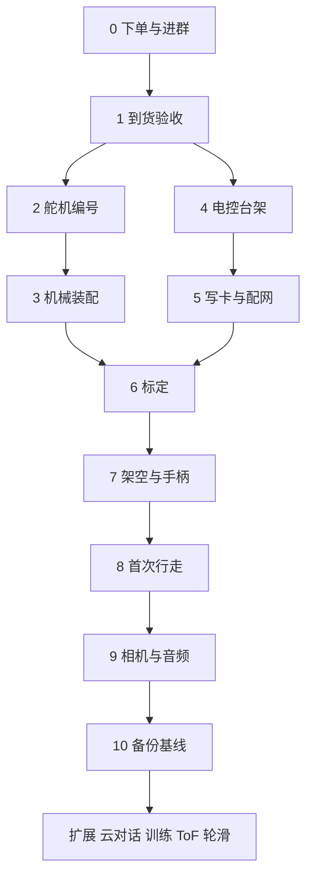

# 复刻总路线

目标：按 fanhao375/microduck-replica 飞特 HD-1910-C001 版，从零件到手到整机遥控行走，完整走一遍；与上游保持一致，不自行改架构。本文是路线总览与待决事项；每一步的操作细节见 [02 指南](02_分阶段复现指南.md)，物料与采购状态见 [01 BOM](01_BOM表.md)，现场结果记入 [03 验收模板](03_标定与验收记录模板.md)。

| 项目 | 结论 |
|---|---|
| 可行性 | 可行。主仓、`20261023c` 镜像、10 个成品模型、CAD、装配 PDF 已全部在本地 |
| 已定决策 | 舵机型号统一写 HD-1910-C001（用户确认与作者照片中的 HD1910M 同款）；HAT、IMU、触点板走微信群拼团；与上游一致，软件用 `20261023c` 镜像 |
| 当前状态 | 舵机、打印件、微雪 Adapter A 均在途，其余缺件待下单 |
| 关键路径 | 到货时间最不确定的是 HAT、躯干 IMU 板、电池触点板和 ZERO 3W |
| 上游范围 | 运动、Studio、摄像头与 ToF 页面、HAT 音频硬件；**不含云端自然对话**，该项列入扩展阶段 |
| 上游状态 | 2026-10-24 核对：master 最新提交仍为 `915ed836`，与本地固定版本一致；最新发布仍为 `20261023c` |

## 一、路线总览

机械线（2、3）与电控线（4、5）可并行，在第 6 步汇合。

## 二、分步路线

每一步完成后在 [根 README](../README.md) 对应任务打勾。

| 步骤 | 做什么 | 完成条件 | 依赖 | 细节 |
|---|---|---|---|---|
| 0 下单与进群 | 按第三节一次下单缺件；用户进作者微信群，询 HAT、IMU、触点板拼团 | 订单与群内回复均已记录 | 无 | 本文第三、四节 |
| 1 到货验收 | 每件到货即清点，记铭牌、板号、针序，拍照；更新 BOM 的 B 行 | B 行状态更新，缺件和错件清单 | 到货 | 02 C3 |
| 2 舵机编号 | 用 Adapter A 逐颗读取原配置、改 ID、贴标签；一次只接一颗 | 15 颗 ID 唯一，断电重连后读回一致 | 舵机、Adapter A | 02 D |
| 3 机械装配 | 按视频第 1–6 集和装配 PDF 分组装配：小腿、大腿与髋、躯干、颈、头；头壳先不封 | 行程内无卡滞，线不拉紧，脚掌平整 | 打印件、螺丝、轴承 | 02 E |
| 4 电控台架 | 断电核对板号和针序，主控、HAT、IMU 台架上电，测 5V 与总线 | 主控电压正确，无异常发热 | HAT、IMU、ZERO | 02 F |
| 5 写卡与配网 | 写 `20261023c` 镜像，首次启动，手机连热点后配家庭 Wi-Fi，设 Studio 密码 | 重启后仍可进入 `:8000`，看到 15 颗舵机与 IMU 数据 | TF 卡、读卡器 | 02 G–H |
| 6 标定 | 零位、IMU 方向、站姿标定，写入主程序，保存诊断包 | 本机标定保存，页面方向与实际一致 | 步骤 3 与 5 | 02 I |
| 7 架空与手柄 | 承托下保持姿态；配对 TGZ 手柄；分别测网页卸力、手柄短按、长按 | 卸力与停止行为有实测记录 | 步骤 6、承托支架 | 02 J |
| 8 首次行走 | 平地低速前后、转向、停止，一次只改一个条件 | 有成功与失败记录，无持续顶限位或重启 | 步骤 7 | 02 K |
| 9 相机与音频 | 接 IMX219，把 `[media] source` 从 `test` 改为真实采集；装扬声器，用上游音频方案核对录放音 | Studio 视频页显示真实画面，音频硬件可用 | 摄像头、排线、扬声器 | 02 L、11 |
| 10 备份基线 | 保存镜像、模型、标定、配置和版本；制作恢复卡 | 备用卡可启动，基线文档完整 | 第二张 TF 卡 | 02 L |

扩展阶段，不阻塞步骤 0–10：云端自然对话（见第五节）、ToF、自训练、轮滑与花式动作。

## 三、步骤 0 的缺件清单

对照作者 2026-10-23 版 BOM 与本机 BOM 逐行比对，缺项如下。

| 缺件 | 作者 BOM 位置 | 本机 BOM | 处理 |
|---|---|---|---|
| HAT、躯干 IMU 板、电池触点板（banana PCB） | 外购 3、4、10，价 120、80、20 元，标“可拼团” | B016、B017、B019 | 微信群拼团，见第四节 |
| ZERO 3W 2GB 无 eMMC 带排针 | 外购 1，价 309 元 | B015 | 打开作者表中的链接核对库存；瑞莎官网页面全部选项为灰色（补货中）；万物拟态商城标现货 ¥385（K91） |
| 64GB TF 卡，另备第二张作恢复卡 | 外购 2 | B024 | 按 01 表购买 |
| IMX219 摄像头、扬声器 | 外购 11、13 | B020–B023 | 与 HAT 成套核对后补；步骤 9 才需要 |
| 2.5 mm 香蕉插头 ×2 | 外购 9 | B035 | 与触点板成套核对 |
| 自攻螺丝 M2×5/6/8、M2.5×6/8 | 外购 17–21 | B036 | 开箱清点后补缺 |
| 乐泰 243 螺纹胶 | 外购 22 | B037 | 待购 |
| M3 螺丝，长度待定 | 作者聊天截图：躯干与髋连接处用 M3，不用自攻 | B038 | 装配时按实物量长度 |
| 鞋底防滑垫 | 外购 23 | B027 | 先查套装是否附送 |

作者表中不需要购买的项：URT2 调试板（已有 Adapter A）、6×12×3 轴承（轮滑用）、V1 备选踝、合体轮胎、滚轮叶片、轴承滚轮（轮滑件）。

## 四、HAT、IMU 与触点板的获取

已决：走路线 A。

| 路线 | 做法 | 风险 | 状态 |
|---|---|---|---|
| A 拼团 | 加作者微信群，按作者表价格 120、80、20 元拼 | 发货时间由群主决定，未知；群二维码仅到 2026-10-31 有效，群满 200 人无法扫码 | **采用** |
| B 成品卖家 | 按 [02 指南 C2](02_分阶段复现指南.md#c2-发给电控卖家的核对内容) 询成套已焊已刷 | 价格高，板版本须逐项核对 | A 无回复时的备选 |
| D 万物拟态商城 | 第三方商城 `wwntai.com/parts.html` 标注 imu_to_dxl 板和 banana PCB “即将上线、价格待定”，目前不能买 | 支付宝扫码转账、手填单号，未写退换货政策，卖家资质未核实 | 先跟踪，不作采购依据；见 K91 |
| C 嘉立创自制 | HAT 官方 Gerber、BOM、坐标齐全；触点板 banana PCB 有现成 Gerber 压缩包（`04_alternatives/microduck-community-kit/hardware/banana_pcb/production/`），见 K94，可直接下单；旧版 IMU 板有工程、固件和 BOM | IMU 须 ST-LINK 烧录 STM32；新版三块板作者标注未打样 | 仅在 A、B 均失败时启动 |

## 五、云端自然对话与上游的关系

上游仓库（固定提交 `915ed836`）全文检索，没有语音识别、大模型或云端对话的代码；与声音相关的只有 HAT 上的 aic3104 音频芯片、官方声音包的安装步骤，以及摄像头与 ToF 的 Studio 页面。作者表中的扬声器和摄像头是硬件，对话软件不在复刻范围内。

因此“与上游一致”意味着首版不含自然对话。本地 [07 指南](07_摄像头与独立云对话指南.md)和 `06_voice/` 保留参考实现（py-xiaozhi 等），如需要，在步骤 10 之后作为扩展阶段单独做。

## 六、待决事项

| 编号 | 问题 | 状态 |
|---|---|---|
| Q1 | 采购路线 | 已决：路线 A |
| Q2 | 舵机型号 | 已决：HD-1910-C001；打印件与舵机均在途 |
| Q3 | ZERO 3W 来源与容量 | 待决：用作者表链接还是另寻来源；2GB 是否定稿 |
| Q4 | 是否打印作者的 0 位支架 | 待决：非必需，可加快标定；作者称仅验证了下半部 |
| Q5 | 云端自然对话是否保留为扩展阶段 | 已决：用户确认放扩展阶段，首版与上游一致 |

## 七、与官方原版的差异和风险

评估依据：官方 `pollen-robotics/microduck` 的 README，fanhao 固定源码中的 `执行器选型.md`、`HD-1910训练前数据清单.md`、README 实机记录，以及本地 [06 动作清单](06_复现完整性与动作清单.md)。标“推测”的为本评估的判断，尚无实测。

### A. 硬件差异

| 项目 | 官方原版 | fanhao 飞特版 | 影响 |
|---|---|---|---|
| 舵机 | Dynamixel XL330 ×15，18 g，堵转 0.52 N·m（5V）；官方实际以 6.6–8.2 V 超压使用 | HD-1910-C001 ×15，21 g，规格书堵转约 1.47 N·m（7.4V），额定 4–8.4 V | 力矩约 2.5 倍，余量更大；满电 8.4 V 正处额定上限，无余量（推测：长期满电使用寿命需观察） |
| 整机质量 | 约 737 g（仿真值），官方 README 写约 800 g | 作者实测带电池约 806 g | 差异小；训练值 820 g，与实机差 1.7%（作者记录） |
| 躯干 IMU | 官方 `imu_to_dxl` 板，未开源 | fanhao 逆向重绘的同名板，或 kissqy 的 FT6 板；新版三块板未打样 | 这是全机最不确定的零件，板与固件版本必须与镜像配套 |
| 供电 | 电池直连舵机，板上一颗降压给主控 | 同一思路，NP-F550 直连；无电池保护板 | 走路时整机掉电已被作者遇到，靠限制转矩缓解 |
| 材料 | 官方成品件 | PLA 打印，部分件可换铝合金 | 刚度与公差依赖打印质量，需自己控制 |

### B. 软件与性能差异

| 项目 | 官方原版 | fanhao 飞特版 | 影响 |
|---|---|---|---|
| 舵机动力学模型 | 官方自己辨识 | 借用陆吾 1910 M6 参数，作者注明“不是自行辨识”；飞特官方另有一份参数，两者差异大且均未在真机比较 | 仿真与真机有差距，步态质量可能不及官方（推测）；首走够用，精细步态受限 |
| 质量与惯量 | 官方 CAD 导出 | 仍用 XL330 版仿真值，作者称后续需按实机校正 | 同上 |
| 实机表现 | 官方视频：行走、起身、坐、踢球、滚动 | 作者记录：已稳定行走；转向偏弱；偶发整机重启；脚抬得不够高会蹭地；已用 D=0、转矩限制 700 缓解 | 首走可行，动作流畅度与官方有差距（来自作者记录，非本机测试） |
| 起身与其他动作 | 官方有倒地起身、坐站、踢球 | 10 个模型都在，本机均未验证；`deployment_verified=false` | 不得假设一次摔倒能自己站起来 |
| 保护行为 | 官方有更新回滚与健康检查 | 摔倒不自动卸力，低电压不自动关机 | 须人在旁边，看到警告立即处理 |
| 整套能力 | 官方有手机应用、蓝牙、OTA 更新、目标检测、NFC、里程计等 | 镜像只含运动、Studio、相机与 ToF 页面；底图来自社区镜像转换而成 | 不具备官方的后几项能力；运行端是 fork，不要执行官方更新，会覆盖 fork（推测，更新机制未在本机验证） |

### C. 结论

1. 机械和电气方案合理：飞特舵机力矩更大、价格约为一半，是 fanhao 项目的核心取舍；其代价是软件链路里有三处借用或沿用的参数（舵机参数、质量惯量、IMU 板），因此实机表现比官方更依赖现场调试。
2. 按 fanhao 复现能做到：行走、手柄遥控、网页标定与诊断、相机与 ToF 页面。做不到或未验证：官方全套应用能力、倒地自动起身的可靠性、轮滑。
3. 最大的三个风险依次是：躯干 IMU 板的版本与固件；走路时的供电压降；ZERO 3W 批次与镜像的兼容。

## 八、本评估发现的遗漏项

| 编号 | 遗漏 | 处理 |
|---|---|---|
| G1 | ZERO 3W 有多批 PCB。作者记录 V1.12J 批（Wi-Fi 为 AIC8800DS2）用瑞莎引导起不来，需 B1 引导加 B1 设备树；镜像底图为 V1.12 板改制 | 下单前向卖家要 PCB 丝印和 Wi-Fi 模块照片；到货先用瑞莎官方镜像验证板可启动，再写 `20261023c`；保留一张官方镜像卡作恢复 |
| G2 | 无电池低压保护，也不会自动关机 | 装配期准备电池电压提示方案（如充电后测电压、固定使用时长上限），低于阈值停止；到货后核对 NP-F550 电池本体是否带保护（未验证） |
| G3 | 满电 8.4 V 贴近舵机额定上限 | 首次上电用台架电源限制电压和电流，记录满电与走路时电压 |
| G4 | 供电压降致整机掉电的缓解依赖转矩限制，镜像默认值是否已含该设置未核实 | 到货后读 `robotd.toml` 的转矩限制，记录在验收模板 |
| G5 | 15 颗中的下颚舵机（ID34）作者未验收；作者文档里旧记录的嘴 ID 为 29 | 单颗编号时按 ID34 设置，首走前单独测试开合 |
| G6 | 备件：舵机、舵盘、线束无备份；手柄兼容未验证 | 首走前不必买；开箱清点后决定是否补 1–2 个备用舵盘与线 |
| G7 | 作者的整机称重与填充率信息：尚无本机称重记录 | 装配完成后称重并填入验收模板，与作者 806 g 对比 |
| G8 | 音频：镜像里声音包指回官方，HAT 的音频芯片需特定设置，作者记录安装脚本曾因缺声卡中断 | 放入扩展阶段，到货后再核对 |

## 九、缺件总清单（2026-10-25 核对）

对照 [01 BOM](01_BOM表.md) 的 B001–B038 与已登记订单。已购或在途的不列。

### A. 核心电控，决定整机能否做成

| 缺件 | B 行 | 来源路线 | 状态 |
|---|---|---|---|
| Radxa ZERO 3W 2GB 无 eMMC 带排针 | B015 | 作者表链接，或万物拟态商城 ¥385 | 未买；下单前核对板批次 |
| 机器人 HAT | B016 | 微信群拼团；官方 HAT 开源，`03_official/elec_RPI_Robot_HAT/production/` 有 Gerber、BOM、坐标 | 未买 |
| 躯干 IMU 板（imu_to_dxl） | B017 | 微信群拼团；社区套件有 Gerber 与固件 | 未买；协议是否与镜像兼容待核 |
| 总线 HUB（分线分电板） | B018 | 微信群拼团；社区套件有 `dxl_hub` Gerber | 未买；容易漏，与 HAT 同样必需 |
| 系统 TF 卡 | B024 | 闪迪或三星官方店，64GB 一张 | 选购中 |
| microSD 转 SD 卡套 | B025 | 电脑有 SD 卡槽，需卡槽支持 SDXC | 待确认卡套是否随卡附送 |

### B. 首次上电与装配所需的小件

| 缺件 | 说明 |
|---|---|
| 舵机单颗调试的供电接线 | 电源已有：已购 NP-F550 电池（7.4 V，满电 8.4 V）。缺的是电池到 Adapter A 的接线：Adapter A 有 DC 5.5×2.1 插座和绿色接线端子，5–8.4 V 可用，不要接 9–12 V。banana PCB 与香蕉插头到货后，加红黑导线接到绿色端子即可；可调直流电源（可限流）为可选项，不是必需 |
| 红黑硅胶导线 18–20 AWG 与热缩管 | 触点板到 HUB 的电源线，运行电流 3–5 A，不要用细线 |
| 万用表 | 量针序、极性、电压，必备 |
| 螺丝刀与镊子、卡尺 | 先清点 B013 焊接套装和已有工具 |
| 机身承托 | 架空标定与卸力时托住机身，可自制吊带或用作者的 0 位支架 |
| M3 螺丝 | 躯干与髋连接处，长度装配时量，B038 |
| 5V USB-C 电源 | ZERO 3W 台架单独启动用，5V 2.5A 以上即可 |

### C. 到货后核对，可能需要补购

| 项目 | 核对点 |
|---|---|
| 摄像头 DECXIN 款 | 孔位能否装入头壳，排线接口能否接 ZERO 3W，系统是否识别；不行再买 Radxa 原厂款 |
| 扬声器杜邦公头 | 与 HAT 接头是否匹配，不匹配则改接线 |
| 打印件 | 是否含软下巴、软嘴（作者建议 TPU）；是否缺件 |
| 舵机线束 | 每颗舵机自带线的长度，是否需要更长的 AMP2.0 线；已购 100 mm 转接线数量待核 |
| 备用 | 备用舵盘、螺丝、线材，首走前不必买 |

### D. 不需要买

URT2 调试板（已有 Adapter A）、6×12×3 轴承（轮滑）、V1 备选踝、轮滑件、ToF（首走后再做）、BMI160（不兼容，已购待处理）。

## 十、BOM 完整性核对（2026-10-25）

BOM 不能确认完整。已与作者 2026-10-23 版 xlsx、CAD 仓库 BOM、装配 PDF 和社区套件逐项比对，以下事项未定。

| 编号 | 事项 | 依据 | 处理 |
|---|---|---|---|
| H1 | 总线 HUB 是否必需。作者 BOM 只列 HAT 和 imu_to_dxl，没有 HUB；官方 HAT 自带 3 个舵机口；`dxl_hub` 是社区套件另设计的板，fanhao 新版 HUB 未打样 | xlsx、官方 HAT 原理图、社区套件 README | 问群：作者实际整机如何连接 15 颗舵机与电池 |
| H2 | HAT 的舵机接口是官方 2.5 mm 还是 AMP2.0 2.0 mm，决定要多少转接线 | fanhao README：飞特舵机接口为 2.0 mm，官方 HAT 为 2.5 mm | 问群：拼团的 HAT 是哪一版 |
| H3 | 社区套件的 imu_to_dxl 用 GD32F303 与自有固件，与 fanhao 的 STM32G031 版不同，与 `20261023c` 镜像是否兼容未核实 | 社区套件 README | 拼团的 IMU 板必须问清型号和固件，不要自行用套件 Gerber 打 |
| H4 | 10-20 版 BOM 有电池座 ¥83，10-23 版换成 banana PCB 加香蕉插头加 AMP2.0 线；是否仍需电池座未核实 | 两版 xlsx 比对 | 看装配视频第 4 集的电池部分 |
| H5 | 舵机互连线的数量与长度；套装内 5264 转 AMP2.0 线的数量未知 | 订单未显示 | 到货清点，不足再补 |
| H6 | 打印件是否含两个 TPU 软件；是否缺件 | CAD 仓库 BOM | 到货清点 |
| H7 | 热熔螺母与压头：fanhao 的紧固件反推建议使用，作者 BOM 未列；以作者 BOM 为准，装配时发现孔座为热熔螺母位再补 | 机械采购清单 | 装配时核对 |
| H8 | 装配 PDF 只有通用步骤，没有螺丝对应表和接线；装配前舵机须先通电归中 | PDF 逐页检查 | 对照视频，逐组件现场确认 |
