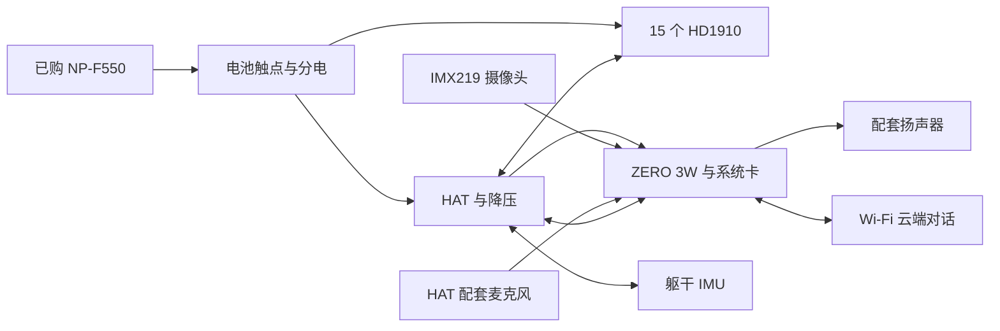

# fanhao 飞特版：装配、安装、标定与首走
目标：让初次接触 Microduck 的使用者，沿同一套资料完成从零件到稳定遥控行走，再进入首版音视频集成。

| 顺序 | 做什么 | 需要什么 | 结束条件 |
|---|---|---|---|
| 0 | 识别硬件和软件 | 本文 A–B、本机 BOM | 知道每块板的作用，确定成套电控 |
| 1 | 补购与等待期间准备 | 本文 C | 核心缺件有明确型号，工具与资料就绪 |
| 2 | 单舵机读写与编号 | 本文 D | 15 颗身份唯一、编号与物理关节一致 |
| 3 | 分组件装配和布线 | 本文 E | 无卡滞，线束在关节运动时不拉紧 |
| 4 | 电控上电检查 | 本文 F | 主控电压、总线身份及 IMU 反馈正确 |
| 5 | 系统写卡和配网 | 本文 G–H | 能进入机器人 Studio |
| 6 | 本机标定和架空验收 | 本文 I–J | 零位、方向、上力和卸力分别通过 |
| 7 | 配套模型低速首走 | 本文 K | 能保持、前后移动、转向及停止 |
| 8 | 摄像头、对话与备份 | 本文 L | 首版功能并发通过且能恢复 |
| 以后 | 自训练和迁移 | [训练指南](08_训练导出与迁移指南.md) | 新旧模型可比较、可回退 |

**当前仅完成资料准备，没有写卡、连接硬件、写舵机或完成本机行走。** 本文中的操作是待执行说明。阶段状态统一在 [根 README](../README.md) 维护，现场结果写入 [验收模板](03_标定与验收记录模板.md)。

## A. 先认识整机

| 名称 | 通俗含义 | 本机位置/作用 |
|---|---|---|
| Radxa ZERO 3W | 一台很小的 Linux 电脑 | 在头部，运行运动模型、视频和云对话客户端 |
| TF / microSD 卡 | 主控的系统盘 | 插入 ZERO；卡容量不会增加运行内存 |
| HAT | 插在主控排针上的扩展板 | 提供配电、舵机总线和音频等接口，具体功能取决于实物版本 |
| 躯干 IMU | 测量机身倾斜和角速度的传感器 | 必须固定在躯干；头部的传感器不能直接替代 |
| HUB / 分线板 | 分配电源和通信的连接板 | 接舵机、IMU 和电池相关线束，不负责训练 |
| 微雪 Adapter A | 电脑调单颗舵机的 USB 接口板 | 用户已购 1 块，不等于整机 HAT |
| Studio | 机器人自带的网页管理界面 | 浏览器访问，可配网、标定、配手柄、诊断 |
| 现成 ONNX 模型 | 已训练的运动策略 | 镜像提供匹配的 HD1910 模型，先用它建立基线 |
| 训练工程 | 在仿真里学习步态的软件 | 后续运行在 Linux/WSL2 NVIDIA GPU 电脑，不在 ZERO 上训练 |

关系如下，图中箭头表达功能，不表达针脚：



## B. 本次只走这一条主线

| 项目 | 本次采用 | 依据 |
|---|---|---|
| 舵机与机械 | 用户已购 HD-1910-C001 ×15；已确认可用的飞特打印件；普通脚底 | 本机 BOM B001–B005 |
| 主控 | ZERO 3W、无 eMMC、40Pin 排针已焊；2GB 已测成套款有效，4GB 作为并发余量候选 | B015；最终以同批板卡和镜像验证为先 |
| 软件主线 | fanhao 复刻镜像 `20261023c`，内置 Studio，网页端口 `8000` | 发布页和首次使用说明 |
| 核心反馈 | 与实物板卡配套、已刷好的躯干总线 IMU | FT6 为优先询价；另一协议须按发布兼容布局核对 |
| 运动模型 | 镜像内匹配 HD1910 的模型 | 先首走，后自训练 |
| 首版音视频 | 原头壳匹配的 IMX219 + HAT 音频 + 板端云客户端 | 对话不是该镜像自带的已完成能力 |

旧 kissqy R1、V167 和早期 fork 作为历史资料保留。**本流程不要求再刷 R1 或安装 V167 更新包。** 对着本镜像操作时，不混用其他路线的热点、端口、标定文件和升级按钮。

资料优先级：固定发布记录 → 同版首次使用说明 → 实际板卡原理图/固件说明 → 较早研究笔记。主仓 `docs/硬件入门.md` 等含历史分析，不能直接把其中“飞特必须从零重训”等早期判断当成当前首走要求。

[固定源码](../02_feetech/microduck-replica_20261024/)与发布镜像不是同一个版本对象：前者是资料快照，后者含自身冻结的 Studio/runtime，准确版本见 [版本锁定](../90_sources/fanhao_20261024/版本锁定.md)。

## C. 先买哪些，等待期间做什么

采购主表只用 [本机 BOM](01_BOM表.md)，不要另按作者 Excel 全表下单。三项核心电控均由用户最新确认尚未购买。

| 优先级 | 本轮要做的事 | 避免重复/买错 |
|---|---|---|
| 立即 | TF 卡与读卡器；确认主控零售库存和批次 | 卡的具体型号见下表；主控必须已焊排针 |
| 同时 | 询 HAT＋躯干 IMU＋HUB＋电池触点＋成品线束的成套交付 | 提供实际板号、固件、针序、尺寸及已测镜像；不只报“Microduck通用” |
| 同时 | IMX219 原厂板型、配套 FPC、扬声器和麦克风 | HAT 已含麦克风就扣除；相机芯片名不能代替板型 |
| 到货前 | 准备万用表、匹配螺丝刀、标签、承托支架/软吊带 | 清点已买工具，不默认六件焊接套装包含所有工具 |
| 可以后做 | ToF、轮滑、花式动作、自己的训练 | 不阻断普通脚底首走 |

### C1. TF 卡直接购买规格

| 项目 | 本次建议 |
|---|---|
| 按原BOM购买 | **64GB正规microSDXC，闪迪SanDisk Extreme红金卡，UHS-I、A2、U3、V30** |
| 可选容量 | 三星PRO Plus 128GB、`MB-MD128SA`系列；128GB仅为额外余量，不要求升级 |
| 数量 | 1张工作卡即可复现；建议另备1张恢复/候选卡，基线验证后制作备份，不是购买后自动有备份 |
| 读卡器 | SanDisk MobileMate USB 3.0 `SDDR-B531`，或同等正规 USB 3.0 microSD 读卡器 |
| 已有正规 64GB | 可以先用；作者系统使用量不要求 128GB，选 128GB 是为维护与扩展留余量 |
| 不额外购买 | “树莓派专用”代烧服务、普通大 SD 卡；电脑没有 SD 卡槽时不能只买 SD 转接套，需要 USB 读卡器 |
| 到货检查 | 防伪/型号、电脑可识别、写卡校验；主控第一次启动后检查扩容及文件系统无 I/O 错误 |

此前耐久优先的 PRO Endurance 仍为备选；本次针对系统盘选择 PRO Plus，不将两者优先级同时保留。A2 不保证 ZERO 一定达到卡盒标称速度，也不等于“比所有耐久卡更耐用”。当前价格和库存未核实，不把搜索截图起价当成交价。

依据：[三星规格](https://www.samsung.com/uk/memory-storage/memory-card/memory-card-pro-plus-microsd-card-128gb-mb-md128sa-eu/)、[Radxa 启动介质说明](https://docs.radxa.com/en/zero/zero3/getting-started/preparation)。

64GB候选依据：[闪迪Extreme原厂规格表](https://documents.sandisk.com/content/dam/asset-library/en_us/assets/public/sandisk/product/memory-cards/extreme-uhs-i-microsd/data-sheet-extreme-uhs-i-microsd-190mbps.pdf)。规格合适不证明搜索结果中每家店获授权；优先正规官方渠道，确认实际选中的64GB版本。

### C2. 发给电控卖家的核对内容

> 我复刻的是 fanhao375/microduck-replica 飞特 HD-1910-C001 版，已有 15 舵机、打印件、微雪 Bus Servo Adapter (A)、NP-F550 电池。计划使用 20261023c 镜像。需要已焊、已刷、已测试的 HAT、躯干 IMU、HUB、NP-F 触点和整套成品线。请提供：各 PCB 板号与实物图、HAT 主控降压和音频测试范围、IMU MCU/芯片/固件/ID/波特率/协议及寄存器布局、各线两端针序与长度、与打印件的安装方式，以及是否实际在该镜像读通 15 舵机和躯干 IMU。总线 IMU 优先 FT6；若为 DXL2，请明确是否 ID200、1Mbps、124/12 SFLP。请分项报价并列出套装包含物，不需要代烧收费系统卡。

该段是待用户发送的采购核对文本，本轮没有代发消息。仓库 `hardware/新版/` 中的三块新设计尚未打样实测，不作为“买空板自行焊完就能复刻”的快捷路线。

### C3. 等件期间可完成

1. 给 15 颗舵机准备独立标签；按 D 节规划关节 ID。
2. 打开 E 节的分集视频和组件图，按左腿、右腿、躯干、颈、头分袋。
3. 下载写卡工具，确认电脑 USB 口和读卡器可用。
4. 在 [验收模板](03_标定与验收记录模板.md) 建立本机记录；型号未知处留“待核”，不填猜测。
5. 清点螺丝规格、转接线数量、脚垫、电池触点；缺项合并补购，减少反复等快递。

## D. 单舵机配置：先编号，再装机

### D1. 本镜像的关节与 ID

左右以小鸭自身为准，不以面对它的人的左右为准。

| 部位 | 关节名 | 总线 ID |
|---|---|---:|
| 右髋偏航 | `right_hip_yaw` | 10 |
| 右髋侧摆 | `right_hip_roll` | 11 |
| 右髋俯仰 | `right_hip_pitch` | 12 |
| 右膝 | `right_knee` | 13 |
| 右踝 | `right_ankle` | 14 |
| 左髋偏航 | `left_hip_yaw` | 20 |
| 左髋侧摆 | `left_hip_roll` | 21 |
| 左髋俯仰 | `left_hip_pitch` | 22 |
| 左膝 | `left_knee` | 23 |
| 左踝 | `left_ankle` | 24 |
| 颈俯仰 | `neck_pitch` | 30 |
| 头俯仰 | `head_pitch` | 31 |
| 头偏航 | `head_yaw` | 32 |
| 头侧摆 | `head_roll` | 33 |
| 鸟嘴 | `mouth` | 34 |
| 躯干总线 IMU | 不属于舵机/策略关节 | 200 |

依据：固定源码 `software/image/calib/hd1910-calibration.option-a.toml`。其中 15 舵机是实物数量，行走策略通常控制 14 维，鸟嘴独立。旧记录中的嘴 ID29、其他编号不能混入此表。

### D2. 已购微雪 Adapter A 怎么用

1. 对照 [微雪资料](../05_vendor/waveshare/) 检查板卡丝印、ST/SC 通道、USB/串口模式及电源接口；实际发货修订与文档不同时先核对。
2. 先接电脑 USB，确认 CH340 串口出现并记录 COM 号；驱动仅从厂家来源获取。
3. 断电连接 **一颗** HD1910 到适用的 ST/SC 串口总线端口；用万用表确认 GND、电源和 DATA，不能只靠线色。
4. 给舵机接匹配的独立电源。Adapter A **没有稳压**，输入会到总线；官方 FAQ 最大承载 5A，不让 15 颗动作电流无条件通过它。
5. 打开 [飞特工具目录](../02_feetech/microduck-replica_20261024/tools/飞特/)，按厂家调试软件说明选 COM、搜索当前身份，读取并保存型号、固件、ID、波特率、运行模式和偏移。
6. 按 D1 改成目标 ID，断电重连再读回确认，贴上“部位＋ID”标签。目标运动总线为 1Mbps；原值不同则保存后按厂家步骤配置。
7. 关闭扭矩后再换下一颗。15 颗全完成后才接成总线，防止同 ID 冲突。
8. 运行模式、PID、速度/加速度、相位和角度限制不按网络通用 STS 表批量覆盖；读取本机固件后再核对对应 HD1910 说明。

通过条件：每颗可读回、身份唯一、标签一致；重启仍保留配置。这里没有统一下发“模式4”等未知固件写入指令。

## E. 机械装配：资料与实际动作对应

主资料：[21 页装配 PDF](../01_mechanical/microduck-replica-cad/安装说明书/microduck装配安装说明书.pdf)、[组件图](../01_mechanical/microduck-replica-cad/组件图/)、[飞特 CAD](../01_mechanical/cad_v2.2/)。打印件已由用户确认没问题，例行试装不重新质疑采购是否选对。

| 建议装配顺序 | 看哪个视频 | 操作重点 |
|---|---|---|
| 清点并分组 | [第1集](https://www.bilibili.com/video/BV1RoHX68EFV/) | 舵机附件、轴承、螺丝按组件分袋 |
| 两侧小腿和脚踝 | [第2集](https://www.bilibili.com/video/BV1Xppb6tECr/) | 轴承同轴、脚踝方向、防滑接触面 |
| 两侧大腿和髋 | [第3集](https://www.bilibili.com/video/BV1ycpb6yEwB/) | 镜像关系、舵盘位置、螺丝不顶舵机 |
| 躯干与电池支撑 | [第4集](https://www.bilibili.com/video/BV1Kwpg6wE9G/) | IMU 固定位置、电池取电和腿线分配 |
| 颈部 | [第5集](https://www.bilibili.com/video/BV1EEpg6nEkD/) | 总线和电源过颈留活动余量 |
| 头、相机和音频 | [第6集](https://www.bilibili.com/video/BV1aKpE6hEzj/) | ZERO/HAT 间隙、相机 FPC、麦孔和喇叭固定 |
| 总装与手动检查 | PDF 与实物对照 | 先不封死头壳，保留调试接口和检查窗口 |

每个组件都执行：核对编号 → 试装轴承/舵盘 → 按装配姿态归中 → 临时固定 → 检查行程与线束 → 确认后锁紧。不要靠强拧螺丝让错位件就位；不强行掰动已上力的舵机。

PDF 不包含每颗螺丝长度和全部走线，无法从资料可靠确定处用现场测量和组件图核对，不能编造完整螺丝对应表。建议先完成一侧作为结构参考，再镜像核对另一侧；左右零位数据仍独立标定。

通过条件：允许行程内无卡滞、线束不夹不拉、脚掌平整、轴承不明显松脱；电池更换和卡槽可操作。轮滑配件和 V1 备选踝不混装。

## F. 电控与供电：先验接线，再首次整机启动

1. 从卖家取得实际板号、端口和两端针序；逐项填入验收记录。没有明确针序时停在断电核对，不套原版 HAT 或另一卖家的接法。
2. 断电检查电池正负、触点、分电、主控降压、舵机供电、总线 DATA 和共地关系。
3. 空载测主控支路，ZERO 官方只支持 **5V 输入**；NP-F550 的电池原压不能直接接 ZERO 的 5V 脚或 USB-C。
4. 若单独试启动 ZERO，用其电源 USB-C 口与合适 5V 电源；整机 HAT 接入前核对双路供电，避免两个电源输出直接并联。
5. 把躯干 IMU 固定并接好，首次整机开机前完成；线束不得把 IMU 固定在头部或悬空晃动。
6. 初次系统通电时承托机身，不让未验收舵机承重。检查主控启动、异常发热、异味及接插件松动。
7. 浏览器进入后，先确认 15 颗舵机和躯干 IMU 的真实数据。识别失败按 M 节排查，不反复使能碰运气。

当前未取得 HAT/IMU/HUB 的具体发货版本，**逐针接线图尚不能定稿**。这是待补实物资料，不影响先做采购、编号和机械分组件工作。

### F1. 线束计划

依据：作者硬件图集的总线拓扑与电源分配图、`HD1910-训练前数据清单` 的关节坐标、飞特规格书。

| 项目 | 内容 |
|---|---|
| 总线 | 主控 UART 经 HAT 上的半双工切换，接成一条 1 Mbps 单线总线，15 颗舵机和 IMU 板（ID 200）都挂在上面，一共 16 个设备，没有集线板 |
| 供电 | 电池直连 HAT 的 `+BATT`，舵机电源随总线线束走；HAT 的舵机口标注最大 3 A，走路时的峰值可能超过，作者记录过整机掉电 |
| 舵机自带线 | 15 cm，与相邻舵机的直线距离相比明显偏长 |
| 相邻舵机直线距离 | 髋偏航到髋横滚 21 mm，横滚到俯仰 31 mm，俯仰到膝 42 mm，膝到踝 49 mm，颈到头约 50 mm，头部各关节约 23 mm |
| 需要的连线数 | 至少 16 根，16 个设备各接一根 |
| 合适长度 | 约 6–10 cm，脖子与躯干交界处多留余量，其余收紧 |
| 接口 | 飞特规格书写 AMP 型，上游另有 5264、JST EH 2.5 mm 的说法，互相矛盾，以实物为准 |

已买 4 根 AMP2.0 100 mm 线，另有套装里的 5264 转 AMP2.0 线，数量到货清点；缺的数量见 BOM 表的追加线材。

## G. 给 TF 卡写入系统

### G1. 用哪个文件

目录：`02_feetech/images/fanhao_20261023c/`。下载/校验结果以 [版本锁定](../90_sources/fanhao_20261024/版本锁定.md)为准。

- 镜像：`microduck-replica-20261023c.img.xz`。
- SHA256：`10009c0a4aa963900719649836f5544036ad52cc15e3a0228eef05f6b747dab5`。
- 镜像压缩文件大小：712,068,864 字节。
- 来源：[正式发布页](https://github.com/fanhao375/microduck-replica/releases/tag/microduck-replica-image-20261023c)。
- 工具：[balenaEtcher](https://etcher.balena.io/)；可用 Raspberry Pi Imager 的自定义镜像功能。

**2026-10-24已补齐完整镜像，整文件大小和SHA256与发布方一致，5份小附件也齐全。** 可以从该目录选取`.img.xz`按G2写入经确认的目标卡；实际写卡前仍核对文件与目标卡。源码ZIP、许可txt、`.sha256`文件不能当镜像写卡。

### G2. Windows 操作顺序

1. 将工作卡贴“A工作卡”，通过读卡器插电脑。确认里面没有需要保留的数据；写卡会覆盖目标卡。
2. 打开 PowerShell，先进入项目镜像目录。实际项目位置不同则替换路径。

```powershell
Set-Location 'E:\HuanCun\Desktop\Microduck\02_feetech\images\fanhao_20261023c'
```

计算压缩镜像哈希，与 G1 比较，必须完整一致。

```powershell
Get-FileHash -LiteralPath '.\microduck-replica-20261023c.img.xz' -Algorithm SHA256
```

3. 在 Etcher 选择该 `.img.xz`，无需解压；选择目标读卡器中的 TF 卡，核对容量，再 Flash。
4. 等写入和校验完成后安全弹出。Windows 弹“需要格式化”时选取消，这是 Linux 分区。
5. 插卡前断开主控电源。卡、HAT、躯干 IMU 和正确线束就绪后按 F 节启动。
6. 备用卡暂不覆盖；首走形成基线后按迁移指南制作恢复卡。

## H. 第一次启动与配网

1. 首次启动等待约 3 分钟；镜像会扩容、生成 `duck-xxxx` 名称并检测 IMU。先观察，不因网页暂未出现连续断电。
2. 手机连接 `Microduck-xxxx` 热点，初始密码 `microduck`；提示“无法上网”选择保持连接。
3. 手机浏览器打开 `http://10.42.0.1:8000/`。安卓打不开时检查是否绕到移动数据。
4. 在顶部“连 WiFi”卡片选择家中 Wi-Fi，输入密码，确认断开热点后切换。手机被断开属于正常现象。
5. 手机/电脑回家中同一网络，按下表访问。找不到主机名时去路由器设备列表找 IP。

| 访问设备 | 地址 |
|---|---|
| Windows | `http://duck-xxxx:8000/` |
| iPhone / Mac | `http://duck-xxxx.local:8000/` |
| 主机名不能解析 | `http://小鸭实际IP:8000/` |

6. 在“更多”页设置 Studio 登录密码。SSH 不是正常首走的必需步骤；需要排障时先在网页里明确启用并设置自己的 SSH 密码。
7. 检查舵机列表、IMU 实际识别协议、供电状态和版本；导出一次初始诊断包。

通过条件：重启后仍能进入页面，数据会变化且身份正确。热点可用于运动调试，但云端对话需要小鸭实际连通互联网，不能把手机连热点等同小鸭已经上网。

## I. 按网页上手清单完成本机标定

### I1. 舵机零位

1. 承托小鸭，先卸力；检查关节 ID 与 D1 逐一对应。
2. 按作者定义摆成腿伸直、头摆正、嘴闭合的几何零位。
3. 进入舵机页，用同版向导“一键校准”，保存产生的本机数据。
4. 小幅单关节检查实际动作与页面方向一致；异常先查编号、舵盘安装和偏移。
5. 不把出厂所有关节 `2048/-1/未标定` 当作本机有效标定，也不将 HOME 重新当作几何零位。

### I2. IMU 方向与站姿

1. 按页面做粗校：托起、摆正、保持静止，再按提示前倾。
2. 交给主程序验证前先恢复摆正，再在提示的时间内向前倾约 15–30°；不要一直停留在前倾姿态等待验证。
3. 站姿校准时点击“站姿使能”会驱动关节，不只是采集传感器；持续承托，先确认零位和机械行程。
4. 按页面完成静止、前、后、左、右采样，再点“失能”或“卸力”并扶住。
5. 模块换位置、换安装方向或换协议后重新校准。不以“已完成/跳过”替代实际方向核验。

### I3. 写入主程序

1. 写入前让小鸭坐着或已卸力，舵机电源保持按向导要求接通。
2. 点击“写进主程序”；等待重启约 20 秒，慢时约 1 分钟，期间持续承托。
3. 检查页面是否接受新标定、是否退出标定模式；若回滚，先读原因，不连续覆盖。
4. 导出/保存本机标定和诊断包，并记录镜像与运行端版本。

依据：[固定版本首次使用说明](../02_feetech/microduck-replica_20261024/software/image/烧录和第一次使用.md)。菜单以该版实际网页为准；上述动作尚未在本机执行。

## J. 架空与手柄验收

1. 承托后测试保持姿态，观察是否错腿、跳动、顶限位或持续嗡鸣。
2. 用现有 TGZ 手柄按 Studio 向导配对；TGZ 的蓝牙/USB模式和映射须实际确认，作者 G50 Pro 的 X 档经验不能当作 TGZ 已支持证明。
3. 先测试网页卸力，再测试手柄 Select **短按**。Select **长按约2秒** 是坐下、卸力并关机，不用长按替代急停测试。
4. 验证停止步态和彻底卸力的差别；退出网页、断开手柄和程序重启各是什么行为，记录实测结果。
5. 先确认 Start、摇杆、Select 等基本键；首走不试翻滚、踢球或轮滑切换。
6. 观察电压、温度、数据新鲜度和重启现象。异常先卸力，保留诊断，再排查。

本版低电压不会自动关机，摔倒不会自动卸力；看到警告先停，扶起前先卸力。已有快捷按钮不代表所有失联情况都已经验证。

## K. 第一次平地行走

1. 装好与基线一致的电池和防滑脚垫，在平整不滑的地面清出小范围。
2. 承托下站起，先不推摇杆，观察能否保持。
3. 点击“开始走”，先小幅前进并松杆停止，再分别试后退、左右转向和停止。
4. 每次只改变一个条件；分别记录是否后仰、前扑、脚底打滑、蹭地、重启或无法卸力。
5. 反复倒向一边先查 IMU 安装方向、左右零位和重量；不先用“加大动作幅度”掩盖错误。
6. 通过后记录模型、配置、电池、整机质量和脚垫，形成首走基线。没有通过则保留失败与改动记录。

通过条件：启动和停止可控，低速前后及转向有实测记录，无持续顶限位、异常重启或明显数据过期。网页模型在动、训练曲线上升、短时站住均不单独算首走通过。

## L. 完成用户要求的首版

行走通过后，普通脚底倒地恢复及其他动作按 [完整性与动作清单](06_复现完整性与动作清单.md)另行验收。当前walk权重实际包含VelStand联合倒地恢复，不把它与sitstand坐站或轮滑起身混为一项；10个成品模型已独立整理。

1. 按 [摄像头与自然对话指南](07_摄像头与独立云对话指南.md)完成真实采集、录放音和云对话。
2. 在机器人无调试电脑参与的情况下完成问答；手机/浏览器管理界面不承担语音识别计算。
3. 保持相机和对话运行，再重复低速行走，记录内存、温度、控制周期和电压。
4. 保存系统镜像、模型、配置、标定和恢复方法，制作备用卡。
5. 首版通过后再按 [训练、导出与迁移指南](08_训练导出与迁移指南.md)开展自己的训练。

视觉问答和语音命令驱动动作是额外集成项。首版最低要求是已确认的摄像头和自然问答，不为了扩展功能阻断这些已明确的目标。

## M. 遇到问题先看这里

| 现象 | 优先检查 | 不直接做 |
|---|---|---|
| 没热点 | 已连家庭 Wi-Fi？首次启动等待够吗？供电/镜像校验？ | 连续多次断电、重装其他镜像 |
| 网页打不开 | 同一网络、`:8000`、实际 IP、移动数据/代理局域网直连 | 默认去访问 V167 的其他端口 |
| 舵机缺失/重复 | ID 冲突、供电、线序、端口、波特率、单颗重读 | 全部同时改寄存器 |
| IMU 未识别 | 实物固件/协议、总线身份、接线、首次开机检测 | 把 BMI160 当兼容替换板 |
| 上力立即歪倒 | 零位、方向、IMU 坐标、模型/配置配对 | 先增加增益或动作系数 |
| 动作时重启 | 电池压降、5V支路、接触件、承流线 | 只归因于模型 |
| 相机出现彩条 | 是否仍为 `source="test"` | 把测试图当成真实采集成功 |
| 对话没声音 | ALSA设备、录放音、云激活/网络、声卡占用 | 反复换整张系统卡 |

求助前在 Studio“更多/日志”导出诊断包，记录阶段、版本、期望与现象；含局域网信息的包按需要处理隐私。临时排障输出按用户规则放 `E:\HuanCun\AI_tmp\GPT\` 的任务目录，经确认需要留存的结果再归项目。
