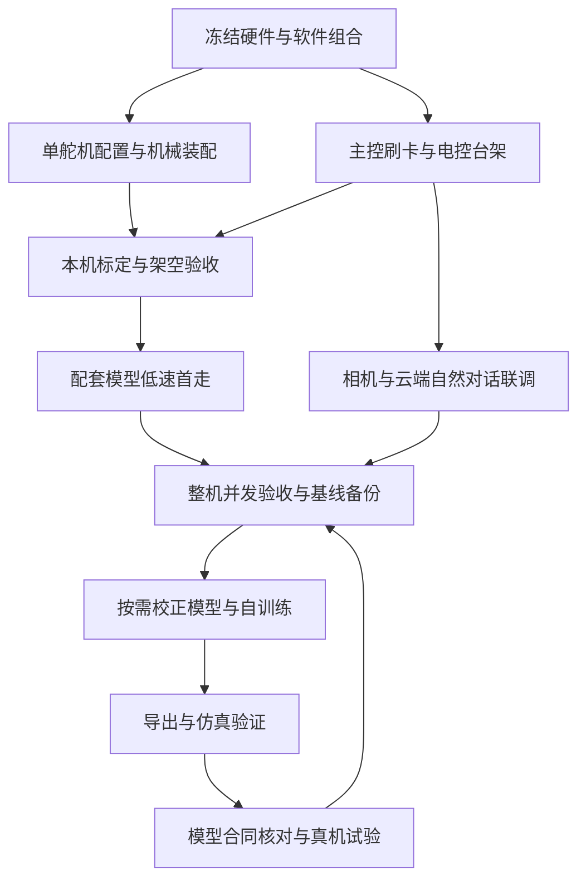

# 历史路线与结论归档
目标：保留切换到 fanhao 主线之前的全部结论、来源和任务记录，避免把历史候选误当当前执行方案。

**2026-10-24 起，当前入口改为 [根 README](../README.md) 与 [fanhao 执行指南](02_分阶段复现指南.md)。** 下文是原总笔记快照；K1–K68 保留原编号，历史采购建议与未下载状态只代表快照时点。当前状态见根 README K69 及以后。

---

# Microduck
目标：结合已购飞特套件，尽快复现独立行走、摄像头与云端自然对话，不依赖外接电脑运行。

| 现在看什么 | 入口 | 状态 |
|---|---|---|
| 完整装机 BOM 与采购状态 | [本机 BOM 主表](../00_notes/01_BOM表.md) | 同表列已购、拟购和待购；含主控/HAT/躯干 IMU/HUB/取电、音视频、存储及工具 |
| 用户提供的机械行者装配 BOM | [10 月 23 日 Excel](../装配BOM-机械行者Robo-2026-10-23-带采购链接.xlsx)、[本次复核](#o-机械行者-bom-与配套流程复核) | 同一机械项目的价格补充版；含选配件与金额问题，不作为整表补购指令 |
| 当前品质优先硬件选型 | [硬件型号与版本调研](../00_notes/11_硬件型号版本选型调研.md) | 完整型号、版本比较、购买状态、升级代价与分档预算；供用户审阅 |
| 早期补购与轻量路线 | [补购清单](../00_notes/12_补购清单与最快路线.md) | 保留原 2GB 基线和需求记录；采购优先看新调研 |
| 按顺序复现 | [分阶段复现指南](../00_notes/02_分阶段复现指南.md) | 已串联步骤、来源与验收条件；未上机 |
| 下载了什么、来自哪一版 | [资料来源与本地索引](../00_notes/09_资料来源与本地索引.md) | 以下载清单和校验记录为准 |
| 用户确认与剩余疑问 | [确认记录](../00_notes/10_回来后统一确认.md) | 需求已回复，剩余为实物与卖家版本核对 |
| 避免版本混用 | [版本差异与避坑](../00_notes/05_版本差异与避坑.md) | 含原 BOM 问题与资料缺口 |
| 装配视频 | [视频与外部入口](../00_notes/04_视频与外部入口.md) | 前六集来自原仓，平台流媒体未离线下载 |
| 后续本机记录 | [标定与验收模板](../00_notes/03_标定与验收记录模板.md) | 所有实机项目均未测 |

## 基准与结论

### A. 从哪里开始

| 你现在的问题 | 本文入口 | 做完后应得到什么 |
|---|---|---|
| 整个项目怎么推进 | 本节、[E. 分阶段计划](#e-分阶段计划) | 知道先做什么、哪些可以并行 |
| 哪台电脑训练，小鸭上装什么 | [B. 设备与软件分工](#b-设备与软件分工) | 分清电脑中控、训练端、主控与 IMU |
| 缺什么、买哪个版本 | [硬件选型调研](../00_notes/11_硬件型号版本选型调研.md)、[D. 候选版本](#d-当前候选版本与路线) | 同一套经过卖家确认的硬件与固件 |
| 如何装配、刷系统、标定 | [F. 安装与首走](#f-安装与首走) | 用配套模型建立第一套实机基线 |
| 如何安装训练环境、开始训练 | [G. 训练流程](#g-训练流程) | 可续训的检查点、日志和配置 |
| 如何把模型移到小鸭 | [H. 导出与仿真](#h-导出与仿真验证)、[I. 真机迁移](#i-真机迁移) | 模型与运行端参数一起交付并验收 |
| 换电脑、服务器或系统卡怎么办 | [J. 环境迁移与恢复](#j-环境迁移与恢复) | 能重建环境、恢复训练或回退机器人 |
| 如何做到摄像头和自然对话 | [K. 首版视觉与语音](#k-首版视觉与语音) | 小鸭脱离电脑仍可工作 |

**目前处于资料准备完成、采购版本待冻结阶段。** 还没有完成实物清点、刷卡、标定、训练或真机验收。下文是依据本地归档版本整理的实施流程，命令未在本机运行；来源作者的测试记录不能当成本机已通过。

推荐把项目拆成两条线：**先复现配套模型，再开展自己的训练。** 摄像头和自然对话属于首版目标，可以在台架上与机械装配并行联调；ToF、轮滑和花式动作放在首版之后。



“训练成功”和“复现成功”分开判断：前者要有可评估的策略与完整训练记录；后者要在本机上完成行走、相机、对话和独立运行验收。现成模型能在本机稳定工作时，不需要为了首走而先从零训练。

### B. 设备与软件分工

| 位置 | 安装或运行什么 | 输入与产出 | 是否必需 |
|---|---|---|---|
| Windows 日常电脑 | 写卡工具、机器人中控 V167、训练中控 R1.5.27 的页面服务 | 配置、SSH 管理、标定记录、模型包 | 装配调试阶段使用；整机日常运行不依赖它 |
| Linux / WSL2 的 NVIDIA GPU 电脑，或 SSH GPU 服务器 | 固定版本训练引擎、Python、CUDA 相关依赖 | 仿真训练产生 PT 检查点、曲线和日志，再导出 ONNX | 自训练时需要；使用配套模型首走时可暂不准备 |
| Radxa ZERO 3W | 系统镜像、robotd、手柄/媒体相关服务、板端云语音客户端 | 读取 IMU/关节，运行 ONNX，控制舵机，处理音视频与联网 | 机器人独立运行的主控 |
| STM32 躯干 IMU 板 | 与电控路线匹配的 IMU 固件 | 姿态/角速度等传感数据 | 运动闭环需要；成品板优先由卖家烧好并测试 |
| HAT、分线板与舵机 | 电源、通信、音频硬件及各自适用配置 | 连接与执行 | HAT 与 STM32 IMU 不是同一块板，不统一称为“刷主板固件” |
| 云端 AI 服务 | 语音识别、对话与语音合成所需服务 | 小鸭通过 Wi-Fi 发送请求并接收结果 | 用户允许；自然对话仍依赖网络与有效服务配置 |

| 名称 | 通俗解释 | 本项目应如何理解 |
|---|---|---|
| 系统镜像 `.img.xz` | 小鸭主控整张系统卡的基础内容 | 用写卡工具写入 TF 卡，不放进模型槽 |
| 机器人中控 | 电脑上的管理界面 | 管理主控、标定、固件、模型和调试；不是训练引擎 |
| 训练中控 | 电脑上的训练管理界面 | 调度本机/WSL/服务器训练；网页能打开不代表 GPU 环境已装好 |
| PT 检查点 `.pt` | 训练保存的状态 | 用于评估、教师或续训；能否完整续训取决于是否保存优化器等状态 |
| ONNX `.onnx` | 推理模型 | ZERO 执行策略使用；单个 ONNX 不包含全部机器人配置 |
| 模型合同/部署合同 | 模型与运行端共同遵守的数据和控制约定 | 包括关节顺序、观测含义、动作缩放、频率、滤波和固件要求 |
| Sim2Sim | 在另一套仿真执行链中检查模型 | 本项目已在 MuJoCo 体系训练，重点检查导出后推理与运行端行为是否一致 |
| Sim2Real | 将仿真策略部署到真实小鸭并验收 | 包括硬件、标定、时序和模型匹配，不能简化成复制文件 |

本项目归档的训练工程使用 **mjlab / MuJoCo Warp**。不要直接套用既往四足项目的 Isaac Lab 任务、观测或执行器参数。具体环境以所选训练路线的锁文件和文档为准。

### C. 对象与目录

| 已有 | 需补齐 | 首版目标 |
|---|---|---|
| 飞特机械套装、微雪板、供电件、BMI160、ToF、焊接工具及已有 TGZ 手柄；适配状态见本机 BOM | 主控、配套 FT6 躯干 IMU、HAT/分电、触点、存储、相机音频、万用表和台架电源；BMI160 不能抵扣配套 IMU | 遥控行走、摄像头、联网自然对话；不依赖电脑，允许云端 AI |

```text
Microduck/
├── 00_notes/                              中文复现步骤、零件匹配、来源、疑问与记录模板
├── 01_mechanical/                         飞特机械 CAD、装配 PDF、BOM、3MF 与发布附件
│   ├── cad_v2.2/                          已解压的 SolidWorks 与 STEP，保留包内原目录
│   ├── microduck-replica-cad/              机械行者Robo 图纸配套仓库的固定提交快照
│   └── releases_v2.2/                     飞特 v2.2 可编辑图纸与改动件 STEP
├── 02_feetech/                            飞特主线的软件、调试、硬件和镜像资料
│   ├── images/                            发布镜像与来源清单，仅下载未烧录
│   ├── Microduck-kissqy/                   V167/control.43 与训练中控、IMU 工程
│   ├── Microduck-kissqy-imu-fork/          I²C 躯干 IMU 适配 fork，独立保存
│   └── microduck-replica_20261024/         复刻主仓、调试记录、电控、Studio 与训练参考
├── 03_official/                           Pollen 官方源资料
│   ├── elec_RPI_Robot_HAT/                 KiCad、生产文件、原理图和器件资料
│   ├── microduck/                         官方机器人运行时与架构文档
│   └── microduck_rl/                      官方训练、MJCF 与导出参考
├── 04_alternatives/                       备选教程与社区硬件，不作为混装依据
│   ├── awesome-microduck/                 社区项目导航，部分描述滞后
│   ├── Microduck-build-tutorial/          树莓派/原版舵机教程参考
│   ├── microduck-community-kit/           社区板卡与工具，须核对 MCU/协议版本
│   ├── microduck-diy/                     中文分阶段装配参考
│   └── microduck-hd1910m/                 另一套 Radxa/HD1910M/BNO08x 运行方案
├── 05_vendor/                             飞特、微雪、瑞莎厂家资料
│   ├── feetech/                           HD-1910 型号、针序、STEP、协议与内存表参考
│   ├── radxa/                             ZERO 3 官方网页快照
│   ├── selection_20261022/                 本轮主控、相机与专业台架电源原厂规格书
│   └── waveshare/                         Adapter A 产品、接线与 FAQ 网页快照
├── 06_voice/                              板端云语音候选，尚未与 Microduck 联调
│   ├── py-xiaozhi/                        备选客户端的说明、许可与依赖参考
│   ├── xiaozhi-esp32/                     独立语音模块的说明与许可参考
│   └── xiaozhi_linux_rs/                  Linux/AArch64 客户端完整源码快照
├── 90_sources/                            原始仓库 ZIP、提交/下载/哈希/失败记录
└── README.md                              本项目唯一总工作笔记
```

- **K1**：首轮用户文件只有商品截图；后续采购状态以本机 BOM 和已保存的新截图为准。最早截图原文件当前不在原位置，见 K58；已购范围与历史用户回复仍保留，不将其当作到货验收。
- **K2**：舵机采购型号已由 2026-10-24 用户回复与选中 SKU 截图确认为 HD-1910-C001，结束早期候选状态；继续采用飞特路线，实物铭牌、固件和数量待验。机械、电路、协议和策略均不能直接套用官方 XL330 版。依据：[零件匹配](../00_notes/01_BOM表.md)、K48。
- **K3**：原始仓库按固定提交归档，原始文件不做内容修改；发布附件与仓库快照分开保存。具体提交、体积与 SHA256 见 [来源索引](../00_notes/09_资料来源与本地索引.md) 和 `90_sources/`。
- **K4**：当前资料基线属于 2026-10-22 的检索快照。它不是本机机械/电气/运动已经通过的版本；实际“最终可用版”须在首走验收后冻结。

### D. 当前候选版本与路线

| 层 | 当前候选 | 本地入口 | 本机状态 |
|---|---|---|---|
| 机械 | 飞特 CAD v2.2，2026-10-20 为归档参考 | [CAD 说明](../01_mechanical/microduck-replica-cad/README.md) | 用户确认现有打印件没问题，装配验收按流程执行 |
| 装配 | 21 页 PDF + 组件图 + 作者视频 | [PDF](../01_mechanical/microduck-replica-cad/安装说明书/microduck装配安装说明书.pdf)、[视频](../00_notes/04_视频与外部入口.md) | 已阅读核对，未试装 |
| 采购依据 | CAD Excel 与 kissqy 采购表交叉核对 | [零件清单](../00_notes/01_BOM表.md) | 不作为未确认的补购订单 |
| 电控 A | Radxa ZERO 3W + 配套 HAT/STM32 总线 IMU + FT6 | [kissqy](../02_feetech/Microduck-kissqy/README.md) | 当前补购推荐，成品版本待卖家核对 |
| 软件 A | R1 镜像升级 control.43，R17 V167 中控 | [发布说明](../02_feetech/Microduck-kissqy/docs/releases/public-image-r1.md) | 仅资料准备，未刷卡 |
| 电控/软件 B | I²C IMU fork 与配套 Studio/镜像 | [fork](../02_feetech/Microduck-kissqy-imu-fork/IMU-MODULE.md)、[复刻主仓](../02_feetech/microduck-replica_20261024/README.md) | 备选；需核对完整组合与验证范围 |
| 训练 | 与所选运行时匹配的 HD1910 工程/合同 | [训练中控](../02_feetech/Microduck-kissqy/microduck-hd1910/training-console/README.zh-CN.md) | 未安装、未训练 |
| 自然对话 | 板端 Linux 客户端 + HAT 音频 + 云端 AI | [语音路线](../00_notes/12_补购清单与最快路线.md) | 已收集候选，尚未板端联调，不等于原固件自带 |

- **K5**：飞特 v2.2 增加头壳散热孔并调整上腿间隙；旧 PDF 截图和仿真网格不能证明卖家件已经包含这些改动。依据：CAD 仓 README 与发布附件。
- **K6**：两条电控路线分别配套。原版 kissqy 服务使用总线 IMU ID 200；BNO085/LSM6DSV16X 直连 I²C 需要相应 fork，不是接上即兼容。依据：`IMU-MODULE.md`、`hardware/IMU-FIRMWARE.md`。
- **K7**：R1 镜像预装 control.40，中控 V167 配套 control.43；系统镜像、电脑中控、ZERO 服务和 IMU `.bin` 是四种不同对象，必须分别核对。依据：kissqy 发布与 FT6 说明。
- **K8**：当前官方默认分支只作最新参考。V167 训练说明冻结了自己的官方提交，后续训练按实际运行时合同对齐，不能自动用最新分支覆盖它。依据：训练中控 `README.zh-CN.md`。

### E. 分阶段计划

| 阶段 | 工作 | 主要验收 |
|---|---|---|
| 0 | 收集、固定版本、匹配零件 | 来源、哈希、内容与缺口可追溯 |
| 1 | 本机清点与路线冻结 | 不再有关键型号/版本猜测 |
| 2 | 单舵机配置与机械装配 | 唯一 ID、方向/行程、无卡滞 |
| 3 | 电源、主控、IMU 与软件 | 供电稳定、数据新鲜、版本一致 |
| 4 | 标定、架空、首走 | HOME/卸力/保持/运动分别通过 |
| 5 | 完成首版功能并冻结基线 | 行走、摄像头、自然对话共同验收，可回退 |
| 6 | 按需准备并运行自训练 | 环境短测通过，训练过程和检查点可追溯 |
| 7 | 导出、仿真与真机迁移 | 模型合同一致，逐级验收后保留新旧基线 |

#### 阶段 0

- [x] **T1** 检查用户原图，建立证据与零件候选清单。
- [x] **T2** 搜索官方、飞特适配、CAD、装配视频与厂家资料，整理版本差异。
- [x] **T3** 阅读和渲染核对 21 页 PDF，检查原始 Excel 的数量、材料、链接与公式。
- [x] **T4** 完成计划下载的仓库与发布附件校验，生成最终来源索引和文件清单。
- [x] **T5** 写出逐步指南、集中问题、版本避坑与本机标定模板。

#### 阶段 1

- [x] **T6** 用户确认已购范围、成品优先、摄像头与独立云端自然对话需求，提出成品总线 IMU 主线。
- [ ] **T7** 持续更新本机 BOM；套装、两款电池与单充已购，轴承数量和打印件已确认。按缺件表补齐成套电控/触点/存储/音视频，清点线束和实物，不重复采购已购项。

#### 阶段 2

- [ ] **T8** 保存每颗舵机原始配置，再逐颗配置、贴标并核对通信。
- [ ] **T9** 按同版 CAD/PDF/视频分组件试装，记录紧固件、走线与机械行程。

#### 阶段 3

- [ ] **T10** 核对电源分支、板卡修订、镜像与引导，完成主控及反馈接入。
- [ ] **T11** 按本机记录完成关节、IMU 与模型合同标定。

#### 阶段 4

- [ ] **T12** 架空验收 HOME、真实回读、卸力、超时/掉线和供电。
- [ ] **T13** 完成短时落地保持、前后移动、转向和停止验收，保留失败与成功记录。

#### 阶段 5

- [ ] **T14** 保存首走可用的固件、模型、标定、机械、电池和脚垫基线，作为后续集成的回退版本。
- [ ] **T15** 完成首版摄像头和自然对话的整机集成，结合 T18 验收并冻结整机基线；首版通过后再选 ToF、轮滑或其他动作。

#### 阶段 6

- [ ] **T19** 明确训练执行端、GPU/显存、系统与存储位置，在独立工作副本准备所选训练环境。
- [ ] **T20** 运行短训练，检查物理步进、数值、日志和检查点保存；记录实际配置，不将短测权重用于行走。
- [ ] **T21** 在固定 HD1910 任务内开展训练，按速度跟踪、稳定性和失败场景选择检查点，保留配置与对照。

#### 阶段 7

- [ ] **T22** 导出 ONNX 与训练/部署信息，核对归一化、关节顺序、观测、缩放、滤波和目标固件。
- [ ] **T23** 完成所选 PT 与导出 ONNX 的仿真对照；若使用独立推理脚本，先确认其执行器已适配 HD1910。
- [ ] **T24** 备份旧基线，在主控完成新模型加载、架空、保持、低速落地与回退验收。
- [ ] **T25** 通过训练环境重建或机器人备份恢复检查，归档可重复的软硬件版本与实机结果。

### F. 安装与首走

#### F1. 开工前先冻结一整套组合

| 必须记录的项目 | 当前候选 | 进入下一步的条件 |
|---|---|---|
| 打印件、舵机、紧固件 | 已购飞特 HD-1910-C001 套装；打印件和轴承数量已由用户确认 | 核对舵机铭牌/固件、装箱与装配，不再重复列已关闭的采购疑问 |
| SBC、HAT、IMU、线束 | ZERO 3W、成品 HAT、FT6 总线 IMU | 卖家确认具体 PCB、针序、固件和系统镜像组合 |
| 系统与运行端 | kissqy R1 → control.43，电脑 V167 | 同一套说明、升级包和传感器协议 |
| 行走模型 | 所选固件配套的 HD1910 模型 | 有模型来源、SHA256 和部署参数，先不换成其他仓库权重 |
| 供电、相机与音频 | 按硬件报告核对 | 电压、极性、尺寸、线材与安装空间可确认 |

当前优先采购判断见 [硬件调研](../00_notes/11_硬件型号版本选型调研.md)。4GB 内存是相机与语音的余量候选，不能替代板卡批次、驱动和镜像兼容验证。若成品卖家提供另一套已经实测的完整组合，先整体比较，不只替换其中一块板或一个镜像。

#### F2. 单舵机与机械装配

1. 拍照并清点实物，在 [标定与验收模板](../00_notes/03_标定与验收记录模板.md)记型号、贴标、原始配置和供电条件。
2. 确认微雪调试板的准确型号、接线和外接电源要求。先只接一颗舵机，读取配置并保存；出厂 ID 可能相同，不先把 15 颗一起接入改 ID。
3. 按最终运行时的关节映射逐颗设置唯一 ID、核对回读并贴标。不同批次的模式/寄存器有差异，先读适用说明，不照通用 STS/HLS 表盲写。
4. 按组件装配并检查行程，暂缓会遮挡舵机、调试口或相机排线的最终封壳。几何零位、舵机中位与 HOME 分别记录，不把“当前位置”自动当零位。
5. 接线前确认针序、极性、保护和电源分支，检查运动范围内线束不拉扯、夹住或磨损。

21 页 [装配 PDF](../01_mechanical/microduck-replica-cad/安装说明书/microduck装配安装说明书.pdf)阅读顺序：躯干第 4–5 页、左髋/大腿第 6–8 页、左小腿第 9–10 页、颈部第 11–12 页、头部第 13–15 页、右大腿第 16–18 页、右小腿第 19–20 页。具体螺丝长度、配线与版本差异继续查 [分阶段指南](../00_notes/02_分阶段复现指南.md)，不能仅靠 PDF 推定。

#### F3. 给 ZERO 安装系统

| 顺序 | 在哪里操作 | 操作与输出 | 检查点 |
|---|---|---|---|
| 1 | Windows 电脑 | 核对已下载 R1 镜像与哈希 | 文件完整；不是仅有发布清单的 fanhao 镜像目录 |
| 2 | 写卡工具 | 用 Armbian Imager 自定义镜像或兼容工具写入 `.img.xz` | 人工确认目标卡，完成写入校验 |
| 3 | ZERO | 按配套接线和供电要求首次启动 | 系统启动，无异常掉电或过热 |
| 4 | 电脑/手机浏览器 | 连接初始热点并完成家庭 Wi-Fi 和密码配置 | 能在家庭网络找到小鸭并建立 SSH |
| 5 | 电脑中控 V167 | 连接 ZERO，在系统维护中安装随包配套固件 | 运行端升级到 control.43，确认 IMU 版本 |
| 6 | ZERO 与中控 | 检查传感器、舵机反馈、服务状态 | 数据持续更新；暂不启用运动 |

已保存镜像：`02_feetech/images/kissqy_R1/microduck-zero3w-0.15.1-R1.img.xz`。SHA256 为 `75da978b5d56acd9e4146256431732381de84523bb683e4ab7ac9f0580a7bce5`。

在项目根目录的 PowerShell 中核对镜像完整性，只读取文件：

```powershell
Get-FileHash -LiteralPath '.\02_feetech\images\kissqy_R1\microduck-zero3w-0.15.1-R1.img.xz' -Algorithm SHA256
```

R1 发布说明给出的初始热点为 `Microduck-kissqy`，密码 `12345678`，配网页面 `http://10.42.0.1:8088`。这些是该镜像的初始设置；首次配置时设置自己的密码。换其他镜像时不要沿用这些地址和操作。

本地 `02_feetech/images/fanhao_20261021b/` 只有发布相关资料，尚无完整系统镜像。此处不能当作可直接写卡文件。依据：[R1 发布说明](../02_feetech/Microduck-kissqy/docs/releases/public-image-r1.md)、K24。

#### F4. 安装电脑中控与升级机器人服务

1. 从 `02_feetech/Microduck-kissqy/release-assets/Microduck-Console-R17-V167.zip` **完整解压**到正式调试工作目录，避免直接在 ZIP 预览中启动；原归档包保留。
2. Windows 在解压后的目录运行 `start.cmd`。页面通常为 `http://127.0.0.1:8090`；以启动窗口显示的地址为准。按该包说明准备 Python，不将 Python 依赖装进其他机器人项目的环境。
3. 在界面填写 ZERO 的实际地址、账户与 SSH 凭据，先看连接和启动检查结果。
4. 在“系统维护 → 随包固件”按说明安装 control.43。若已经是相同版本，先核对版本与校验，不重复覆盖。STM32 IMU 固件独立核对，不能用 ZERO 服务包代替。
5. 检查本机标定是否有效并保存副本。安装包可能包含作者样机标定，不能因为系统能启动就认定这些数值适用于本机。

页面、服务和固件入口见 [中控说明](../02_feetech/Microduck-kissqy/microduck-hd1910/firmware/console/README.zh-CN.md)与 [打包安装说明](../02_feetech/Microduck-kissqy/microduck-hd1910/firmware/packaging/README.zh-CN.md)。机器人中控端口 8090 与训练中控端口 8092 分开。

#### F5. 标定、架空与第一步

| 次序 | 具体核对 | 通过条件 | 失败时回查 |
|---|---|---|---|
| 1 | 关节 ID、方向、零位、限位、HOME | 关节名和实物一一对应，慢速动作方向正确，无顶死 | 单舵机配置、几何装配与本机标定 |
| 2 | IMU 安装方向、静态重力、转动响应、数据新鲜度 | 静止与绕各轴转动时符合所选运行端约定，无持续丢样 | 模块协议、固件、安装姿态与轴变换 |
| 3 | 架空后启用 HOME、保持、明确卸力 | 无突跳/卡滞；回读正确；能可靠退出使能 | 零位、方向、供电、串口与命令路径 |
| 4 | 配套模型架空运行 | 输出和反馈有限、无异常振荡/饱和，控制节拍稳定 | 模型合同、动作缩放/滤波、时延与限位 |
| 5 | 承托下短时落地保持 | 电源不重启、不明显滑脚或倒向一侧 | 重心、脚垫、机械、IMU 与标定；不先乱改奖励 |
| 6 | 分开测零命令、前进、后退、左右转、停止 | 低速可控，停止命令有效；记录地面、电池与失败视频 | 手柄映射、命令编码、模型与本机差异 |

全机 15 个舵机不等于 15 维步态动作：当前运动策略为 **14 维动作**，鸟嘴单独处理。TGZ 手柄需要在 Microduck 中重新核对轴、按键和失联行为；已有四足项目的 `/joy` 记录不能直接证明这套服务已适配。

停止网页、关闭电脑中控、停止 robotd 和舵机卸力是不同操作。先在承托条件下验证本机的卸力与断电路径，再进入落地。首走通过后，按 J 节保留可回退基线。

### G. 训练流程

#### G1. 先选训练路线

| 路线 | 适合用途 | 本地入口 | 使用边界 |
|---|---|---|---|
| 训练中控 R1.5.27 | 首次使用、图形化队列、评估、导出和远程训练 | [完整说明](../02_feetech/Microduck-kissqy/microduck-hd1910/training-console/README.md) | 优先配合 kissqy 运行路线；仍须核对具体任务能否导入当前固件 |
| fanhao 自包含 HD1910 训练工程 | 明确掌握任务、参数和命令，开展独立实验 | [训练工程](../02_feetech/microduck-replica_20261024/software/training/README.md)、[基线说明](../02_feetech/microduck-replica_20261024/software/training/docs/hd1910-baseline.md) | 作为独立训练路线；产出的模型不能默认与另一套运行端直接兼容 |
| 官方 `microduck_rl` | 阅读训练原理、模型和上游实现 | [官方归档](../03_official/microduck_rl/README.md) | 默认 XL330 任务与执行器不是已购 HD1910 的直接训练入口 |

**第一次建议用图形化训练中控学习完整流程。** 要研究 fanhao 工程时另建工作副本和运行记录，两条路线分别固定依赖与配置。不要把一个工程的 `.venv`、另一个工程的任务文件和第三套权重拼成基线。

目前还没有核实训练电脑的 GPU、显存、驱动和可用磁盘，因此不在这里假定并行环境数、训练耗时或最终轮数。先短测，再根据显存、采样速度、曲线和仿真表现决定正式训练规模。

#### G2. 训练前需要准备什么

| 类别 | 最少需要保留的内容 | 为什么需要 |
|---|---|---|
| 计算环境 | Linux / WSL2、可用 NVIDIA GPU、驱动和 Python/依赖版本 | 页面能打开不能代替 CUDA 实际步进验证 |
| 工程来源 | 所选路线、固定提交/发行包、锁文件 | 能重建同一套训练代码 |
| 机器信息 | 本机标定、打印修订、电池/相机/音频配置、整机质量与重心变化 | 新增硬件会改变真实动力学 |
| 模型信息 | 关节名和顺序、零位、方向、限位、执行器、频率、传感器坐标约定 | 避免训练对象与真机不同 |
| 实验记录 | 独立任务/运行名、配置快照、随机种子、日志和输出目录 | 能比较结果并定位失败原因 |

导入舵机标定不会自动修正仿真里的质量、惯量、重心、脚底摩擦和所有时延。fanhao 归档明确仍沿用原版部分质量惯量，并借用公开 HD1910 BAM M6 参数；这些不是本机已经辨识的参数。

正式实现时使用新的 HD1910 工作副本/任务，保留原始归档。针对本机的修改限定在本机配置，不写入其他机器人或共享基准。相机、扬声器和电池最终装上后，再记录真实整机状态。

#### G3. 图形化训练中控的操作顺序

1. 完整解压 `02_feetech/Microduck-kissqy/release-assets/Microduck-Training-Studio-R1.5.27.zip` 到训练工作目录。电脑页面服务要求 Python 3.10 或以上；训练引擎的 Python 与 GPU 环境另行准备。
2. Windows 双击 `start-training.cmd`；Linux/macOS 按包内说明运行 `start-training.command`。打开 `http://127.0.0.1:8092`，保持启动窗口运行。
3. 在“训练位置”选择本机/WSL 或 SSH 服务器。使用服务器时填写地址、账户、SSH 端口和独立工作目录，再按页面“部署并准备环境”准备该版本冻结的引擎。
4. 导入本机标定文件，或在已连接机器人时从 ZERO 获取。记录标定属于哪一台机器，检查字段与版本；没有实机数据时只能做仿真流程试跑。
5. 先选普通脚底行走任务，保持该任务默认配方。轮滑、起身教师和联合训练有额外条件，不作为新手第一个目标。
6. 填写运行名称、少量并行环境和短迭代数，点击“加入队列”，再“开始训练”。队列保存加入时的参数；更改表单后需重新确认队列项。
7. 看日志是否完成物理初始化、是否出现 NaN/Inf、是否生成检查点。短测成功仅表示训练链路可运行。
8. 选择已保存检查点，在“模型与验证”查看策略。检查行为后再开展正式训练，一次只调整一个主要变量并保留对照。
9. 训练过程中周期评估不同检查点，不只选最后一轮或奖励最高的一轮。结束任务使用页面“停止训练”；远程任务不会因为关闭电脑页面就自动停止。
10. 选定候选后导出 ONNX 和完整模型包，转入 H、I 节。服务器重启后从已保存检查点恢复，未保存的进度无法凭页面找回。

训练中控冻结的上游参考为 `microduck_rl@8d0db74916a4f833d1d9b95d6a1d7f4d13b9d5ec` 与 `microduck@1fa84386f07884e27866411bc1ba166977bced95`；本地 `03_official/` 的快照用于阅读，不自动替换这些基线。

#### G4. fanhao 工程的命令行入门

以下只适用于归档中的 `software/training/`。先把该完整目录复制到独立的 Linux/WSL 训练工作目录，保留 `uv.lock`、参数和模型资源，**不要在原始归档中安装或生成训练结果**。安装 Git、uv 与 GPU 驱动属于后续实施；此处未执行安装。

在 Linux/WSL 训练终端检查 GPU 是否可见；该结果仍需后面的实际训练短测验证：

```bash
nvidia-smi
```

进入工作副本的训练工程根目录，按锁文件创建 Python 3.12 环境：

```bash
uv sync --frozen --python 3.12
```

列出任务，确认存在带 `HD1910` 后缀的入口：

```bash
uv run --frozen list-envs
```

用平地 HD1910 任务跑 64 个环境、5 轮，检查加载、步进、更新和保存：

```bash
uv run --frozen train Mjlab-Velocity-Flat-MicroDuck-HD1910 --env.scene.num-envs 64 --agent.max-iterations 5 --agent.logger tensorboard --agent.run-name hd1910_smoke
```

输出在工作副本的 `logs/rsl_rl/microduck_hd1910_velocity/` 下。**这 5 轮权重不用于真机行走。** 显存不足时降低并行环境数；依赖失败先检查锁文件和 GPU 兼容，不直接升级到最新 torch/mjlab。WSL 环境和虚拟环境优先放在 Linux 文件系统；不要复制 Windows `.venv` 进 WSL。

正式训练仍使用该 HD1910 任务或独立的本机适配任务，记录实际环境数、迭代数与改动。粗糙地形入口为 `Mjlab-Velocity-Rough-MicroDuck-HD1910`，应在平地链路跑通后再研究。具体包版本以归档 `pyproject.toml` 和 `uv.lock` 为准，不另写一份随时间漂移的依赖表。

#### G5. 什么时候才算值得导出

| 检查内容 | 有用的结果 | 需要回查的结果 |
|---|---|---|
| 数值与训练记录 | 无持续 NaN/Inf，有配置、日志、检查点 | 只看到网页进度，没有实际权重或输出异常 |
| 零命令与起始状态 | 能维持合理姿态，初态不靠穿模或弹跳获益 | 零命令漂移、蹲死、关节极限抖动 |
| 速度与转向 | 分别验证前后移动、左右转和停止响应 | 奖励升高但速度不跟随，或只在一个方向有效 |
| 多次评估 | 多个初始状态/种子下重复观察，保存失败场景 | 仅一次漂亮视频，重置后立即失稳 |
| 动作与执行器 | 动作、角速度和限位使用合理，时延/供电假设可解释 | 持续饱和、过高频动作或依赖不真实扭矩 |
| 本机匹配 | 对质量、重心、摩擦、执行器与传感器差异有记录 | 只凭 61 维输入、14 维输出判断能上机 |

奖励是优化过程的指标，不能单独证明策略稳定或可部署。第一次失败先定位环境、关节、时序和物理差异；不要同时修改多项奖励与电机参数。真实验收数值和训练规模等完成本机短测后再冻结。

### H. 导出与仿真验证

#### H1. 需要拿到哪些成果

| 文件/信息 | 作用 | 保留要求 |
|---|---|---|
| 原始 PT 检查点 | 评估、教师或续训 | 保留完整训练保存内容，不只提取网络权重 |
| ONNX | 主控推理 | SHA256 与部署合同绑定 |
| 训练配置与来源 | 说明模型如何产生 | 任务名、提交、锁文件、配置快照、迭代、标定与种子 |
| 部署合同与参数 | 说明运行端如何解释模型 | 观测/动作语义、顺序、HOME、缩放、滤波、频率、固件要求 |
| 仿真评估记录 | 说明候选模型通过了什么 | 命令序列、初态/种子、视频、失败案例与结论 |
| 完整模型包 | 传输和归档 | 与 PT、ONNX 和原训练记录关联；不是系统镜像或固件升级包 |

训练中控导出可生成完整模型 ZIP；其导出代码记录 `policy.onnx`、`checkpoint.pt`、`manifest.json`、`deployment-profile.toml` 等内容。具体以实际导出包为准。`deployment-profile.toml` 是需要合并的配置片段，**不能覆盖整份 `robotd.toml`**；元数据存在也不证明固件会自动采用其中所有参数。

#### H2. 命令行导出示例

仅用于 G4 的 fanhao 工作副本。先查该任务导出参数，确认入口与当前工作副本一致：

```bash
uv run --frozen python scripts/export.py Mjlab-Velocity-Flat-MicroDuck-HD1910 --help
```

把下面两个绝对路径替换为真实检查点和新的导出目标，再执行；不要覆盖已经验收的模型：

```bash
uv run --frozen python scripts/export.py Mjlab-Velocity-Flat-MicroDuck-HD1910 --checkpoint-file /absolute/path/to/model_XXXX.pt --onnx-file /absolute/path/to/candidate.onnx
```

该归档导出脚本将观测归一化包含在 ONNX 中。运行端不得再重复做同一次归一化；其他路线是否内嵌，以对应合同为准。此脚本导出 ONNX 与元数据，不等于已经完成训练中控那套完整部署包。

#### H3. 导出后要再验一次

1. 核对模型可加载，当前策略接口为 61 维观测、14 维动作，输入输出数值有限；同时核对各维语义，不能只看形状。
2. 对相同观测比较 PT 推理与 ONNX 推理，确认归一化、精度与动作结果没有无法解释的差异。
3. 在适配该模型的仿真里，使用与 G5 相同的命令序列评估 ONNX；检查 HOME、初始状态、关节限位与执行频率。
4. 若使用独立 CPU 推理或 testbench，先审查它的模型、执行器、观测和滤波。归档 `infer_policy.py`、`testbench_sim2real.py` 中仍有 XL330/BAM 路径，不能仅换成 HD1910 ONNX 就认定验证完成。
5. 保存评估结果、模型 SHA256 与全部部署参数，再进入真机架空验收。

MuJoCo 训练策略不必为了流程名称再强行转一次 Isaac Lab。这里的仿真对照用于发现训练、导出和部署推理链的差异；相同仿真器里表现一致也不能消除真实机械和传感器误差。

### I. 真机迁移

#### I1. 上机前核对模型合同

| 核对项 | 必须一致或明确转换的内容 |
|---|---|
| 机器人与模型槽 | HD1910、普通脚底/轮滑机械、行走/起身等角色；教师模型不能自动当保持模型 |
| 关节与标定 | 14 个策略关节的名称/顺序、舵机 ID、方向、零位、HOME、限位；鸟嘴独立 |
| 观测 | 61 维每一段的含义、单位、坐标系、历史动作定义与归一化 |
| 命令 | 前后速度、侧向/转向等编码与任务具体约定；不同任务不可凭同维度互换 |
| 动作 | 动作缩放、默认姿态、头腿滤波与滤波施加位置 |
| 执行器 | HD1910 固件、增益映射、速度/加速度限制、限位和回读 |
| 时序 | 当前基线 50 Hz 策略周期、传感器更新时间、总线延迟与过期处理 |
| 物理 | 实际质量、重心、脚垫、地面、电池电压/压降与线束 |
| 兼容范围 | 目标运行端版本、模型导入功能支持范围、模型 SHA256 与配置配对 |

不同模型的动作缩放、滤波和增益没有一个通用数字。旧 `policies/README.md` 与新中控/运行端说明可能属于不同版本；优先核对当前实际模型合同、安装包说明与运行中配置，出现冲突先停在核对阶段。

#### I2. 按顺序部署和验收

1. **备份。** 保留当前系统卡、运行端版本、旧模型、配置、本机标定与 SHA256；记录恢复方法。只更换新模型时，也要保留其配套的旧参数。
2. **确认导入支持。** 使用机器人中控当前支持的模型导入/模型槽。完整 ZIP 不被识别或任务角色不支持时，先核对包格式和路由；不要改后缀或直接覆盖系统目录强行导入。
3. **落实配置。** 导入候选 ONNX 并按合同核对动作系数、滤波、角色和路径。需要手动合并配置时只合并已核实字段，保留其他模型槽、技能和硬件配置。
4. **加载检查。** 暂不运动，核对模型加载、观测/动作、传感器与控制周期；记录实际运行的模型哈希，避免页面选择与实际文件不同。
5. **架空检查。** 按 F5 重新验证 HOME、保持、动作输出、回读和卸力；换模型后不跳过。
6. **落地检查。** 承托下保持，再分别测低速前进、后退、转向和停止，逐项记录。异常时回到旧模型和旧配置，不用未记录的临时调参掩盖问题。
7. **整机检查。** 带最终电池、头壳、相机与音频运行，观察供电、温度、控制时序和重心影响；结果通过后形成新的基线，保留上一版。

当前 kissqy 打包说明中，本机配置路径为 `/etc/robot/feetech-ft5/hd1910-calibration.toml` 与 `/etc/robot/feetech-ft5/robotd.toml`，模型安装目录为 `/opt/robot/feetech-ft5-r5/`。目录名里的 `ft5` 属于该包沿用命名，不应为“统一成 FT6”而自行重命名。它们用于识别和备份，具体部署以所选安装包为准。

### J. 环境迁移与恢复

| 场景 | 要带走的内容 | 在新位置怎么恢复 | 不能直接照搬的内容 |
|---|---|---|---|
| 换训练电脑/服务器 | 固定源码、锁文件、参数、配置、标定副本、完整检查点和日志 | 重建 Linux/GPU 环境，短测后加载检查点；验证能否恢复优化器/训练进度 | Windows/Linux `.venv`、旧 CUDA 二进制与旧机器绝对路径 |
| 从本地转 SSH 训练 | 同上，并记录远端工作目录和实际成果路径 | 由训练中控部署固定引擎，传入需要的检查点/配置，确认输出留在远端 | 只复制网页配置而没有服务器上的模型与日志 |
| 小鸭更换系统卡 | 已验证系统镜像/卡备份、本机配置、标定、模型包与版本记录 | 用备用卡验证启动、数据、HOME 与卸力，再做短时运动 | 仅恢复 ONNX，遗漏主控服务与动作参数 |
| 同一只小鸭更换主控 | 上述机器人备份、板卡与 Wi-Fi 信息 | 先验证镜像支持该板卡批次，再恢复属于本机的配置并验收 | 假定同名 SBC 的所有批次驱动相同 |
| 换另一只小鸭 | 可复用源码、环境与经过评估的候选策略 | 重新清点装配、逐颗核对舵机、完成新机标定和验收 | 作者样机或上一台机器的零位、方向和机械误差 |

每次形成基线，记录“机器人编号、日期、机械修订、板卡、系统/固件、模型 SHA256、标定与配置 SHA256、电池/质量、通过项目、失败项目、回退入口”。记录放在正式验收材料中，字段沿用 [模板](../00_notes/03_标定与验收记录模板.md)。

备份与模型包不混入 Wi-Fi 密码、SSH 私钥或云 API 密钥；迁移后单独配置凭据。恢复是否成功，要靠重新启动和分级验收证明，不能只看文件复制完成。

### K. 首版视觉与语音

| 子系统 | 实施顺序 | 首版验收 |
|---|---|---|
| 相机 | 核对 8M219 与排线 → 板端真实采集 → 中控预览 → 检查封壳和散热 | 显示真实画面；摄像头默认测试画面不计通过 |
| 录放音 | HAT 麦克风/扬声器或已核对的 USB 音频 → 分别录音、播放 → 同时测试 | 人声清楚，音量可用；无严重啸叫、削波或供电干扰 |
| 自然对话 | 板端客户端 → 云端账户/服务 → 多轮问答 → 开机服务管理 | 拔掉调试电脑后，小鸭经 Wi-Fi 自行录音、请求并播放回答 |
| 回声与打断 | 确认所用客户端/硬件的实际能力与播放参考链路，再测试 | 播放自己的回答时不反复触发；需打断时行为可控，不能仅凭麦克风数量推定支持 |
| 视觉问答 | 在真实相机可用后，接入支持图像的模型和客户端工具 | 对当前画面进行问答；单独视频预览不等于 AI 能看见 |
| 行走并发 | 开启真实相机与对话，再执行已验收的低速行走 | 控制周期、温度、内存和供电仍正常，不因云请求阻塞步态 |

候选 Linux 客户端在 `06_voice/xiaozhi_linux_rs/`，其他方案见该目录与 [硬件调研](../00_notes/11_硬件型号版本选型调研.md)。当前尚未完成板端集成，不能把候选源码当成已经可用的一键语音固件。

自然对话流程是“小鸭麦克风 → 板端客户端 → 云端识别/对话/合成 → 小鸭扬声器”；不要求电脑常开。相机是否进入对话模型，取决于另行接好的图像工具和服务。语音与媒体进程独立于运动控制循环；先在台架跑通，再测试整机并发。T18 负责实际验收记录。

### L. 已核实的问题与处理规则

- **K9**：早期截图轴承有 13/14 两种文案；2026-10-24 用户已确认数量，见 K53，该项关闭。微雪板准确型号仍按已购实物核对，不据其他 SKU 改用 URT-2 接法。依据：原图、本机 BOM。
- **K10**：CAD 原始 Excel 实际列 23 类外购件，介绍文字仍写 21；合计公式未覆盖最后一行防滑垫，电池金额为空。历史总价不能作为本项目补购预算。依据：原表 `A60/I60/I43`，详见零件清单。
- **K11**：21 页装配 PDF 已做全文提取与逐页缩略图核对，图文可读；没有逐根接线与逐颗螺丝长度，必须配合 CAD、BOM 和现场试装。依据：原 PDF。
- **K12**：微雪 Adapter A 官方 FAQ 写明没有板载稳压、板卡最大承载 5 A。只有确认实物确为该型号时才适用，不能将其等同 URT-2 或整机电流能力。依据：`05_vendor/waveshare/FAQ.html`。
- **K13**：舵机 ID、几何零位、方向、HOME 与 IMU 安装方向必须由本机核对。下载到样机标定不表示已完成本机标定。依据：各运行时标定说明。
- **K14**：停止或重启进程不等于已卸力；首轮先承托机身，实测明确的卸力与独立断电路径。依据：I²C fork 的控制边界说明。
- **K15**：厂家型号资料与通用内存表、社区批次在最低电压和模式描述上有差异。不能把通用 HLS/STS 表当成全部 HD1910 固件的写入依据。依据：飞特型号页、Wiki 和社区调试记录。
- **K16**：早期商品截图用于识别候选路线，后续 K48 已确认采购 SKU；旧 PDF 用来理解组件关系，官方模型用来理解运动学。这些资料均不用于推定整机电控已买齐、孔位可制造或策略可落地。
- **K17**：视频平台访问、部分原理图和 Gitee 抓取有缺口；失败来源登记在索引，不补造链接或下载成功状态。依据：下载与访问记录。
- **K18**：本轮仅下载、阅读、整理和检查完整性，没有安装环境、执行来源仓程序、采购、刷卡、写舵机、连接真机或训练。后续正式实验与修改继续按全局先验证规则执行。
- **K19**：2026-10-22 用户仅买截图套件的记录保留；后续新增采购见 K51 与本机 BOM，不再据早期回复将已购电池/单充列为未买。成品优先、预算不设限制的偏好不变。
- **K20**：首版包括摄像头与自然对话，不依赖电脑但允许云端 AI。原固件叫声不等于自然对话，需单独验收录放音、会话与相机工具。依据：用户回复、客户端说明。
- **K21**：现有手柄在既往 Jetson 项目识别为 TGZ Controller、6 轴/13 键，并已验证 `/joy` 和 `/cmd_vel`；Microduck 接入与映射未测。依据：`project_ros2_joystick.md` 的 2026-06-25 记录。
- **K22**：用户指定的 `fanhao375/microduck-replica` 已是本项目核心来源；2026-10-22 在线核对提交 `813639d668c1dc56bd0aa145a930bb2c9fb5986c` 与本地快照一致。飞特机械与 HD-1910 路线一致；现有打印件已由用户确认可用，不等于已完成本机装配验收。依据：原检索记录、`02_feetech/microduck-replica_20261024/README.md`、K53。
- **K23**：本项目建议的 kissqy R1/V167/control.43/FT6 成品总线方案，与 fanhao 的 fork/Studio/20261021b 镜像主要差在软件组合；后者同时支持 I²C 模块和 FT6 总线 IMU，不能将两者说成互斥硬件路线。AMP2.0 HAT 与该镜像的整套兼容尚未验证。依据：复刻仓 `software/image/烧录和第一次使用.md`。
- **K24**：2026-10-22 归档时，fanhao 的 20261021b 镜像标为预发布、真机验收中，摄像头默认使用测试画面，所列镜像组件没有自然对话客户端；不能推定刷卡后摄像头与云端自然对话已全部可用。本地已保存其源码及发布清单，尚未下载该完整镜像。2026-10-24 查到的新版另见 K67，不将历史归档状态当作当前最新状态。依据：复刻仓 `README.md`、`software/image/README.md`、本地来源清单。
- **K25**：OpenMicroDuck 的公开清单支持 HD-1910-C001 与 ZERO 3W，但本轮简查未发现其整机配套比当前路线更省调试的证据。依据：[项目 README](https://github.com/JoyandAI/OpenMicroDuck)。
- **K26**：DuckBuddy 已公开语音、视觉与行为集成，当前主线为 Orange Pi 与 HL-2915，HD-1910 仍在适配；不作为本机直接替换方案。依据：[项目 README](https://github.com/Animan-AI/DuckBuddy)。
- **K27**：用户要求仅简单比较，并以已购 HD-1910 为前提。本轮判断继续采用飞特复刻资料与同套已测电控/软件，语音另行集成；这是基于文档的选型判断，尚无本机横向实测证明优劣。

### M. 补购费用与淘宝入口

本表保留早期询价过程。**当前采购型号和品质配置以 [硬件选型调研](../00_notes/11_硬件型号版本选型调研.md)为准**，不按下表旧预算直接下单。

| 尚缺项目 | 数量 | 金额 | 价格性质与入口 |
|---|---:|---:|---|
| ZERO 3W，2GB、无 eMMC、带排针 | 1 | ¥309.00 | 作者历史订单；[原淘宝已下架](https://item.taobao.com/item.htm?id=763812025816)，替代入口与状态见 K31–K33 |
| Radxa 8M219 摄像头 | 1 | ¥129.99 | 作者历史订单；[淘宝](https://item.taobao.com/item.htm?id=768918125679) |
| NP-F550 电池与标准双充 | 2 块＋1 个 | ¥84.59 | 作者历史订单；[淘宝](https://item.taobao.com/item.htm?id=585415365001) |
| 3525 腔体、4Ω3W 扬声器 | 1 | ¥3.08 | 作者历史订单；[淘宝](https://item.taobao.com/item.htm?id=683920556900) |
| 上述四项合计 | — | ¥526.66 | 历史价合计，不是今日到手价 |
| 已焊、已刷、已测 HAT＋FT6 IMU | 各 1 | 暂留 ¥300–500 | 预算占位，成品售价待报价；[作者成品入口](https://item.taobao.com/item.htm?id=1095121548583) |
| HUB、电池触点与缺少的整机成品线 | 1 套 | 暂留 ¥80–150 | 预算占位，配套范围待确认；[AMP2.0 线材入口](https://item.taobao.com/item.htm?id=825340808235) |
| 64GB 卡两张与读卡器 | 1 套 | 暂留 ¥120–200 | 预算占位，品牌与型号未下单 |
| 麦克风配套、相机排线、电源线、散热与脚垫等 | 按缺口 | 暂留 ¥40–100 | 预算占位，HAT 已包含的项目应扣除 |

- **K28**：四项历史价来自 [kissqy 实购总清单](https://github.com/kissqy/Microduck-kissqy/blob/main/DUCK-SHOPPING-LIST.md)；2026-10-22 本轮淘宝详情页均无法读取，当前 SKU、库存和到手价未核实。
- **K29**：按上表历史价与占位额相加，缺件预算约 ¥1,100–1,500；基本工具另暂留 ¥500–1,000，合计约 ¥1,600–2,500。这是预算判断，成品板未报价，实际可能超出；不含已购套件、云端服务、运费与代装调试。
- **K30**：语音先复用 HAT 与板端云客户端，不重复预算整套音频；若另选独立语音成品，额外暂留 ¥100–200，并核对尺寸、供电与重量，不能推定买模块即可完成整机集成。
- **K31**：2026-10-22 用户截图确认 ZERO 3W 原淘宝商品 `763812025816` 已下架；历史价与旧链接不再作为当前可购买依据，本条更新 K28 的该商品状态。
- **K32**：2026-10-22 重新打开 [Arace ZERO 3W 商品页](https://arace.tech/products/radxa-zero-3w)，页面显示 SKU `RS107-D2E0H1W15`、US$39.99、`In stock`；该 SKU 为 2GB、无 eMMC、已焊排针。运费、寄送范围、发货时间、板卡修订及实际成交库存尚未核实。
- **K33**：[京东 RADXA 官方旗舰店对应商品](https://ic-item.jd.com/10147078913756.html)标明 ZERO 3W、2GB、无 eMMC、带排针；本轮页面未返回价格和地区库存，仅作为国内核查入口。[安联新创淘宝店](https://allnetchina.taobao.com/)为官方旧 Wiki 列出的渠道，本轮未读到可核实的新商品或库存；ALLNET 独立站当前商品表显示售罄。
- **K34**：用户要求进一步详细调研并提高选购品质。已完成 [硬件选型报告](../00_notes/11_硬件型号版本选型调研.md)，新建议与旧轻量基线的差异在报告中说明；报告不作为订单，实际已购以本机 BOM 为准。
- **K35**：本轮增加 ZERO 3W 4GB 作为优先询价候选，为相机与语音预留内存；最终仍以同批 PCB/Wi-Fi 与镜像验证为先，2GB 已测成套方案保留。该项为选型判断，未做本机性能比较。
- **K36**：品质升级需同时核对尺寸、质量和供电。电池与独立音频阵列尚不能认定直接装入现有打印件；具体型号、规格冲突与冻结条件见报告第 6–7 节。
- **K37**：原工具预算不适用于新报告的专业台架配置。已核实页面价、历史价、待报价与资金预留分别登记在报告第 9 节，不合并称为已核实成交总价。
- **K38**：新增原厂主控、相机与台架电源 PDF 保存在 `05_vendor/selection_20261022/`；检索跨至 2026-10-23，来源和下载校验见 `90_sources/hardware_selection_manifest_20261023.json`。

### N. 流程依据与新增结论

- **K39**：本项目先用匹配的 HD1910 配套模型完成首走，独立自训练在基线建立后按需开展；相机和自然对话仍属于首版，可与装配并行。依据：用户目标、F–K 节实施路线；属于本项目推进安排。
- **K40**：归档 HD1910 训练使用 mjlab/MuJoCo Warp，训练执行端为 Linux/WSL2 NVIDIA GPU 或服务器；ZERO 负责运行端推理。依据：[fanhao 训练说明](../02_feetech/microduck-replica_20261024/software/training/README.md)、[训练中控说明](../02_feetech/Microduck-kissqy/microduck-hd1910/training-console/README.md)。
- **K41**：训练中控页面服务与训练引擎是独立层；训练队列保存加入时的配置，远程任务不因关闭页面自动结束。依据：训练中控 R1.5.27 说明。
- **K42**：fanhao HD1910 工程可在保留完整目录与锁文件后独立准备；64 环境、5 轮为流程短测，质量惯量和借用执行器参数仍需结合本机校正。依据：[HD1910 基线](../02_feetech/microduck-replica_20261024/software/training/docs/hd1910-baseline.md)。
- **K43**：归档导出流程可将观测归一化包含在 ONNX；训练中控部署片段需合并，不能覆盖完整运行端配置，且任务元数据不保证固件自动导入支持。依据：[导出脚本](../02_feetech/microduck-replica_20261024/software/training/scripts/export.py)、[部署导出实现](../02_feetech/Microduck-kissqy/microduck-hd1910/training-console/training/deployment.py)。
- **K44**：归档独立推理与 testbench 中仍有 XL330 执行器路径，不能作为任意 HD1910 模型已经通过 Sim2Sim/Sim2Real 的证明。依据：[推理脚本](../02_feetech/microduck-replica_20261024/software/training/scripts/infer_policy.py)、[testbench](../02_feetech/microduck-replica_20261024/software/training/scripts/testbench_sim2real.py)。
- **K45**：迁移真机需要模型与观测、关节、标定、缩放/滤波、执行器和时序一起匹配；15 个实物舵机与 14 维策略动作分开，鸟嘴独立。依据：运行端、模型合同与 I 节核对表。
- **K46**：系统恢复须同时保存服务版本、模型及配套配置、本机标定；不同机器不能直接继承零位。当前包沿用 `feetech-ft5` 配置路径。依据：[打包安装说明](../02_feetech/Microduck-kissqy/microduck-hd1910/firmware/packaging/README.zh-CN.md)。
- **K47**：本次 README 完善为归档资料的流程整理，新增命令均未执行，没有安装依赖、写卡、连接硬件或生成训练结果。后续短测与真机实验的结果另行记录，不将源作者验证计入本机完成状态。
- **K48**：2026-10-24 用户提供“云驱者科技企业店”选中 SKU 截图并确认已买，采购型号确认为 HD-1910-C001 15 舵机套装。证据保存在 [采购截图](../90_sources/purchases/20261024_hd1910_c001.png)，不额外累计成第二套；页面价不认定为实付价，到货仍未确认。
- **K49**：原截图 SKU 写轴承 13 个与主图不一致，现已由 K53 的用户最终确认关闭。微雪板已购确认保留，实际型号与针序待验；不因 SKU 文本未列而重复补买。依据：[本机 BOM](../00_notes/01_BOM表.md)。
- **K50**：用户要求主动检查已购物品是否合适，发现型号、接口、版本、结构或配套范围不匹配时直接提醒，并说明依据、影响和补救。当前未发现 HD-1910-C001 舵机采购型号错误，打印件与轴承问题按 K53 关闭；其他未验字段不能仅因未知就判定买错。依据：2026-10-24 用户回复。
- **K51**：2026-10-24 新增两款 NP-F550 电池与 USB 单充已购，订单截图显示已揽件，未确认到货或供电验收。具体 SKU、数量边界和证据统一记在 [本机 BOM](../00_notes/01_BOM表.md) B008–B010；其他品牌保留备选，不重复采购。
- **K52**：用户要求买什么就记入文档，作为本机 BOM；指定 `00_notes/01_BOM表.md` 为物料和采购状态主表，以固定 B 编号维护实际型号、数量、证据、物流与验收。候选建议不等于已购，到货不等于验收。
- **K53**：用户最终确认轴承为大 11＋小 3，共 14 个，并确认打印件没问题；关闭此前数量与打印件适用性的采购疑问。到货装配的例行验收仍保留，不再将旧 SKU 的 13 个当作缺件依据。
- **K54**：新增传感器与焊接套装订单已记入本机 BOM B012–B014；两张截图的 BMI160 是不同订单，按两笔记录，单笔件数未显示。原图保存于 `90_sources/purchases/`，没有代为操作退款。
- **K55**：GY-BMI160 不能直接替代当前 STM32G031＋LSM6DSV16X/FT6 躯干 IMU；归档 I²C fork 也未列 BMI160 支持。若专为首版购买，建议退货或留作独立开发备件，配套躯干 IMU 仍缺。依据：[FT6 说明](../02_feetech/Microduck-kissqy/hardware/IMU-FIRMWARE.md)、[fork 支持列表](../02_feetech/Microduck-kissqy-imu-fork/IMU-MODULE.md)。
- **K56**：VL53L8CX 芯片受归档驱动支持，但截图中的长条板型存在默认脸壳空间/孔距风险；作者曾遇到同类长板无法安装，不能将其样品尺寸当本机实测。先核对实物/卖家图，再决定短板换货或台架备用；ToF 不阻断首走。依据：[ToF 驱动](../02_feetech/Microduck-kissqy/microduck-hd1910/firmware/tof/src/sensor.rs)、[作者踩坑记录](../02_feetech/microduck-replica_20261024/踩坑记录.md)。
- **K57**：焊接工具按选中 SKU 记录简易 6 件套，内容与功率/温控待到货清点；已购工具不改变成品电控优先路线。依据：本机 BOM B013 与采购证据 P3。
- **K58**：2026-10-24 链接检查发现最早的 `00113830327b83ac61582d0a7be84ccf.png` 原文件缺失，已移除失效链接并保留文件清单中的历史大小/哈希及缺失标记；当天新增的采购截图均已保存。缺失原因未核实，不以新图冒充旧文件。
- **K59**：用户提出拟购 ZERO 3W 2GB 无 eMMC 带排针，记为 BOM B015，未确认下单；4GB 同批已测款仍为相机/云对话并发的优先询价建议。截图与解释保存在 BOM 的主控拟购节，不能将建议容量当用户已经购买的容量。
- **K60**：主控候选截图呈灰色选项并标“补货中”，显示 ¥888；这不是可售库存、个人起订量或已确定 SKU 成交价的证明。付款前需核对实际配置价、零售库存、交期与已焊排针实物。依据：采购证据 P5。
- **K61**：用户要求将主控、电控、IMU 等加入同一 BOM，已将主表扩为 B001–B034，补齐核心控制、相机音频、存储、线材和工具；附功能连接关系及套装包含的扣重规则。新增需求均按拟购/待购/随套核对/选配标注，不计为已购。
- **K62**：用户提供的外部购物截图不能整套照搬到当前方案：HAT 头部 IMU 不替代 FT6 躯干板，未有现成 BMI160 支持，“只买2GB”与“统一6V”也不作为下单/接线规则。逐项复核与来源已写入本机 BOM；具体卖家其他版本未取得证据，不作整体否定。
- **K63**：按用户指定样式，BOM 第一列改为“部分/模块”，展示主控、电控 HAT、躯干 IMU、分电/触点等名称；B 编号并入型号栏，原采购数量、来源与状态保留，不另建平行表。

### O. 机械行者 BOM 与配套流程复核

| 对象 | 本次核对结果 | 对本机的决定 |
|---|---|---|
| 用户提供的 10 月 23 日 Excel | 与归档 10 月 20 日版相比，只有 10 个价格/金额单元格不同；名称、数量和 22 个超链接目标相同 | 建议继续以这一机械项目为复刻依据，无需重买现有机械套装 |
| 核心电控 | 表内分别列 ZERO 3W、HAT 和 `imu_to_dxl`，未限定内存、板卡修订和 IMU 固件 | 采购前取得成套实物型号与配套软件版本；不能仅凭通用商品名下单 |
| 现有已购件 | 舵机型号以用户订单 HD-1910-C001 为准；轴承大 11＋小 3 与表一致 | Excel 的 `HD1901M` 名称不覆盖本机采购记录；不重复买 URT2 替代已购微雪板 |
| 普通脚底与轮滑 | 第 52 行 6×12×3 轴承用于轮滑，打印清单含轮滑和 V1 备选脚踝 | 首走采用已确认的普通脚底，不把所有打印/外购条目都视为缺件 |
| 报价与完整性 | 电池单价和金额冲突；合计漏脚垫；一根调试转接线不等于整机线束 | 原表保持不变；本机采购与缺件仍在 B001–B034 主表维护 |
| 作者软件新版 | `20261023c` 已正式发布，支持特定 FT6/IMU-to-DXL Feetech 与 DXL2 布局 | 作为待验证候选；未下载新镜像，未替换本地源码和现有建议组合 |

- **K64**：用户提供的 `装配BOM-机械行者Robo-2026-10-23-带采购链接.xlsx` 只有 `BOM清单` 一个工作表；本次只读解析单元格、公式、缓存值与超链接。文件 SHA256 为 `2300853b7828a2560f84d39b9ba6a378eada2dcc454b313042e83de0f9730295`，没有修复或重新保存 Excel。
- **K65**：与归档 10 月 20 日版相比，变化仅为 HAT、IMU、15 舵机、banana PCB、电池及总额的 10 个价格/金额单元格。核对时公开 CAD 仓的 BOM 目录仍仅列 10 月 20 日文件，不能凭用户文件名认定出现新机械修订或证明其发布来源。
- **K66**：该表 `G43×H43` 为 ¥17，`I43` 却为 ¥47；`I60=SUM(I3:I58)` 的缓存值 ¥2,426.88 未含 `I59` 的 ¥16 脚垫。按原表金额列加上脚垫为 ¥2,442.88，但电池冲突、选配项和当前售价未解决，不能作为本机补购总额；没有执行公式重算。依据：`BOM清单!G43:I43/I59:I60`。
- **K67**：2026-10-24 核实 [20261023c 正式发布](https://github.com/fanhao375/microduck-replica/releases/tag/microduck-replica-image-20261023c)，镜像源码固定为 `dd7a753026c40b0bf385374a896e7253cff42720`，runtime 为 `0791fcd44f71c705dc8bb0fbcde405593b52d19b`、`control.44`。新增 DXL2 兼容限定 ID 200、1 Mbps、124/12 SFLP 布局；发布记录明确新增总线兼容尚待真板验收，IMU 小板必须预先刷好适配固件。不能由板名相同推定固件兼容。
- **K68**：作者配套资料已覆盖机械、舵机调试、刷卡联网、Studio 标定、模型运行与训练导出链路；现能核实的装配视频入口仍为六集，未声称看过完整八集。新版仍默认相机测试画面，发布组件没有集成满足本机目标的自然对话客户端；相机实采、板端云语音与并发必须另行验收。依据：[首次使用说明](https://github.com/fanhao375/microduck-replica/blob/915ed8364650dff317d9b80760ee632fa4b1c9ed/software/image/烧录和第一次使用.md)、发布记录、视频索引。

#### O1. 如果采用作者 Studio 镜像，按此顺序实施

| 阶段 | 操作与输出 | 与现有流程的关系 |
|---|---|---|
| 1. 成套定版 | 确认普通脚底、ZERO 批次、HAT 接口、躯干 IMU 芯片/固件/协议、线束和供电；逐项落入本机 BOM | 对应 T7/T28，未完成 |
| 2. 舵机与机械 | 配置并核对 15 个独立 ID，按作者 CAD/PDF/视频装配并检查活动范围 | 已购微雪板按实际型号接线；不套用 URT2 针序 |
| 3. 主控系统 | 选定镜像和校验文件，核对 SHA256 后写入 TF 卡，首次启动和联网 | 调试电脑用于装配阶段，整机日常运行无需电脑 |
| 4. 网页中控 | 作者镜像热点 `Microduck-xxxx`，初始密码 `microduck`，入口 `http://10.42.0.1:8000/` | 仅适用于此镜像路线；不与 F 节 kissqy R1/V167 的入口和升级步骤混用 |
| 5. 本机标定 | 舵机零位、IMU 方向/站姿标定、写入本机配置、手柄映射与卸力验证 | 全程按提示承托，作者样机标定不能直接作为本机结果 |
| 6. 配套模型首走 | 使用匹配的现成 HD1910 模型，分别验证保持、低速前后、转向、停止与卸力 | 首走不以重新训练为前提 |
| 7. 首版完整功能 | 相机真实采集、录放音、板端云自然对话，再与行走并发运行 | 默认测试画面与原有叫声不算通过，见 K 节 |
| 8. 基线与后续训练 | 保存系统、模型、版本、本机标定和配置；需要改步态时再训练、导出、仿真核对和真机部署 | 沿用 G–J 节与 T18–T25；尚未执行 |

此表为建议流程，不表示已正式切换软件路线或完成真机验证。具体菜单和服务以最终冻结镜像的固定版本文档为准。

### P. 后续需要处理的项目

先完成 T7 的成品配套补购与到货清点，再进入装配。主控、HAT 和配套 FT6 躯干 IMU 仍缺，已购 BMI160 不计为该链路补齐；传感器退换建议见 T27。首版内电气、音频与运动分别验收，语音独立进程不进入运动控制循环。

## 已完成

- [x] 2026-10-22：保留原始截图并完成候选零件识别，对应 K1/K2/K9。
- [x] 2026-10-22：建立固定提交归档与分类目录，对应 K3/K4；实际下载状态见来源索引。
- [x] 2026-10-22：完成装配 PDF 与 Excel 只读核对，记录原表缺项，对应 K10/K11。
- [x] 2026-10-22：整理候选软件路线、IMU 配套、厂家资料与版本差异，对应 K5–K8/K12–K17。
- [x] 2026-10-22：完成阶段指南、问题清单和本机验收模板，对应 K13/K14/K18。
- [x] 2026-10-22：完成快照、发布附件与资料索引核对，对应 K3/K4。
- [x] 2026-10-22：同步用户回复、查回 TGZ 记录、整理补购与云语音路线，对应 K19–K21。
- [x] 2026-10-22：核对用户指定仓库最新提交，对照飞特机械、电控、IMU、Studio 镜像与自然对话边界，对应 K22–K24。
- [x] 2026-10-22：按已购 HD-1910 简查替代项目，保留当前路线，对应 K25–K27。
- [x] 2026-10-22：检索淘宝入口与作者实购价格，分开记录历史价、待报价与预算占位，对应 K28–K30。
- [x] 2026-10-22：按用户截图标记主控原淘宝下架，查找同型号替代购买入口并区分库存核实状态，对应 K31–K33。
- [x] 2026-10-23：完成品质优先的具体硬件型号、版本与渠道调研，保留原厂规格书并同步旧清单入口，对应 K34–K38。
- [x] 2026-10-23：完善设备分工、安装标定、首走、两条训练路线、模型导出、仿真核对、真机迁移和环境恢复流程，保留原结论与任务编号，对应 K39–K47。
- [x] 2026-10-24：保存用户新采购截图，确认 HD-1910-C001 套装 SKU，同步零件、确认和补购文档；保留装箱冲突并记录主动检查采购是否合适的要求，对应 K48–K50。
- [x] 2026-10-24：将零件清单整理为本机 BOM 主表，登记供电订单，关闭轴承数量和打印件适用性疑问，同步各采购入口，对应 K51–K53。
- [x] 2026-10-24：登记传感器与焊接工具订单，核对 FT6/fork 支持范围和 ToF 板型踩坑记录，提示不匹配项并保留退换待办；检查链接并标注旧截图缺失，对应 K54–K58。
- [x] 2026-10-24：保存主控候选截图，核对容量建议与购买边界，完善完整装机 BOM、模块功能和连接说明，对应 K59–K61。
- [x] 2026-10-24：按模块列调整 BOM 表格样式，复核外部购物截图中的 IMU 分工、容量、供电与接口说法，保留参考原图及纠正依据，对应 K62/K63。
- [x] 2026-10-24：只读核对用户提供的机械行者 10 月 23 日 Excel，对比归档表，确认价格缺陷、选配范围与作者最新镜像边界，补充配套流程；没有修改原表或切换软件基线，对应 K64–K68。

## 待完成

- [ ] 阶段任务统一在“基准与结论 → E. 分阶段计划”维护，包括 T1–T15 与 T19–T25；当前优先 T7，不重复登记。
- [ ] **T16** 确认原作者装配合集第 7/8 集的实际发布情况；本轮平台接口受限。
- [ ] **T17** 若实物确为微雪 Adapter A，补核当前有效原理图附件；本轮文档链接返回 404。
- [ ] **T18** 到板后验收 HAT 录放音、独立云对话、回声/打断与相机接入。
- [ ] **T26** 补齐已购 BOM B008–B010 的电池件数、完整铭牌、尺寸/质量与放电资料，以及单充输入/输出和适配说明；到货后按供电流程验收，暂不重复买备选品牌。
- [ ] **T27** 确认两笔 BMI160 的退货或开发备件安排；取得 VL53L8CX 模块外形、孔距与镜头位置并核对脸壳，必要时换匹配短板。没有实际处理结果前不登记已退款/已换货。
- [ ] **T28** 确认 B015 主控的最终容量、实际成交价、零售库存、交期、PCB/Wi-Fi 批次和已测镜像；收到订单确认后更新同一 B 行，不重复新增主控数量。
