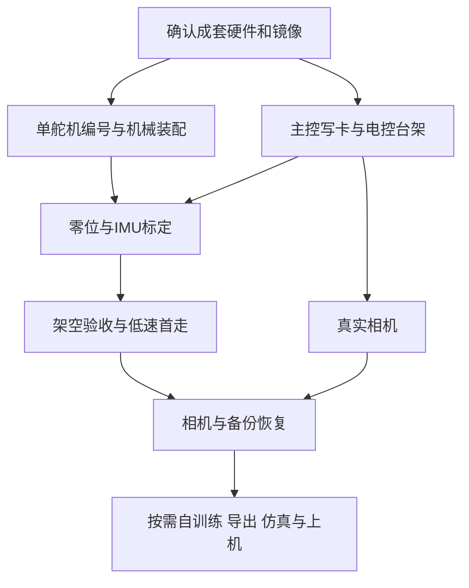

# Microduck
目标：沿 fanhao 飞特 HD1910 主线，以最短路径完成遥控行走和真实摄像头；云端自然对话列入扩展阶段，并保留后续训练与恢复能力。

| 现在要做什么 | 直接打开 | 当前状态 |
|---|---|---|
| 在 Windows 浏览器看鸭子的训练动作 | [Jetson 鸭子训练效果](http://192.168.55.1:8080/) · [联合训练与动作预览](#联合训练与动作预览) | 点 **Checkpoints → Use Latest** 切到最新已保存权重 |
| 打开电脑本地的调试网页 | [舵机调试台](http://127.0.0.1:8080/) · [Studio 演示](http://127.0.0.1:18080/) · [自启设置](#08_local_web) | 舵机调试台接 COM10 时可读实机，18080 是 Studio 演示 |
| 先看全局：现在在哪、先做什么、再做什么 | [复刻总路线](00_notes/00_复刻总路线.md) · [最新实机联调进度](#2026-11-14-实机联调) | 台架已确认 15 颗；ZERO 可达性有波动，HAT 总线待验 |
| 第一次了解，全程照着执行 | [装配、安装、标定与首走](00_notes/02_分阶段复现指南.md) | 新手主指南，按阶段顺序执行 |
| 买什么、已有多少 | [唯一 BOM 主表](00_notes/01_BOM表.md) | 2026-11-13 更新主控到手、音频候选和首启网络状态 |
| 当前装配照片与主控订单 | [装配照片](00_notes/evidence/20261110/assembly_progress.jpg) · [主控已发货](00_notes/evidence/20261110/zero3w_shipped.png) | 原图已归档；不据机械外观认定标定和通电通过 |
| 当前摄像头装不进眼圈，找哪两个模型 | [摄像头面板与眼圈修改](#摄像头面板与眼圈修改2026-11-10) | 源文件已定位，眼圈分面已由 API 核实；用户自行修改，尚无改件或打印验收 |
| 滑轮鞋文件与补打数量 | [文件说明](01_mechanical/roller_skates_kissqy_20261107/README.md) · [ZIP](01_mechanical/roller_skates_kissqy_20261107.zip) | 上壳与支架已提交，审核为“有问题”；薄壁、收缩与缺损风险待处理，付款未知 |
| 多个作者的资料放哪、VS Code 如何拉取 | [作者仓库与 VS Code 拉取](#作者仓库与-vs-code-拉取) | 按作者与仓库分目录；直接使用 VS Code 或 Git，不需要额外更新脚本 |
| 四个机械目录如何区分、SW 为什么有警告 | [机械资料与打开入口](#机械资料与打开入口)、[CAD 检查结果](#cad-检查结果2026-10-29) | 目录用途已核对；原包完整，但部分零件存在几何异常，尚未修复 |
| 下载了哪一版 | [版本锁定与下载状态](90_sources/fanhao_20261024/版本锁定.md) | 固定源码、镜像、运行端与校验分别记录 |
| 走路、倒地恢复等文件究竟齐不齐 | [完整性与动作清单](00_notes/06_复现完整性与动作清单.md) | 10个成品模型全部在本地；源码/训练入口/本机验收分别列明 |
| 摄像头、录放音和自然问答 | [独立云对话指南](00_notes/07_摄像头与独立云对话指南.md) | 扩展阶段，首走后再做 |
| 当前训练、命令、看曲线与动作 | [联合训练与动作预览](#联合训练与动作预览) · [训练与迁移指南](00_notes/08_训练导出与迁移指南.md) | 2026-11-11 已启动 Jetson HD1910 四动作联合训练，实机部署待验收 |
| 实物标定和验收记录 | [标定与验收记录](00_notes/03_标定与验收记录模板.md) | 15 颗舵机 ID 与保护断电复核通过，下一步核对实物关节和方向 |
| 团队新版舵机标定引导程序 | [中控下载页](https://www.wwntai.com/products/microduck-console.html) · [到货后核对事项](00_notes/02_分阶段复现指南.md#i-按网页上手清单完成本机标定) | 已登记团队通知；等主控到货后再核对与操作，见 K123 |
| 为什么以前有另一套建议 | [历史结论 K1–K68](90_archive/notes/13_历史路线与结论归档.md) | 完整保留，旧路线不作为当前操作入口 |
| 旧选型、问价与参考资料 | [历史笔记](90_archive/notes/) · [参考资料](90_archive/references/) | 已集中归档，当前采购以 BOM 为准 |

## 基准与结论

### A. 现在就用哪一套

| 层 | 选定主线 | 仍须核实 |
|---|---|---|
| 主项目 | [fanhao375/microduck-replica](https://github.com/fanhao375/microduck-replica)，固定资料提交 `915ed8364650dff317d9b80760ee632fa4b1c9ed` | 实际上机后形成独立验收基线 |
| 机械 | 已购飞特 HD-1910-C001 ×15、打印件和普通脚底；CAD v2.2作对照 | 螺丝、线束及装配验收 |
| 主控 | ZERO 3W，1GB RAM、无 eMMC、带排针；已到手并从 `20261027` 镜像启动出 `Microduck-9c2a` 热点 | PCB/Wi-Fi 批次、HAT 供电、舵机/IMU 实机识别和 Studio 验收 |
| 电控 | 人人可做机器人 HAT＋IMU＋HUB 已下单；IMU 已有到手照片 | IMU 板形与原参考板不同，芯片、固件及适配未验收；HAT/HUB 最新收货状态未确认，详见 BOM |
| 金属结构件 | 原成品套件订单保留；另研究过原图 CNC 加工，截图为询价 | 未确认成品收货或 CNC 付款，不把加工报价当作已下单 |
| 系统 | fanhao `20261027`；Studio网页 `:8000`；行走运行时、模型与 IMU 核心沿用 `20261023c` | 新卡首次使用、软件升级/回退尚无真机验收；首走后评估新增功能 |
| 系统卡 | 闪迪 Ultra 64GB microSD，A1，已写入作者 `20261027`；ZERO 已启动并开出热点 | 首启扩容、Studio 实机访问和配网验收；保留 `20261023c` 作为回退镜像 |
| 首走模型 | 镜像配套 HD1910 模型 | 完成本机零位、IMU和分级验收 |
| 扩展：云对话 | 板端客户端＋HAT音频＋Wi-Fi云服务 | 上游没有该功能，首走后单独做 |

**机械主体已装起，ZERO 已写卡并联网，15 颗舵机已在微雪台架确认。** 当前核对 ZERO Studio 访问稳定性及 HAT 装机总线；机械零位、IMU 和首走尚未验收。真机首走优先采用配套成品模型；ToF、轮滑、花式动作、摄像头和自然对话留到首走后。



### B. 现在先做什么

1. 等待已发货的 ZERO 3W 到货，核对 1GB、无 eMMC、排针及 PCB/Wi-Fi 批次，V1.12J 线索见 K115；不重复采购主控。
2. 对照当前装配照片检查关节活动、螺丝、走线和承托；照片不能证明已完成编号、归中或标定。
3. 用 Bus Servo Adapter (A) 核对 15 颗舵机 ID 并保存读回结果，ID 见 [02 指南 D1](00_notes/02_分阶段复现指南.md)。
4. 核对已到手 IMU 的板号、方向与固件，以及 HAT/HUB 的到货与接口；未核实前不沿用其他板型的安装和接线参数。
5. 补打件按 BOM 的 2026-11-10 计划处理；普通脚底首走与滑轮鞋作为不同机械配置分别验收。

装配到首走的顺序：机械装配 → 电控装入但**不封头壳** → 写卡、首次通电，只确认网页可进、IMU 被识别、15 颗舵机扫到 → 封壳 → 网页清单（零位、IMU 方向、写入、手柄、急停）→ 低速首走 → 整卡备份。依据见 K115。

### C. 文件夹怎么用

同级先目录后文件，按名称排序。原始快照不修改；新增当前资料单独固定版本。

```text
Microduck/
├── 00_notes/                         7份常用笔记与实物证据
│   ├── evidence/                    订单、装配及实物原图
│   ├── 00_复刻总路线.md              当前阶段与下一步
│   ├── 01_BOM表.md                  唯一采购与备料主表
│   ├── 02_分阶段复现指南.md          装配、烧卡、标定与首走
│   ├── 03_标定与验收记录模板.md      本机实测记录
│   ├── 06_复现完整性与动作清单.md    模型与动作能力边界
│   ├── 07_摄像头与独立云对话指南.md  音视频扩展
│   └── 08_训练导出与迁移指南.md      自训练与迁移
├── 01_mechanical/                   CAD、打印、装配及原始下载
│   └── original_downloads/          原根目录支架、装配BOM和上手PDF
├── 02_feetech/                      固定源码、镜像和运动模型
├── 07_upstream/                     按作者存放的可拉取仓库
├── 08_local_web/                    正在使用的本地网页与自启环境
├── 90_archive/                      旧选型、问价与参考资料
│   ├── notes/                      9份历史笔记与视频索引
│   ├── references/                 原03官方、04备选、05厂家、06语音参考
│   ├── before_20261110.zip          整理前本机笔记及导航备份
│   └── migration_20261110.json      移动对照与原始文件SHA256
└── README.md                        总入口与工作记录
```

旧来源中的 README 保持原样，不向原始仓库插入本机步骤。细节只在对应主表/指南维护；本 README 记推进状态，不重复全部命令。

#### 作者仓库与 VS Code 拉取

| 仓库 | 打开位置 | 分支与远程 |
|---|---|---|
| 本机整理仓库 | 项目根目录 | `main`；`xlx2730109-code/Microduck` |
| fanhao 作者主仓 | [07_upstream/fanhao375/microduck-replica](07_upstream/fanhao375/microduck-replica/) | `master`；`fanhao375/microduck-replica` |

`07_upstream` 只保存 `作者名/仓库名` 结构的作者仓库。额外更新脚本已删除，作者仓库中的 `.git` 保留；原有历史快照继续在原处，不改本机固定复现版本。

1. VS Code 选择“文件 → 新建窗口”，再选“文件 → 打开文件夹”，打开上表的作者主仓目录。
2. 按 `Ctrl+Shift+G` 打开源代码管理，确认当前仓库是 `microduck-replica`，分支是 `master`。
3. 在源代码管理的 `…` 菜单选择“拉取 / Pull”。该仓库已设置跟踪 `origin/master`，并配置只允许快进更新。
4. 后续可从 VS Code 的“打开最近的项目”再次打开这个作者目录，然后执行拉取。

若希望在同一窗口查看多个仓库，可用“文件 → 将文件夹添加到工作区”加入作者主仓；操作前在源代码管理的仓库列表选中作者仓库。仅在根目录展开作者文件夹，不代表 Git 操作已切换到作者仓库。

在根项目的 VS Code 终端中，也可明确指定作者仓库拉取：

```powershell
git -C .\07_upstream\fanhao375\microduck-replica pull --ff-only
```

“同步更改”包含先拉取、再推送；只获取作者更新时选择“拉取”。`git pull` 仅更新仓库跟踪的文件，不自动下载 Release 镜像、CAD 压缩包或其他仓库。操作依据：[VS Code 仓库与远程说明](https://code.visualstudio.com/docs/sourcecontrol/repos-remotes)。

#### 机械资料与打开入口

| 文件夹 | 内容 | 用途 |
|---|---|---|
| [author_tips_20261024](01_mechanical/author_tips_20261024/) | 作者补充的零位支架 STEP、3MF、实物照片和装配提示 | 打印零位支架、辅助标定；不是整机模型 |
| [cad_v2.2](01_mechanical/cad_v2.2/) | 已解压的飞特版 SolidWorks 模型，以及 13 个改动件 STEP | 查看三维装配、量尺寸和研究零件；修改前先处理下述几何异常 |
| [microduck-replica-cad](01_mechanical/microduck-replica-cad/) | 作者仓库资料快照，含装配 PDF、组件图、BOM 和打印工程 | 查装配说明、爆炸图，或准备切片打印 |
| [releases_v2.2](01_mechanical/releases_v2.2/) | 原始 SolidWorks 与改动件 STEP 的 ZIP 包 | 下载备份；对应解压内容位于 `cad_v2.2` |

1. 查看完整三维装配，使用 SolidWorks 打开 [00-microduck装配体-FT2026.9.23.SLDASM](01_mechanical/cad_v2.2/SolidWorks-FT2026-10-20/00-microduck装配体-FT2026.9.23.SLDASM)。文件名保留 `2026.9.23`，所属发布包为 `2026-10-20 / v2.2`；保留整个同级零件目录，不能只复制总装文件。
2. 查看通用交换模型，打开 `cad_v2.2/STEP-changed-parts-FT 2026-10-20/`。该目录只有改动件，不是完整整机；STEP 不保留原 SolidWorks 特征历史与装配配合。
3. 切片打印，使用 Bambu Studio 打开 [飞特版打印工程](01_mechanical/microduck-replica-cad/打印/microduck-飞特版-BambuStudio2026-10-20.3mf)，按具体零件核对 PLA、TPU 与打印参数。
4. 零位支架使用 [zero_position_jig.3mf](01_mechanical/author_tips_20261024/zero_position_jig.3mf)；作者仅验证了下半部，不能将未验证部分作为标定依据。

`FT` 表示飞特 HD-1910 版；原版 XL330 的舵盘配合件不能直接混用。本机机械沿用机械行者 Robo / fanhao 版本；采购其他来源的电控板与金属结构件不会自动切换机械版本，板卡孔距、电池仓和固定件仍按实物核对。

#### 摄像头面板与眼圈修改：2026-11-10

| 图片中的零件 | SolidWorks 源文件 | 当前处理 |
|---|---|---|
| 灰色面板 | [face_part_面部零件-FT.SLDPRT](01_mechanical/cad_v2.2/SolidWorks-FT2026-10-20/face_part_面部零件-FT.SLDPRT) | 用户已确认目标零件；是否需连同眼圈扩孔由实物配合决定 |
| 黄色眼圈 | [noenoeil_眼睛-FT.SLDPRT](01_mechanical/cad_v2.2/SolidWorks-FT2026-10-20/noenoeil_眼睛-FT.SLDPRT) | 用户自行修改；建议另存副本，保留原件对照 |

实物问题见[摄像头与眼圈照片](00_notes/evidence/20261110/camera_lens_fit.png)：用户反馈镜头无法穿过现有孔；镜头最大外径、所需孔径与打印配合间隙尚无测量记录，不能按照片估尺寸。

| 只读检查项目 | 结果 |
|---|---|
| API 连接 | SolidWorks 官方 interop，强类型 C# 通过 COM 读取活动眼圈文档 |
| 几何 | 1 个实体，324 个面全部为平面；圆柱面与圆锥面均为 0 |
| 判定 | [SW 截图](00_notes/evidence/20261110/eye_facets_sw.png)中的分段对应真实平面几何，不能靠显示精度变成解析圆面 |
| 文档保存状态 | 读取前后 `GetSaveFlag=False`；本次未编辑、重建或保存模型 |
| 其他版本 | 本地未检出另一份光滑眼圈 SW/STEP；同名 STL 不代表存在解析圆面，也未据此承诺其他作者没有该模型 |
| 当前交付 | 已提供两个原始零件位置；未生成扩孔副本、光滑重建件、STL 或新打印订单 |

用户已明确“找出模型即可，我自己先修改”。后续路径：实测尺寸 → 用户另存并扩孔或重建 → 核对面板配合、台阶与剩余壁厚 → 导出 STL、检查单位与比例 → 少量打印验配。仅扩大内孔时可用圆形草图切除；内外圈均需光滑时可按原安装尺寸重新拉伸或旋转建模。改件和试装通过前，不登记为已修复或已打印。

#### CAD 检查结果：2026-10-29

| 检查项 | 结果 | 含义 |
|---|---|---|
| 原 ZIP 与本地解压内容 | ZIP 内 90 个文件均存在，逐文件 SHA256 一致 | 本轮未发现解压遗漏或内容损坏；不等于作者原 CAD 没有问题 |
| 活动装配与环境 | 上述总装；SolidWorks 2025 SP4.0，API Revision `33.4.0` | 通过 COM API 读取，不依据截图推断错误原因 |
| 组件引用 | 87 个实例对应的本地文件全部存在 | 当前不是大面积缺少本地引用文件 |
| 总装“出错什么” | 10 条，API 均标为警告，错误码 `1 / swFeatureErrorUnknown` | 为子组件警告汇总；不能把通用错误码当作具体根因 |
| 几何检查 | 按路径与配置去重，检查 41 组零件/配置、403 个实体；16 组检出异常，共 64 条几何故障记录 | 使用支持轻化组件的 `GetBodies3` 和 `IBody2.Check3`；不是全装配配合或运动验收 |
| 模型保护 | 总装与首轮已加载文档检查前后 `GetSaveFlag=False`；未调用重建、修复或保存接口 | 原 CAD 文件未由本轮诊断修改 |

几何异常分布如下。故障数量是 API 返回的故障记录数，不是需要购买或重打印的零件数量。

| 零件文件 | 故障记录数 | 检查结果 |
|---|---:|---|
| `3D_wire_hub_PCB_2026-10-19.SLDPRT` | 1 | 边的端点相触 |
| `foot_left_左脚-FT.SLDPRT` | 3 | 面自相交 |
| `foot_right_右脚-FT.SLDPRT` | 3 | 面自相交 |
| `hip_l_髋部左-FT.SLDPRT` | 6 | 面与面不一致 |
| `jaw_下巴-FT.SLDPRT` | 5 | 面自相交、边的端点相触 |
| `jaw_soft_软下巴-FT.SLDPRT` | 6 | 面自相交、环不一致、边的端点相触 |
| `left_shell_左壳-FT.SLDPRT` | 4 | 面与面不一致 |
| `left_upper_leg_左上腿-FT.SLDPRT` | 6 | 面与面不一致 |
| `leg_腿部-FT.SLDPRT` | 2 | 面与面不一致 |
| `np_f970_NPF970电池-FT.SLDPRT` | 3 | 面自相交；文件名沿用旧命名，不能据此采购 F970 |
| `right_shell_右壳-FT.SLDPRT` | 6 | 面与面不一致 |
| `right_upper_leg_右上腿-FT.SLDPRT` | 1 | 面自相交 |
| `soft_mouth_top_软嘴顶部-FT.SLDPRT` | 3 | 边的端点相触 |
| `sole_left_左脚底-FT.SLDPRT` | 3 | 面自相交 |
| `sole_right_右脚底-FT.SLDPRT` | 6 | 面与面不一致 |
| `top_head_shell_头部上壳-FT.SLDPRT` | 6 | 面与面不一致 |

已加载的髋部、小腿、右上腿零件，其“输入1”导入特征带警告，同时实体检查检出上述异常；这说明问题涉及导入几何，不能只靠关闭警告显示处理。其他轻化组件的特征历史、全部配合和重建后的状态尚未完整检查，不能宣称没有配合错误。

当前可结合总装缓存外形、组件图和 PDF 研究装配；精确布尔修改、可靠体积/惯量计算和 URDF/USD 导出前，应在独立副本逐件诊断、修复并验证。STEP 也不保证自动消除原几何问题；打印 3MF 的网格有效性须单独检查，本轮不据 CAD 警告直接否定已购打印件。

依据：本地原始 ZIP、SolidWorks COM 只读诊断，以及 [SOLIDWORKS 几何错误码定义](https://help.solidworks.com/2024/English/api/swconst/SolidWorks.Interop.swconst~SolidWorks.Interop.swconst.swFaultEntityErrorCode_e.html)。临时诊断 JSON 位于 `E:/HuanCun/AI_tmp/GPT/tmp_20261029_microduck_sw_audit/`，与正式模型隔离。

### D. 必须记住的边界

| 项目 | 当前结论 | 后续怎么做 |
|---|---|---|
| 已购 BMI160 | 不是所选软件支持的直接躯干替换件 | 退货或独立开发备件，实际处理后更新BOM |
| 已购 VL53L8CX | 芯片受支持不等于长板装得进脸壳 | 量尺寸与孔距，ToF后做 |
| 微雪 Adapter A | 没有板载稳压，官方标板卡承载上限5A | 单舵机调试按实物针序；不承诺整机峰值供电 |
| 新版PCB | 主仓 `hardware/新版/` 仍标尚未打样 | 先买有测试证据的成品，不自行承担新板开发 |
| 摄像头 | 镜像默认测试画面 | 切实采后观察真实场景 |
| 自然对话 | 不随运动镜像自动具备 | 按07指南完成客户端与实体触发 |
| 自训练 | 现有模型首走不需要先训练 | 基线后按08指南，训练和真机验收分别记录 |
| 保护行为 | 本版摔倒不自动卸力，低电压不自动关机 | 承托下实测卸力和电压警告处理 |
| 资料完整性 | 全文件哈希通过不等于真机通过 | 本机装配、电控、运动、音视频逐级验收 |

### E. 固定结论与来源

K1–K68 原编号、原结论和相关过程已移至 [历史归档](90_archive/notes/13_历史路线与结论归档.md)，不删除已核实资料。以下只增加编号。

- **K69**：2026-10-24 用户明确指定按 fanhao 项目全盘整理，当前执行路线切换为 `20261023c` 镜像与其 Studio；旧 R1/V167保留参考，不再混用操作步骤。
- **K70**：用户本轮确认主控、HAT和躯干IMU都还没买；微雪调试板准确型号为 `Bus Servo Adapter (A)`、数量1。已同步BOM B006/B015–B017，不计为新增第二块。
- **K71**：系统卡本轮首选改为 Samsung PRO Plus 128GB、`MB-MD128SA` 系列、A2/U3/V30/UHS-I、2张，原 Endurance 优先建议降为备选；64GB仍足够，容量升级是项目余量建议而非最低门槛。来源：三星规格、Radxa说明、作者首次使用记录；本机未测试卡速。
- **K72**：当前源码提交 `915ed8364650dff317d9b80760ee632fa4b1c9ed` 的1095个文件全部与GitHub树的Git blob SHA1一致；复用947个相同文件、下载148个变化文件，保留旧快照，未执行仓库代码。来源：`90_sources/fanhao_20261024/source-tree.json`。
- **K73**：镜像5份小附件已与发布方SHA256一致；此前完整镜像下载失败的状态已由K82更新，详情见 [版本锁定](90_sources/fanhao_20261024/版本锁定.md)。
- **K74**：零基础执行方案现已明确15舵机ID、Adapter A单颗调试、分集装配、写卡配网、标定、手柄、卸力和首走验收；HAT具体发货版本未知，逐针接线图必须取得实物资料后定稿。
- **K75**：Training Studio选用主仓配套版，端口8093；真实训练与演示分开，关闭训练台服务会停止其拥有的子进程。模型部署使用同次导出的身份与合同，不能把一个ONNX视为完整恢复包。来源：固定提交训练台与MODEL_IMPORT说明。
- **K76**：首版语音保留 Linux 客户端调用云服务的方向；客户端架构/声卡、激活、会话触发、自启动、回声和并发均待台架验证，未宣称主仓自带自然对话。来源：07指南及归档客户端文档。
- **K77**：从本地原始FT6发布包解出86个模型相关文件，单独整理10个成品ONNX及元数据，10个权重SHA256全部与fanhao 20261023c模型清单一致；不能把测试夹具ONNX计为动作模型。依据：`90_sources/fanhao_20261024/model-audit.json`。
- **K78**：补齐镜像对应runtime提交`0791fcd44f71c705dc8bb0fbcde405593b52d19b`的1948文件，以及模型manifest标注上游训练提交`8d0db74916a4f833d1d9b95d6a1d7f4d13b9d5ec`的241文件，全部Git blob核验一致；旧快照未覆盖。
- **K79**：普通脚底walk权重是VelStand行走/保持/倒地恢复联合策略，不能只将倒地恢复归到轮滑；sitstand坐站与roller/standup轮滑起身是另外的动作。恢复能力范围须在本机分别验收，不能由模型名或元数据承诺任意倒姿自动起身。依据：独立模型manifest/model-info与runtime联合恢复路径。
- **K80**：当前fanhao明确HD1910任务入口包括平地/地形行走和实验性平衡；其他上游动作代码存在不代表全部已转换为同套HD1910配方。这10个成品模型对应完整PT检查点未取得，第三方依赖也未全部离线封装，不能宣称所有动作可离线一键重训或从作者轮次续训。
- **K81**：2026-10-24本机只读`nvidia-smi`读到RTX5080、16303MiB显存、驱动610.47；WSL列表查询12秒超时，安装状态待核。当前训练建议Windows＋WSL2 Ubuntu，未安装/重置系统、未运行GPU训练。依据：本轮只读查询、08指南及微软/NVIDIA说明。 此条保留历史判断，当前状态由 K124 更新。
- **K82**：2026-10-24分段补齐完整20261023c镜像，大小712068864字节、整文件SHA256与发布方一致；已清理临时分片。当前主仓、runtime源码、训练资料、10个成品模型与完整镜像已在本地，但不等于全部第三方依赖离线封装、作者PT已取得或本机动作已验收。
- **K83**：仅用现成模型复刻时，电脑端可全程Windows；机器人运行Linux镜像，不需先搭Ubuntu训练环境。自行训练的当前路径仍为Linux/WSL2，纯Windows原生兼容未验证，不能承诺可全程照抄。Ubuntu不是唯一Linux发行版；不愿本机WSL时可用Windows管理远程Linux GPU执行端。依据：项目训练README、08指南及mjlab上游FAQ；本轮未安装/适配环境。 此条保留历史判断，当前状态由 K124 更新。
- **K84**：用户再次核对作者BOM的64GB要求后，明确按64GB采购即可，原128GB和2张卡仅为余量/恢复建议，不是复现硬需求。闪迪Extreme 64GB的A2/U3/V30/UHS-I规格已查原厂资料；截图店铺授权、实际SKU和成交价未核实，未登记已下单。K71的128GB优先建议由本条更新；容量不增加RAM或改变行走模型。
- **K85**：2026-10-24核对上游：master最新提交仍为`915ed836`，最新发布仍为`20261023c`，与本地固定版本一致；上游issue中无公开的拼团渠道说明，HAT、IMU和触点板的拼团只能经微信群联系，群二维码2026-10-31前有效。来源：GitHub API、主仓README。
- **K86**：作者2026-10-23版BOM与10-20版相比仅补填价格：HAT 120元、IMU 80元、舵机95元/个、触点板20元、电池17元（合计47）；HAT、IMU、舵机、触点板均标“可拼团”。来源：两版xlsx逐行比对。
- **K87**：作者BOM比对出本机BOM原先缺的项：2.5 mm香蕉插头、M2.5自攻螺丝、乐泰243、M3螺丝，已补为B035–B038；触点板（banana PCB）是B019的组成部分。作者表中的URT2、6×12×3轴承及轮滑件不需购买。
- **K88**：作者群聊照片中的舵机铭牌为`HD1910M`；用户2026-10-24确认HD1910M与已购HD-1910-C001是同一款，文档统一写HD-1910-C001。瑞莎官网ZERO 3W页面（P5）的全部配置选项呈灰色，作者表中的ZERO链接价309元，库存未核实。
- **K89**：上游固定提交`915ed836`全文检索没有语音识别、大模型或云端对话代码，只有HAT音频芯片、官方声音包安装步骤及摄像头/ToF页面。用户要求与上游一致，首版因此不含自然对话，列入扩展阶段，不阻塞首走；用户2026-10-24已确认。来源：对上游源码与文档的关键词检索。
- **K90**：2026-10-24按用户要求删除`02_feetech/microduck-replica/`（10月22日旧快照，提交`813639d6`）。删前核对：988个文件的Git blob哈希与记录一致，无本地修改，无新快照没有的文件；其中41个文件在新快照中是更新后的版本。笔记链接已改指向`microduck-replica_20261024/`；`90_sources`下哈希清单保留为来源记录，`file_inventory.json`中对应条目标为`removed_2026-10-24`。
- **K91**：2026-10-24用户提供第三方电子书 `unitclaw.github.io/microduck-wwduck`（万物拟态机器人，基于fanhao方案），其官网商城 `wwntai.com/parts.html` 标现货7天内发货：ZERO 3W 2GB无eMMC带排针 ¥385、Radxa Camera 8M 219 ¥180、扬声器 ¥5.9、标准件套装 ¥99（含轴承、M2/M2.5自攻螺丝、乐泰243、防滑垫，与作者BOM一致）；imu_to_dxl板与banana PCB标“即将上线、价格待定”；页面HAT只有无关的ZERO 3E PoE HAT，无电池触点板。付款为支付宝扫码转账并手填单号，页面未写退换货政策，未核实卖家资质。来源：商城页面与PARTS.md，本机未下单。
- **K92**：2026-10-24通读第三方电子书的配件、装配、硬件、镜像、标定章节及BOM、故障附录，并比对其配套仓库`UnitClaw/microduck-wwduck`与本地固定源码：其源码基于更早的fanhao版本，缺少`20261023c`的模型管理、传感器与总线IMU自动识别等文件；书中硬件与操作内容与fanhao实际方案不符（IMU写MPU6050/ICM20948而实际为LSM6DSV16X总线板，舵机ID写1–15而实际为10–14/20–24/30–34，供电写2S/3S配BMS而实际为NP-F550，镜像文件名与标定命令均与实际不一致）。结论：该书只作商城信息和方法论参考，装配、接线、标定一律以fanhao固定源码和镜像为准。未读章节为仿真、BAM、域随机化、训练、任务拓展等，与首走无关。
- **K93**：2026-10-24评估fanhao方案与官方原版的差异：舵机力矩约2.5倍但满电8.4 V贴近额定上限；舵机动力学借用陆吾参数、质量惯量沿用XL330版值、IMU板为逆向重绘；作者实机记录为已稳定行走，转向偏弱、偶发重启、抬脚不足，倒地恢复和其他动作本机均未验证；镜像不含官方的手机应用、OTA、目标检测等。全部结论与遗漏项G1–G8见[方案评估与核对记录第七、八节](90_archive/notes/15_方案评估与核对记录.md)；其中“推测”项无实测。
- **K94**：电池触点板banana PCB可自行在嘉立创下单，不必等拼团：`90_archive/references/04_alternatives/microduck-community-kit/hardware/banana_pcb/production/banana_pcb.zip`是KiCad导出的完整Gerber（2层、1.6 mm、外形39.19×6.79 mm、含钻孔与丝印），CERN-OHL-P许可；配套2.5 mm香蕉插头PCB连接器×2，尺寸13 mm、尾部1.5 mm，参考型号U6068，引线正常运行电流3–5 A不宜过细。同一套件还附dxl_hub与imu_to_dxl的Gerber，与fanhao镜像的协议兼容性未核实。注意：fanhao的BOM反推把`banana_pcb_locker`认作imu_to_dxl的固定件，与社区套件说法不一致，装配时以实物为准。该套件为社区项目，非Pollen官方。
- **K95**：2026-10-25用户在嘉立创下单banana PCB：双面板、5片、1.6 mm、绿色、有铅喷锡，页面显示¥21.60包邮，状态为已提交厂方、待发货，订单截图见 `90_sources/purchases/20261025_jlc_banana_pcb_order.webp`。依据K94的Gerber；到货后核对孔径与板厚，并试装打印件。香蕉插头尚未购买。
- **K96**：2026-10-24用户在淘宝补购电池、AMP2.0转接线、香蕉插头、摄像头、扬声器、轴承、自攻螺丝和防滑垫，已登记于BOM的“补购订单”表。两处与本机BOM要求不同，须到货核对：摄像头为DECXIN树莓派Pi5款IMX219 222°广角，非Radxa原厂；扬声器为杜邦公头，须匹配HAT接头。未见乐泰243、TF卡、ZERO 3W、M3螺丝、HAT与IMU板订单。
- **K97**：2026-10-25用户下单闪迪Ultra 64GB（A1）TF卡1张，页面价¥75.69，先用后付，预计10月28日送达，截图见`90_sources/purchases/20261025_sandisk_ultra_64g_order.png`。与K71的建议不同：容量由128GB改为64GB，A2改为A1，2张改为1张。依据：用户决定，64GB满足系统需求，A1对本系统够用；到货后须用H2testw或f3测容量，通过后再写镜像。
- **K98**：2026-10-25 BOM 表改为序号、名称、数量、单价、总价、采购链接六列，按已购、待购、选配分组；价格取自用户订单截图，运费单列，当前合计 ¥2592.97（含套装 ¥1854）。采购链接取自作者 2026-10-23 版 xlsx，仅填价格和店铺吻合的项，ToF 与乐泰因价格不符未填。
- **K99**：自制电控板的可行性：官方 HAT 为 4 层、双面贴装、约 110 个器件，文件齐全；上游自述“打样贴片一次上千块，很多人觉得划不来”，并提供不打 HAT 的替代方案（降压模块加半双工转接板飞线），该方案标注“计划，还没做过”，且无板载音频。imu_to_dxl 有嘉立创工程、固件和 BOM，须贴片并用 ST-LINK 烧录；上游注明旧版舵机座插不进飞特线，新版 1V0A 未打样。依据：官方 HAT 工程、`docs/不打HAT.md`、`hardware/新版/README.md`。
- **K100**：电池：上游与官方均为 NP-F550（2S，6.6–8.4 V），不是 F970；官方软件把 6.6 V 作空电、满电负载约 8.2 V。网上没有查到唯卓仕或各款克隆电池的放电实测，容量标称无法验证；作者采购清单推荐唯卓仕（国标 3C、带电量显示）。上游踩坑记录建议粗短供电线（16–18 AWG）和输入端并联 1000–2200 µF 电容。
- **K101**：2026-10-25核对`codex_意见/`四份报告：对固定源码、镜像、模型哈希和主要缺口（最终板卡未冻结、标定未测、系统辨识用公开参数、训练成果包缺部署合同、旧PDF对应20261021b）的结论与本仓库记录一致；抽查确认`training-studio`代码中没有`deployment-contract`。GitHub搜索到可参考的第三方仓库：`elecsheep1/microduck-isaaclab`（Isaac Lab复现，含`robot_walk.usda`与训练脚本）、`kabilankb/isaaclab-microduck`（自述走路任务未收敛）、`Indigochi1d/microduck_urdf`与`adityakamath/microduck_description`（URDF）；均基于XL330的原版MJCF，不含HD-1910参数，未下载验证。
- **K102**：2026-10-25 用户确认飞特套装的打印件就是机械行者 Robo（fanhao 方案）的版本，没有问题。陆吾 XGO-Duck（Arduino UNO Q 路线）为另一套设计，仓库已存 `90_archive/references/04_alternatives/xgoduck_hardware/` 供参考，其 25 页装配指南逐步标螺丝，但零件不同，只作对照，不当作本机依据；两版舵机 ID 左右相反，以 fanhao 的 ID 表为准。
- **K103**：2026-10-25 上游 master 已领先本地固定提交 9 个，均为文档与图片（README 重排、`BOM/README.md`、`hardware/README.md`、官方更新跟踪、上手指南 V2 的 20261022 版、微信群码），无代码与镜像变化，最新镜像仍是 `20261023c`；上游称“飞特版整机复刻、首次上手与实机运动链路已跑通”。三块自制板仍只有嘉立创 EDA 专业版工程与 STEP，没有 Gerber、BOM，没有打样实测；官方 HAT 的生产文件齐全（D1 版 BOM 52 行共 128 件，坐标 120 行，无编号的 9 行为不贴件、标志与测试点）。本地快照暂不更新。依据：GitHub 比较接口与上游硬件说明。
- **K104**：2026-10-25 决定 HAT 用作者实际使用的 C1 版，已准备嘉立创上传文件 `90_sources/purchases/jlc_hat_C1/`（Gerber 压缩包、BOM 41 行、坐标 114 行，不贴件位号 C25、H2、R10、R11、R16、R17、R41、TP2–TP4、U4 已剔除），尚未上传下单。IMU 的更省事路线：作者 fork 的运行端支持直接把 BNO085 模块接到 HAT 的 J5（JST SH 1 mm 4 针，1 GND、2 3.3 V、3 SDA、4 SCL），作者在真机上用 BNO085 走通过，推荐开陀螺积分姿态；LSM6DSV16X 模块只对模拟总线测过。依据：`Microduck-kissqy_runtime_20261023c/IMU-MODULE.md`。
- **K105**：2026-10-26 用户发现淘宝 kissqy 店“HAT 加 IMU TO DXL 套件”，页面价 ¥119，预售 7 天内发货，包邮，不支持 7 天无理由退货，已售 90，规格选项为 IMU TO DXL 与 HAT。kissqy 仓库 README 与 `hardware/README.md` 都把该商品（id 1095121548583）列为“购买 HAT 主板 / IMU 板（作者提供）”，页面图示为 AMP2.0 飞特舵机接口版，与飞特 15 舵机线束相符；kissqy 文档称成品 IMU 已烧好 FT6 固件，无需重复烧录，镜像 20261023c 支持 FT6。页面价是否含两块板、IMU 是否已刷 FT6、与 20261023c 镜像是否配套，须向卖家确认。BOM 表 HAT 与 IMU 两行链接已改为此商品。
- **K106**：2026-10-26 对比 fanhao 与 kissqy：两者同源，10 个成品模型与 kissqy 发布清单 SHA256 全部一致（本地独立核对）；结论为机械沿用 fanhao，电路板买 kissqy 成品，训练工具阶段二优先研究 kissqy，没有两者同条件实测的优劣数据。kissqy 采购表写明 HAT ¥119、IMU ¥99，同指一个淘宝商品，两项规格，合计约 ¥218，不是套装 ¥119。kissqy 原创部分仅限个人非商业，单位或组织用途需事先书面许可。详见[核对记录第十三节](90_archive/notes/15_方案评估与核对记录.md)与 `90_sources/references/codex_fanhao与kissqy对比_20261026.md`。
- **K107**：2026-10-26 对照 kissqy 采购表更新 BOM：扬声器新增 kissqy 同款 3525 腔体 4Ω3W，自带 1.25 端子；舵机线追加改为同向直通 10 cm ×20 与 20 cm ×10，kissqy 实购 10 cm 与 20 cm 各 30 条；线序为 HAT、IMU 的 AMP2.0 口 1=GND、2=电源、3=DATA，舵机资料为 1=信号、2=VCC、3=GND，板与舵机之间用反向线，舵机之间用同向线，上电前万用表核对。对照表见 `90_archive/notes/14_BOM依据与采购记录.md`。
- **K108**：2026-10-27 用户在淘宝 kissqy 店下单 HAT ¥119 与 IMU TO DXL ¥99 两个规格，实付 ¥218，包邮，不支持 7 天无理由，截图见 `90_sources/purchases/20261027_kissqy_hat_imu_order.png`。商品页说明 IMU 配套固件与 ID 200、1 Mbps，到货后须核对：板版本是否 AMP2.0、IMU 是否已刷 FT6、40 Pin 排母是否已焊、IMU 的尺寸与孔距是否匹配打印件。2026-10-29 用户确认本订单已取消/退款，当前采购由 K112 更新。
- **K109**：2026-10-26 核对 kissqy 在线教程：其整机用 HUB 分电，电池接 HUB 的 CN1，HUB 自带 1000 µF 电容；采购页没有 HUB 的购买链接与价格，须经作者微信确认供货，淘宝上的 HAT 与 IMU 商品不含 HUB。本机采用 fanhao 机械与电池直连方案，HUB 不买；ZERO 须连 5 GHz Wi-Fi 以免与无线手柄干扰。要点见[核对记录第十四节](90_archive/notes/15_方案评估与核对记录.md)。

- **K110**：2026-10-29 核对四个机械资料目录用途，并补充完整总装、改动件 STEP、打印 3MF 与零位支架的打开入口，见 C 节“机械资料与打开入口”；四个目录不是四套不同整机模型。
- **K111**：2026-10-29 通过 SolidWorks COM API 核对引用、特征警告与实体几何，结果见 C 节“CAD 检查结果”；本地文件与原始发布包一致，但存在导入几何异常，未修改或保存 CAD，修复与完整配合验收仍待完成。
- **K112**：2026-10-29 用户提供“人人可做机器人”订单截图，已下单 HAT、IMU、HUB 各 1 件及金属结构件 1 套，共 7 个，均待发货；订单与金额见 [BOM 主表](00_notes/01_BOM表.md#2026-10-29-订单与验收)。用户确认旧 kissqy 订单已取消/退款，本表已替换且不重复计数；K109 的“HUB 不买”决定由本次采购更新。新板卡的具体硬件、固件与整机适配仍待核对，不能继承旧供应商参数。
- **K113**：2026-10-30 建立 `07_upstream/作者名/仓库名` 多作者工作副本目录，已将用户下载的 fanhao 主仓复制并接入 Git；原下载与原有固定源码、CAD、镜像不迁移。接入提交 `0b463c56d9abb649854774a9439f9b863510b643`，1286 个文件复制校验通过，Git 对象检查与实际拉取通过；作者副本可更新，当前复现基线不随之自动切换。
- **K114**：2026-10-30 用户要求只保留作者仓库，已删除额外的批量更新脚本；`07_upstream` 仅保留作者目录。拉取改用 C 节所列的 VS Code 或 Git 方法，根项目的 `main` 与作者的 `master` 分别操作。

- **K115**：2026-10-31 对照作者主仓 `2852bcc` 复核路线。①作者《烧录和第一次使用》以“15 颗舵机 ID 配好、HAT 插好、IMU 在首次开机前接好”为前提，之后才烧卡、配网、走网页清单，与 codex 的“先装全再上电”一致。②最新镜像 `20261027` 的主程序、模型和 IMU 识别与 `20261023c` 相同，新增网页升级与本地语音，作者注明新卡首次使用未真机验收；软件包 `2026.10.31` 含手柄映射学习，只适用已有升级入口的系统。本机首走仍用 `20261023c`，走通并备份后再决定是否升级。③“人人可做机器人”的抖音号 1852366168 与作者 BOM 编制者机械行者Robo 相同；7 个金属结构件与作者 BOM 标“建议铝合金”的 7 件（颈部 2、躯干底座 1、上腿加固板 2、轴承滚轮 2）数量吻合，属推测，待卖家确认。④作者 `hardware/新版/` 的 HUB 未打样，CN1 端子与结构干涉；所购 HUB 的版本和电池接法未知。⑤Zero 3W 2024-11 后批次（V1.12J，Wi-Fi 为 AIC8800）需作者踩坑记录中的 B1 引导方案，见其 `tools/radxa/镜像使用说明.md` 第 6 节。⑥以下无实物不能验证：HAT/IMU/HUB 版本与接线、IMU 固件与镜像配套、TGZ 手柄、主控批次、峰值电流下的供电稳定性。

- **K116**：2026-11-10 用户提供本机装配照片，机械主体已装起并置于支架；部分线束外露。头部最终封装、关节行程、紧固、编号、零位与通电均不能由照片认定通过。照片见首页证据入口。
- **K117**：ZERO 3W 已购并已发货，实际规格为 1GB RAM、无 eMMC、带排针；取代此前未购和容量候选描述。订单号、物流、截图及未确认项统一见 BOM。
- **K118**：补打件与备料计划已整理，打印付款、生产和交付未确认。滑轮鞋原 3MF 为 4 个轮子、2 个支架；本机拟多打备份，数量和截图统一见 BOM。模型文件原样保存，未改 CAD 或 STL。
- **K119**：本机已有 IMU 到手照片，方形四安装孔板、丝印 V1.0A，与部分上游长条双孔参考板不同；不能据同名产品继承安装方向、固件和标定参数。
- **K120**：本地演示网页已配置登录自启和异常恢复，独立环境位于 `08_local_web`，验收范围见该工作包；模拟后端网页可用不等于机器人已联网或已通电。

- **K121**：2026-11-10 按用户确认精简整个项目：常用笔记7份留在 `00_notes`，9份历史笔记归入 `90_archive/notes`；官方、备选、厂家及语音参考归入 `90_archive/references`。根目录支架、装配BOM和PDF移入机械资料目录。移动项逐文件SHA256一致，本机Markdown路径同步更新；固定源码、镜像、作者仓库与网页服务保留原位，未永久删除资料。移动对照及整理前备份见归档目录。

- **K122**：2026-11-10 嘉立创上壳与滑轮支架两单已提交并进入问题确认。工程师要求整体壁厚1.6mm以上、局部不低于1.2mm，提示缺损、变形、层纹、支撑痕及支架收缩风险；这些是审核要求和风险提示，不是本机已测缺陷。此前只完成封闭网格检查，不能据此认定该工艺可直接生产；建议暂不接受全部风险、不盲目加厚功能配合位。订单及问题原图见 BOM 文末。

- **K123**：2026-11-10 用户转发团队通知：针对舵机标定困难，已升级“傻瓜式引导程序”，中控下载入口已登记在首页。用户要求主控到货后再做；本次仅记录，未下载、安装或执行。网页本次未能读取，程序版本、硬件及现用镜像兼容性未核实，不据通知自动更换既定镜像或标定流程。

- **K124**：2026-11-10 已在原生 Windows RTX 5080 与 Jetson AGX Orin 64GB 跑通 HD1910 任务小规模 PPO；用户已在 Jetson 启动平地行走长训。平台、版本、兼容适配、检查点和当前状态统一见 [08 训练指南](00_notes/08_训练导出与迁移指南.md)，不再沿用“训练环境未安装”或“必须使用 WSL2”的旧状态。
- **K125**：Jetson 已实际启用 MAXN 并锁定当前支持的 CPU/GPU/EMC 最高频率；原训练进程未中断。短时提速、后续预览并行时的吞吐及恢复方法分开记录在 08 指南；不能以短时峰值声称长期性能已榨干。
- **K126**：已完成在线非阻塞采样，定位延迟缓存、姿态索引与命令重采样同步热点，并对前两项做隔离组件检查。候选未接入共享框架或当前训练；整体收益与长期行为仍待完整 A/B 验证。
- **K127**：统一训练入口已新增到 Jetson 独立测试目录，支持 `python train.py --task=任务名 --headless`；底层仍为 mjlab/MuJoCo Warp。TensorBoard 已实际打开并显示曲线，动作预览进程正在运行；入口、地址与检查点切换说明统一见 08 指南。

- **K128**：2026-11-10 已定位用户指定的灰色面板和黄色眼圈 SW 源文件，并通过 COM 只读核实眼圈为分面几何；检查数据、实物与 SW 截图统一见 C 节“摄像头面板与眼圈修改”。用户自行修改，目前没有新改件或打印验收结果。

#### 联合训练与动作预览

- **K129**：2026-11-11，Jetson 用 MuJoCo Warp 和 PPO 运行一个进程、一个 HD1910 策略。4096 个环境每种动作 1024 个，原定 5000 轮。四种动作是行走与倒地恢复、坐下与站起、前滚翻、低头拾物。批次目录为 `~/microduck_training_test_20261110/logs/hd1910_joint_20261111_112233`。按用户要求停训，已核验无残留训练进程、训练锁已释放，最新保留权重为 `model_2750.pt`。
- **K130**：Windows 浏览器通过首页的 Jetson 动作预览入口查看本批权重。已核验 HTTP 200、WebSocket 发送鸭子网格，仿真步数从 210 增至 220。预览在独立的单环境里发送 0.20 m/s 前进指令。预览仿真仍由 Jetson 运行。看完可在网页点 **Pause** 暂停预览。
- **K131**：Windows 上的 `127.0.0.1:8080` 对应本机舵机调试台。Jetson 上的 TensorBoard 使用 6006 端口显示训练曲线。用户要看训练出来的步态时，先核对目标批次及检查点，再使用首页的 Jetson 动作预览入口。
- **K132**：联合策略在原有 61 维观测上加入 4 维动作模式，输出仍为 14 路关节动作。四种动作共用一套权重。4096 环境短测完成一轮 PPO、三次指令切换和权重重载，切换时仿真姿态未被重置。联合配置暂未沿用各单项的独立训练课程。
- **K133**：单场景 4096 环境直接采用单项任务中最高的接触预算 `nconmax=200` 时，Jetson CUDA 分配失败。将共享接触预算改为 `nconmax=80` 后，4096 环境短测通过。长训期间的接触容量和动作质量仍待验收。
- **K134**：两批误启动的四进程训练均已退出。历史目录 `hd1910_batch_20261111_105033` 和 `hd1910_batch_20261111_105042` 中的权重属于各自的单动作任务。停止训练时按项目查全部批次和子进程，区分运行进程和终端残留日志。
- **K135**：旧平地行走权重 `model_1499.pt` 已在独立 MuJoCo 3.6 CPU 程序中播放并核对真实按键日志。沿用 Bennett 的按住移动、松开归零，方向键控制前后和侧移，`6`、`7` 转向。该播放器加载旧平地权重。当前联合权重用本节的 `preview_joint_hd1910.py` 预览。
- **K136**：2026-11-11，联合训练的 TensorBoard 日志显示，关闭网页预览前后抽样每轮耗时约从 15.3 s 降至 12.0 s，缩短约 22%。样本分别为第 110–113 轮和第 120–127 轮，耗时为采样与更新之和。终端 ETA 取全程平均，因此变化滞后。该比较为本批次短时观测。
- **K137**：2026-11-11 联合批次第 155 轮的 TensorBoard 原始日志显示，已结束回合平均 14.19 步，平均奖励从第 0 轮的 -15.43 改善到 -0.64，四组均有非零奖励。第 135–154 轮终止日志主要由 `GroundPick_fell_over` 构成，未见 NaN 终止。合并均值不能代表四组各自的回合长度。拾物失败发生在重置、动作切换还是拾物过程中，仍待分模式诊断。
- **K138**：2026-11-11 对联合批次 `model_2750.pt` 做 MuJoCo 无窗口回放，每种动作 4 个环境、每个 5 s、关闭推扰。以 0.20 m/s 行走指令测试，4/4 保持直立，3/4 位移不足 1 cm，另 1 个移动 33 cm。坐下时躯干最低 11.4–11.6 cm，目标为 6 cm。前滚累计 130–136°，4/4 未完成翻滚。拾物有下蹲，嘴尖离地最低约 9 cm。该次回放从站立开始，未测主动倒地恢复或连续动作切换。
- **K139**：Jetson 的独立 MuJoCo 3.6 `simulate` 已接入联合场景和 `model_2750.pt` 的 65 维策略。64 组输入的 C++ 与 PyTorch 输出最大绝对误差为 2.4×10⁻⁶。真实窗口日志确认方向键按住／松开及 `Y` 坐下／站起、`R` 前滚、`G` 拾物、`X` 回行走并清零速度指令。按键验证仅覆盖指令切换，动作完成度见 K138。
- **K140**：单策略多动作参考 [DeepMimic §7、§10.2](https://xbpeng.github.io/projects/DeepMimic/DeepMimic_2018.pdf)，采用技能编号、动作相位、参考轨迹奖励和参考状态初始化，并在完整动作周期边界随机切换。另见 [OmniTrack](https://omnitrack-humanoid.github.io/)，先在仿真获得符合机器人动力学的参考，再训练统一跟踪策略。[Microduck 上游](https://github.com/pollen-robotics/microduck_rl/blob/develop/README.md#tasks) 的键盘多动作为多权重热切换。本机联合版关闭了单项课程，按固定顺序每 250 控制步轮换，无参考动作监督。参考轨迹方案尚未在 HD1910 上验证。
- **K141**：本地 `02_feetech/models/fanhao_20261023c/models` 已核对到四种动作的候选 ONNX，具体目录见 [06 动作清单](00_notes/06_复现完整性与动作清单.md)。VelStand、GroundPick、Roulade 的 manifest 标注 HD1910，SitStand 的清单记录 HD1910 训练路径，三者的标签及路径均不能代替实际回放。[Pollen 上游](https://huggingface.co/pollen-robotics/microduck-training) 还发布了对应动作的训练检查点。下一轮先在同一 HD1910 仿真核对输入、关节顺序、动作缩放和闭环完成度，合格轨迹才用于单策略模仿，之后再用 PPO 训练动作衔接。候选权重尚未完成本机回放验收。
- **K142**：2026-11-11 已在 Jetson 的 HD1910 联合任务场景，用 fanhao 复现包的四份独立 ONNX 做 5 s 闭环回放。核对 SHA256、61 维输入、14 维输出、关节顺序和默认关节角。0.20 m/s 指令下行走 3/3 保持直立并移动 57–63 cm，趴倒起身 3/3 在 2.4 s 时已站起。坐站 6/6 躯干降至 6.2 cm 再回到约 12 cm。前滚翻 6/6 经头部接地后站稳，支撑阶段积分角 327–354°。低头 6/6 回站，但嘴尖最低离地 2.8–3.1 cm，仍需验证拾取目标。24 个环境均无重置。此为固定动作的短回放，未采集训练轨迹，也未验收连续切换或真机效果。
- **K143**：Jetson 已新增 fanhao 四份成品权重的独立 MuJoCo 3.6 演示。C++ CPU 推理与四份原 ONNX 在各 32 组输入上对照，最大绝对误差为 1.1×10⁻⁵。真实窗口验证了方向键按住／松开及 `Y` 坐下／站起、`R` 前滚、`G` 低头拾物、`X` 回行走并清零。此入口供查看四份成品的效果，后续单权重训练另见 K141–K142。
- **K144**：未找到同一份 Microduck 权重覆盖本项目指定四种动作的开源实现。[上游推理代码](https://github.com/pollen-robotics/microduck_rl/blob/develop/scripts/infer_policy.py) 在触发技能时切换 ONNX 会话。已找到同一机器人上更接近的 [VelStand 公开训练记录](https://github.com/xinhuagu/my-microduck-journal/blob/main/docs/training-log.md) 和 [本地教师补丁](https://github.com/xinhuagu/my-microduck-journal/blob/main/patches/velstand-local-teachers.patch)，用行走权重热启动一个学生，按倾角选择行走或起身教师，在 PPO 中加入模仿损失。将教师选择扩展到本项目四种动作仍是待验证方案。
- **K145**：备用 Luwu HD1910 拾物权重的默认髋、踝角与当前模型最多相差 0.109 rad。对齐关节参考位和上一拍动作后，在 Jetson 的无物体场景中 2/2 次嘴尖触地，且在 3.6 s 时躯干回到 11.3–11.4 cm。该权重已作为低头拾物教师接入，尚未验证真实物体的夹取。
- **K146**：四教师联合入口 `train_joint_distill.py` 已保存到 Jetson。行走权重热启动一个学生，按当前模式选择老师，交替做 PPO 与模仿更新。首阶段固定分组，保留趴倒、坐姿和滚到中段的训练起始状态。Jetson 4096 环境一轮短测四组均参与更新，模仿误差均下降，单学生权重重载输出一致。首批建议 300 轮，每 50 轮保存，随后按各动作完成度复测，再训练动作衔接。
- **K147**：fanhao 四份成品的 Windows 原生 MuJoCo 3.6 播放包位于 `02_feetech/native_fanhao_win`。与 Jetson 版使用同一套场景和权重。已通过实际 `simulate.exe` 窗口核对方向键按住／松开及 `Y`、`R`、`G`、`X`，动作键需窗口在前台。测试窗口已关闭。
- **K148**：截至2026-11-12，作者最新正式镜像为 `20261027`，适用 HD-1910 + ZERO 3W；其运行时、模型和 IMU 核心沿用 `20261023c`，新增网页升级与本地语音，但作者注明新卡首次使用及真机升级/回退尚未验收。当时先建议用 `20261023c` 建立基线；后由 K149 更新为直接使用 `20261027`。用户确认可清空 G 盘；系统识别为磁盘3、约64GB，现有相机目录及 `MISC/AC002.db` 尚未擦除。
- **K149**：根据作者 20261027 Release 元数据，镜像大小 741,604,104 字节，官方 SHA256 `91ab5550e0f409d634722718a638d6e9615412b779b5d26c0af5c777056d0194`，明确适用于 HD-1910 + ZERO 3W；核心行走运行时、模型、IMU 与 `20261023c` 相同。新增功能尚缺新卡首次启动及真机升级/回退验收，风险主要在新增网页升级和本地语音功能，不改变首走使用的核心策略链。为避免先刷旧版再重刷，首卡选用最新 `20261027`，旧版保留回退。镜像已下载且本机 SHA256 匹配。用户指定自行安装官方 balenaEtcher v2.1.9；安装包大小 274,253,464 字节，SHA256 `3fa63ea453e75c0338f8f1444b511f38decdd002e17922a910aec5e29b85b751`，Authenticode 为 Valid，签署者 Balena Ltd。用户已确认可清空 G 盘，系统识别为磁盘3、约64GB；目前仍未写卡。
- **K150**：2026-11-12 用户在 balenaEtcher 中将 `microduck-replica-20261027.img.xz` 写入 G:，界面明确显示“烧录成功”。写后 Windows 仍识别目标为原 USB SD/MMC 磁盘3（63,864,569,856 字节，Online，非系统盘），并看到一个约3.14GB、无盘符、文件系统类型 Unknown 的镜像分区；该状态符合 Linux 镜像尚未由 ZERO 首启扩容，不能据 Windows 文件系统识别状态判为失败。Etcher 报告成功，但尚未在 ZERO 3W 实机首启、扩容、配网或验证 Studio，因此只确认写卡完成，不代表主控启动/系统功能验收通过。
- **K152**：2026-11-12 手机扫描到 `Microduck-9c2a`，确认 ZERO 3W 已从 `20261027` SD 卡启动并进入首次热点模式。该热点密码为 `microduck`，Studio 入口为 `http://10.42.0.1:8000/`；当时尚未接 HAT、舵机或 IMU，因此没有实机 15/15 或 IMU 通过证据。
- **K153**：用户在 Studio 中将 ZERO 配置到校园网 `web.wlan.bjtu` 后，手机/电脑无法直接访问 `duck-9c2a:8000`；电脑解析到 `duck-9c2a.local = 10.60.120.64`，TCP 8000 受校园网隔离不可达。该网络需要网页登录认证且可能隔离终端，不适合作为首次机器人配网网络。是否已重新烧卡未取得新的 Etcher 完成截图，不能登记为已完成；优先恢复热点或改用普通家庭 Wi-Fi。

在 Windows PowerShell 启动 fanhao 成品演示。

```powershell
& 'E:\HuanCun\Desktop\Microduck\02_feetech\native_fanhao_win\Start-CPU.cmd'
```

在 Jetson 终端启动首批蒸馏训练。

```bash
cd ~/microduck_training_test_20261110 && WANDB_MODE=disabled MUJOCO_GL=egl flock -n logs/hd1910_joint.lock ./venv/bin/python -B -u train_joint_distill.py --num-envs 4096 --iterations 300 --log-dir "logs/hd1910_joint_distill_$(date +%Y%m%d_%H%M%S)"
```

在 Jetson 桌面打开 fanhao 四份成品权重的原生演示。

```bash
~/microduck_training_test_20261110/native_fanhao_cpu_20261111/start_cpu.sh
```

在 Jetson 桌面用独立 MuJoCo 3.6 `simulate` 打开联合权重，点一下窗口后用 K139 的键位试动作。

```bash
~/microduck_training_test_20261110/native_joint_cpu_20261111/start_cpu.sh
```

在 Jetson 桌面打开旧平地权重的独立 CPU 播放器，用于复查此前的走路效果和键位。

```bash
~/microduck_training_test_20261110/native_cpu_20261111/start_cpu.sh
```

在 Jetson 终端前台启动网页预览。看完在同一个终端按 `Ctrl+C` 停止预览。预览占用 Jetson 算力，关闭浏览器标签页不会终止预览服务。此前用 `nohup` 启动的后台预览已停止，已确认 8080 释放且联合训练进程继续运行。

```bash
cd ~/microduck_training_test_20261110 && flock -n logs/hd1910_preview.lock env MUJOCO_GL=egl ./venv/bin/python -B -u preview_joint_web.py
```

在 Jetson 桌面打开原生 MuJoCo，查看最新已保存权重。

```bash
cd ~/microduck_training_test_20261110 && MUJOCO_GL=glfw ./venv/bin/python -B -u preview_joint_hd1910.py
```

在 Jetson 终端启动一批新的联合训练。先核对是否已有同项目训练进程在运行。

```bash
cd ~/microduck_training_test_20261110 && WANDB_MODE=disabled MUJOCO_GL=egl flock -n logs/hd1910_joint.lock ./venv/bin/python -B -u train_joint_hd1910.py --num-envs 4096 --iterations 5000 --log-dir "logs/hd1910_joint_$(date +%Y%m%d_%H%M%S)"
```

#### 2026-11-13 实机台架

- **K154**：Windows 舵机调试台 `http://127.0.0.1:8080/` 通过微雪 Adapter A V3.1、`COM10`、1 Mbps 接实机。右腿 10–14、左腿 20–24、头颈和嘴 30–34 共 15 颗同总线应答。台架采样 191 帧均读到全部 15 颗，电压 6.0–6.3 V。
- **K155**：15 颗 HD-1910 的寄存器 19 已从 4 改为 13，启用过热、过流及过压保护。用户断开并重新接通舵机电源后，逐颗读回 ID 匹配、寄存器 19 为 13、扭矩为 0、EEPROM 锁为 1。
- **K156**：14 号右踝单颗低速试动位置回读 190 → 209 → 191，试动结束回读确认扭矩关闭。整机下一步在承托、关扭矩状态下逐关节手摆，核对实物 ID、方向和线束余量，再按实物基准校零。ZERO + HAT 的 15/15、IMU、承托站姿和首走待验。
- **K157**：用户确认已接回 HAT。fanhao 样机的飞特 TTL 总线经 HAT 三芯口 J13/J14 和 `/dev/ttyS2` 通信，舵机使用 `+BATT` 原压，HAT 另降压为 ZERO 提供 5 V。确认接回 HAT 前的 Studio 截图记录 15 个目标 ID 均无应答、`rx_bytes=0`；接回后尚无有效总线读数。电池取电线、实际输入端子及舵机口电压待核对。依据：[fanhao 硬件入门](https://github.com/fanhao375/microduck-replica/blob/master/docs/硬件入门.md)、[作者调试记录](https://github.com/fanhao375/microduck-replica/blob/master/调试记录.md)。

#### 2026-11-14 实机联调

- **K158**：ZERO 的跨网入口为 [Studio](http://100.97.155.75:8000/)。Windows 实测 Tailscale ping 2/2，经东京 DERP 中继，约 138–164 ms。首轮 `/healthz` 3/3 返回 HTTP 200；随后首页、日志接口和实时 WebSocket 建连均超时。复测时 Tailscale 仍显示主控在线，`/healthz` 连续 3 次在 4 秒内未返回。跨网访问不稳定，超时根因未确定，HAT/IMU 实时状态未验收。
- **K159**：电脑本地[舵机调试台](http://127.0.0.1:8080/)的 HTTP 服务仍响应，但后台仍对 COM10 写入并报 `WriteFile failed / PermissionError(13)`；同期 Windows 仅枚举 COM1、COM8，没有 COM10。接口返回的 15 个 ID 是上次扫描记录。若舵机已转接 HAT，应从 ZERO Studio 验收；若继续使用微雪台架，先恢复 USB 串口枚举，再按当前端口名选口重扫。
- **K160**：HAT 到舵机的三芯线先断电，再按实物两端定义逐脚核对 `DATA`、`+BATT` 与 `GND`。插头能插入及红白黑颜色均不能证明针序正确；本机现有线束是否需要交换外侧两脚，尚无实测记录。

- **K161**：最终接线后经 Tailscale 读到 ZERO Studio 实时状态。主控连接 Wi-Fi `xlx`，局域网地址 `172.20.10.9`。标定模式下 15/15 颗舵机都有新读数，全部卸力。飞特总线 IMU `imu_to_dxl` 正常输出，读取错误为 0，安装方向待验证。舵机零位仍为 0/15。诊断接口返回 HTTP 500，未取得逐颗 ID 和电压。

### F. 分阶段推进

| 阶段 | 操作入口 | 主要完成条件 |
|---|---|---|
| 0. 资料 | 本文、02指南和版本锁 | 固定资料与当前路线 |
| 1. 采购 | BOM、02指南C节 | 成套电控到货且版本明确 |
| 2. 机械 | 02指南D–E | 唯一ID、结构与线束通过 |
| 3. 主控 | 02指南F–H | 正确供电、联网、反馈完整；封头壳前先通电确认 |
| 4. 运动 | 02指南I–K | 本机标定、卸力、低速首走 |
| 5. 首版 | 07指南、08指南G节 | 真实相机、独立对话、并发与恢复 |
| 6. 自训练 | 08指南B–D | GPU短测、正式训练、评估 |
| 7. 迁移 | 08指南E–G | 模型导入、实机复验和回退 |

任务编号沿用原记录，完成后在原处打勾。表内的阶段进度与本机验收独立于文档编写。

#### 阶段0：资料准备

- [x] **T1** 识别原始套件和采购证据，保留历史缺失文件标记。
- [x] **T2** 归档官方、飞特、CAD与厂家资料，选择当前主线。
- [x] **T3** 核对21页装配PDF与采购Excel，记录原表计价问题。
- [x] **T4** 完成固定源码和发布附件的校验；完整镜像状态见版本锁。
- [x] **T5** 完成当前执行、音视频、训练迁移和验收文档。

#### 阶段1：补购与清点

- [x] **T6** 用户确认现有采购、成品优先、摄像头与云对话，并指定fanhao路线。
- [ ] **T7** 跟进已发货主控收货与清点，核对 HAT、HUB、金属件和仍缺成品线；IMU 已有实物照片但适配未验收，按 BOM 原行更新。不重复采购主控或读卡器。

#### 阶段2：机械与舵机

- [x] **T8** 台架逐颗写入并读回 15 个唯一 ID，保护配置通过断电复核。实物安装位置与方向留在 T9 核对，见 K154–K156。
- [ ] **T9** 与主控到货后的装机检查一并完成：核对全部关节行程、螺丝、走线与头部最终装配，不据照片勾选整体完成。

#### 阶段3：电控与系统

- [ ] **T10** 核对实际电源/线序和板卡版本，写卡联网，读通舵机与IMU；封头壳前完成，结果记入验收模板。
- [ ] **T11** 主控到货后先核对 K123 新版引导程序的版本、硬件及镜像兼容性，再确定采用的标定入口；完成本机零位、IMU方向与站姿标定，保存实际配置。当前暂不下载、安装或执行。

#### 阶段4：首走

- [ ] **T12** 完成架空保持、卸力、失联行为和供电验收。
- [ ] **T13** 完成低速前后、转向和停止，保留成功与失败记录。

#### 阶段5：首版

- [ ] **T14** 保存首走系统、模型、标定、配置和版本备份。
- [ ] **T15** 完成真实相机和整机并发，冻结首版基线；云端自然对话列入扩展阶段，见K89。

#### 阶段6：自训练

- [x] **T19** 已建立原生 Windows 与 Jetson 的独立适配训练环境；版本差异和未完成的严格环境冻结见 08 指南。
- [x] **T20** 已完成两端小规模 PPO 短测，报告结果与限制；用户已启动 Jetson 长训。
- [ ] **T21** Jetson HD1910 平地行走训练进行中；继续检查点备份、步态评估和失败场景记录，不能只据奖励或进度判定成功。

#### 阶段7：导出与迁移

- [ ] **T22** 导出ONNX与同次模型合同，核对运行时参数。
- [ ] **T23** 完成PT/ONNX一致性与匹配仿真评估。
- [ ] **T24** 备份旧基线，导入候选并逐级真机复验。
- [ ] **T25** 验证训练环境重建或系统卡恢复，保留新旧版本。

## 已完成

- [x] 2026-11-14：实测 ZERO 跨网访问和 Windows 调试台端口，记录两条链路的状态与验收缺口，对应 K158–K160。
- [x] 2026-11-13：完成实机舵机 ID、整总线扫描和保护断电复核，对应 K154–K156。

- [x] 2026-11-12：Etcher 将官方 `20261027` 镜像写入 64GB 系统卡并报告成功；Windows 确认原磁盘3在线且出现镜像分区，ZERO 首次启动与扩容仍待验收，对应 K150。

- [x] 2026-11-11：验证联合 PPO 及检查点重载，核对 Jetson 网页预览和本机舵机调试台入口，对应 K129–K131。
- [x] 2026-11-11：记录联合配置、接触预算验证、历史批次停止情况和旧平地策略的 CPU 播放入口，对应 K132–K135。
- [x] 2026-11-10：定位相机面板与眼圈源文件，完成眼圈只读几何检查并归档两张问题截图；按用户要求交由用户修改，对应 K128。

- [x] 2026-11-10：同步两端训练实测、Jetson 长训、MAXN 调整、软件分析与统一命令；修正未安装训练环境和 WSL 必需的过时状态，对应 K124–K127。
- [x] 2026-11-10：登记团队新版标定引导程序入口及主控到货后再处理的安排，对应 K123。
- [x] 2026-11-10：完成目录精简、历史资料归档与导航更新，对应 K121。

- [x] 2026-11-10：归档装配照片、主控已发货截图及补打备料计划；更新当前状态、BOM、总路线、执行指南和本机记录，对应 K116–K120。
- [x] **T32** 2026-11-10 已有 ZERO 3W 实际订单，停止重复查库存和备选采购；实价及到货检查并入 T28。

- [x] 2026-10-31：更新作者副本到 `2852bcc`，复核首走路线并补入封壳前通电检查，对应 K115。

- [x] 2026-10-30：按用户要求删除额外更新脚本，清理失效说明链接，并补充 VS Code 拉取方法；作者仓库及 `.git` 保留，对应 K114。

- [x] 2026-10-30：建立作者仓库集中目录，完成下载副本复制校验和 Git 接入，提供统一更新脚本，对应 K113。

- [x] 2026-10-29：按新订单更新 BOM 和当前电控采购状态，登记金属结构件，扣除用户确认已取消/退款的旧订单；结束原 T30、T36 的拼团与自制备选采购任务，对应 K112。

- [x] 2026-10-29：补齐机械目录用途与模型打开入口，完成原包完整性、引用和几何只读检查，记录异常与使用边界，对应 K110/K111。

- [x] 2026-10-22至24：历史调研、采购核对和用户确认保留于历史归档，对应K1–K68。
- [x] 2026-10-24：按用户指定切换fanhao主线，同步微雪准确型号及未购核心件，对应K69/K70。
- [x] 2026-10-24：核对系统卡规格，更新B024并保留替代依据，对应K71。
- [x] 2026-10-24：固定源码逐文件核验，保存发布元数据和小附件，对应K72/K73。
- [x] 2026-10-24：重整总入口与新手执行指南，补充训练迁移及音视频专项，历史结论未丢弃，对应K74–K76。
- [x] 2026-10-24：逐个核对10个模型、补齐镜像runtime和模型指定训练上游源码，区分普通脚底恢复/轮滑起身与训练PT缺口，对应K77–K80。
- [x] 2026-10-24：只读确认RTX5080，补充Windows＋WSL2训练路径并记录WSL查询超时，对应K81。
- [x] 2026-10-24：补齐完整镜像并核对SHA256，同步各处下载状态，清理本轮临时分片，对应K82。
- [x] 2026-10-24：明确现成动作复刻、WSL训练和纯Windows原生训练的不同边界，对应K83。
- [x] 2026-10-24：按用户对原BOM的复核明确64GB足够，核对闪迪Extreme 64GB规格，纠正128GB/两张卡被理解为必需的问题，对应K84。
- [x] 2026-10-24：删除旧replica快照并修正笔记链接，对应K90。
- [x] 2026-10-24：核对上游最新状态与作者10-23版BOM，新建复刻总路线，补入B035–B038，整理作者零位支架资料，对应K85–K88。
- [x] 2026-10-25：登记订单价格与链接，BOM 表改版，新增 .gitignore，对应 K98–K100。

## 待完成

- [ ] **T46** 验收联合策略的动作完成度、倒地恢复和连续动作效果。独立 MuJoCo 的按键切换已验证，见 K138–K139。
- [ ] **T47** 网页预览脚本 `preview_joint_web.py` 已存到 Jetson 并通过内容和语法校验。现有服务仍在运行，下次重启预览时复核固定入口、目标批次和当前检查点，见 K130。
- [ ] 阶段任务统一见F节，不重复登记；主控仍待到货，写卡与舵机/机械检查可并行推进。
- [ ] **T16** 核实作者视频第7/8集的有效发布入口，不编造链接。
- [ ] **T17** Adapter A 照片已确认 V3.1 板体；用户确认缺少图示 DC5521 电源线。可改由绿色 DC+/DC− 端子接独立供电线，但该线/电源目前也未核；ZERO 3W 的 5V/2A USB-C 是主控输入，不作舵机电源。图示 Wheeltec E351S 电池组标称10.8 V、满电12.6 V，不可直连 Adapter A/HD-1910；只有经独立降压并实测输出不超过8.4 V、极性正确后才可考虑。另须核对 USB/舵机连接线、针序与极性。
- [ ] **T18** 到板后完成音频、云激活、实体对话触发、回声/打断和并发验收。
- [ ] **T26** 核实两款已购电池件数、铭牌、尺寸/质量、放电资料与单充适配，不重复买备用品牌。
- [ ] **T27** 确认BMI160退货/开发备件安排，核对VL53L8CX板型与脸壳；未处理前不登记退款/换货。 用户2026-10-25确认本机不使用BMI160，退货与否待定，7天无理由退货期限自收货起算。
- [ ] **T28** ZERO 容量已按订单冻结为 1GB、无 eMMC、带排针；待补成交价、收货、PCB/Wi-Fi 批次及镜像启动结果，见 BOM 第28项。
- [ ] **T29** 在首走与卸力通过且已备份后，按06清单分别验收普通脚底倒地恢复及其他动作；轮滑另配机械和基线，不将一次起身扩大为任意倒姿通过。
- [ ] **T31** 原打印件已进入装配；跟进新增补打件的实际下单、交付与适配，舵机固件仍待读回。
- [ ] **T33** 跟踪万物拟态商城imu_to_dxl板与banana PCB上线时间和价格；评估其ZERO 3W与标准件套装作为淘宝之外的备选，下单前先核实卖家与退换货条款。
- [ ] **T34** 按[方案评估与核对记录](90_archive/notes/15_方案评估与核对记录.md)第八节G1–G8逐项处理：到货前先落实G1（核对ZERO批次）和G2（电池电压提示方案）。
- [ ] **T35** 核对已购 banana PCB、香蕉插头与新 HUB 的电池接入、线束和机械固定配合；核对 HAT、IMU、HUB 版本与镜像兼容性，不重复按旧拼团或自制路线采购。
- [ ] **T38** 对已到手 IMU 核对芯片、固件、接口与安装方向；总线 ID、读序须实测，不混用其他板型参数，见 K119。
- [ ] **T39** 阶段二：自训练前补齐本机辨识、PT 与 ONNX 数值对照、部署合同生成和 sim2sim 回放，见核对记录 C4–C6。
- [ ] **T41** 向“人人可做机器人”确认：HAT 为 C1 还是 D1、40Pin 排母是否焊好；IMU 是否预刷 FT6、ID 200、1 Mbps，安装孔距；HUB 版本与电池接法、有无接线图；7 个金属件的名称与安装位；整套与 `20261023c` 是否实测。卡点：等待卖家答复。
- [ ] **T40** 全套 CAD 几何修复按用户此前“先停”的要求暂停，保留原诊断；恢复须用户另行指示。当前相机面板与眼圈由用户自行修改，见 K128。
- [ ] **T42** 核对补打订单实际成交与材料：截图为白色 PLA-P 上壳、TPU 脚底/轮子、黑色 ABS-ESD 支架；不把材料建议记成已选或已购。
- [ ] **T43** 核对滑轮支架与现有脚部接口、623ZZ 轴承及紧固件；配套左右脚仅附参考，不默认必须重打。
- [ ] **T44** 等用户提供自行修改后的相机面板、眼圈文件或尺寸；核对孔径、安装台阶、剩余壁厚和板件配合后，再导出打印件。
- [ ] **T45** 相机改件先少量打印验配，记录镜头可装入、固定可靠、排线不受挤压及头壳配合；未确认下单、生产或试装通过。
- [ ] **T48** 用 `xlx` 同网地址与 Tailscale 分别核对 Studio 首页和实时状态，确认掉线在跨网链路还是设备侧；核对 HAT 线序与供电，验收 15/15 舵机及 IMU。记录 ZERO PCB/Wi-Fi 批次和文件系统扩容状态。见 K157–K160。
- [ ] **T49** 音频按 B13/B14 二选一核对；确认 HAT 是否带板载麦克风、音频 codec、扬声器接口和实际接头后，再做录音/播放测试。摄像头打印件未到、ToF 未焊接，均延后到首走后。

---

# 08_local_web
目标：电脑登录后自动提供两个 Microduck 本地演示网页，并在进程异常退出后恢复服务。

## 基准与结论

### A. 入口与运行方式

| 对象 | 入口 | 作用 |
|---|---|---|
| 舵机调试台 | http://127.0.0.1:8080/ | 模拟舵机及3D调试展示 |
| Studio | http://127.0.0.1:18080/ | 使用模拟机器人后端 |
| 手动启动 | `08_local_web/Start-Microduck.cmd` | 启动已注册的计划任务 |
| Windows任务 | `Microduck-Local-Web` | 当前用户登录自启，每分钟补启动，运行中忽略重复实例 |
| 运行日志 | `08_local_web/logs/` | `supervisor.log`记录退出、恢复与进程号 |

- **08-K1**：用户于2026-11-10明确确认设置自启；长期服务位于本目录，含独立Python 3.12.14，不依赖旧临时目录或Codex运行时缓存。原机器人源码、CAD和系统镜像未改动。
- **08-K2**：任务以当前用户普通权限后台运行，无执行时限；电池模式允许启动且不终止。网页服务只监听本机回环地址。仍为演示模式，不表示已连接实体机器人。
- **08-K3**：网页子进程退出或连续三次HTTP检查失败时，守护程序重启演示进程；守护程序本身停止后，每分钟的任务触发器负责补启动。单独配置Windows失败重试在本机强制退出测试中未触发，因此不能只依赖该设置。
- **08-K4**：子进程归入带`KILL_ON_JOB_CLOSE`的Windows Job，守护程序被强制结束时一并清理，避免遗留进程占端口。机制依据：[Microsoft Job Objects](https://learn.microsoft.com/en-us/windows/win32/procthread/job-objects)。

### B. 验证结果与范围

| 检查 | 本机结果 |
|---|---|
| 网页子进程故障 | 自动重建进程，约3.22秒后两页和模型资源返回HTTP 200 |
| 守护程序故障 | 原三个子进程全部退出，计划任务约一分钟后自动恢复两页 |
| 页面及资源 | 两个首页、舵机模型JSON与网格、Studio脚本均返回HTTP 200 |
| 自动启动配置 | 已核对当前用户登录触发器、每分钟补启动、普通权限与单实例策略 |
| 尚未验证 | 未重启电脑或注销用户实测登录触发；未进行实体机器人验收 |

- **08-K5**：2026-11-10截图故障前，最近开机时间为2026-11-07；两端口无监听且无演示进程，旧服务没有登录自启任务。独立后台进程不能跨电脑重启保留。
- **08-K6**：首次故障测试暴露了父进程结束后遗留子进程的问题，已按08-K4修正。首次恢复检查夹具因向临时目录写结果时出现`PermissionError`而失败；改用原测试解释器记录结果后完成最终验收，未修改系统安全配置。
- **08-K7**：最终守护程序为`08_local_web/supervise.py`，SHA256：`9ef6e772d47191ab7a8773b8b5cd585a1d9b3ac3992a7f90bd5a5669a811d9dd`。复制阶段1218个文件通过哈希核对，初始服务包约52.6MiB。
- **08-K8**：测试证据保留于`E:/HuanCun/AI_tmp/GPT/tmp_20261110_microduck_autostart/`的`job_cleanup.json`、`scheduler_recovery_final.json`、`child_recovery_final.json`和`final_task.xml`，服务运行不依赖这些证据文件。
- **08-K9**：本机 Git 仅提交网页服务源码和启动入口；独立 Python、运行状态、锁文件、日志及缓存由根 `.gitignore` 排除，仍保留在本机。截图中的提交失败源于 Git 尝试读取服务占用的 `state/supervisor.lock`；修正忽略规则后无需停服务或删除锁文件。

### C. 手动管理

需要手动启动时双击上表中的启动入口。停用自启时先禁用任务，再结束任务，否则补启动触发器可能重新启动服务。

禁用自动启动：

```powershell
Disable-ScheduledTask -TaskName 'Microduck-Local-Web'
```

停止当前服务：

```powershell
Stop-ScheduledTask -TaskName 'Microduck-Local-Web'
```

重新启用自动启动：

```powershell
Enable-ScheduledTask -TaskName 'Microduck-Local-Web'
```

## 已完成

- [x] 2026-11-10：复制并校验长期服务与独立运行环境，保留原演示状态，对应08-K1、08-K7。
- [x] 2026-11-10：注册Windows任务并验证页面、故障恢复与子进程清理，对应08-K2至08-K6。
- [x] 2026-11-10：修正本地网页运行文件的 Git 忽略规则，避免提交时读取运行锁，对应08-K9。

## 待完成

- [ ] **08-T1** 下次用户正常重启并登录后，复核两个网页自动可用；本次未为测试主动重启电脑。
