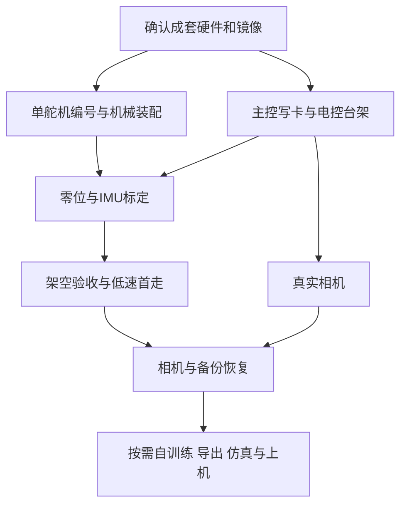

# Microduck
目标：沿 fanhao 飞特 HD1910 主线，以最短路径完成遥控行走和真实摄像头；云端自然对话列入扩展阶段，并保留后续训练与恢复能力。

| 现在要做什么 | 直接打开 | 当前状态 |
|---|---|---|
| 从零到首走的完整路线、待决事项 | [复刻总路线](00_notes/00_复刻总路线.md) | 2026-10-24 新建，先看这个 |
| 第一次了解，全程照着执行 | [装配、安装、标定与首走](00_notes/02_分阶段复现指南.md) | 新手主指南，按阶段顺序执行 |
| 买什么、已有多少 | [唯一 BOM 主表](00_notes/01_BOM表.md) | 序号、名称、数量、单价、总价五列，按已购、待购、选配分组；旧 B 编号见表后对照 |
| 下载了哪一版 | [版本锁定与下载状态](90_sources/fanhao_20261024/版本锁定.md) | 固定源码、镜像、运行端与校验分别记录 |
| 走路、倒地恢复等文件究竟齐不齐 | [完整性与动作清单](00_notes/06_复现完整性与动作清单.md) | 10个成品模型全部在本地；源码/训练入口/本机验收分别列明 |
| 摄像头、录放音和自然问答 | [独立云对话指南](00_notes/07_摄像头与独立云对话指南.md) | 扩展阶段，首走后再做 |
| 如何训练、导出、上机和迁移 | [训练与迁移指南](00_notes/08_训练导出与迁移指南.md) | 首走后按需开展，不挡首次行走 |
| 实物标定和成功/失败记录 | [验收模板](00_notes/03_标定与验收记录模板.md) | 本机全部实测项目仍未完成 |
| 为什么以前有另一套建议 | [历史结论 K1–K68](00_notes/13_历史路线与结论归档.md) | 完整保留，旧路线不作为当前操作入口 |

## 基准与结论

### A. 现在就用哪一套

| 层 | 选定主线 | 仍须核实 |
|---|---|---|
| 主项目 | [fanhao375/microduck-replica](https://github.com/fanhao375/microduck-replica)，固定资料提交 `915ed8364650dff317d9b80760ee632fa4b1c9ed` | 实际上机后形成独立验收基线 |
| 机械 | 已购飞特 HD-1910-C001 ×15、打印件和普通脚底；CAD v2.2作对照 | 螺丝、线束及装配验收 |
| 主控 | ZERO 3W，无 eMMC，已焊40Pin；2GB成套已测款可用，4GB为并发余量候选 | 用户确认未买；交期、批次和镜像兼容 |
| 电控 | HAT＋躯干总线 IMU＋NP-F触点板（HUB 是否需要待向作者群确认） | HAT/IMU 未买，拼团中；实际板号和固件 |
| 系统 | fanhao `20261023c`；Studio网页 `:8000`；runtime `control.44` | 新增总线兼容仍有作者注明的真板验收缺口 |
| 系统卡 | 闪迪 Ultra 64GB microSD，A1，1 张，已下单 | 到货后测容量再写镜像；恢复卡首走后再定 |
| 首走模型 | 镜像配套 HD1910 模型 | 完成本机零位、IMU和分级验收 |
| 扩展：云对话 | 板端客户端＋HAT音频＋Wi-Fi云服务 | 上游没有该功能，首走后单独做 |

**现在先补齐核心电控，同时做单舵机编号和分组件装配。** 不先训练，不为 ToF、轮滑或花式动作延后首走。摄像头在首走后接入，自然对话列入扩展阶段。



### B. 现在先做什么

1. 联系作者微信群，问 HAT、IMU 板、HUB 的拼团，群二维码 2026-10-31 失效。
2. 确认 ZERO 3W 来源，下单前核对板批次。
3. 用已购 Bus Servo Adapter (A) 做 15 颗舵机编号，电池接线待 banana PCB 与香蕉插头到货。
4. 对照 [BOM 表](00_notes/01_BOM表.md) 到货清点，缺项见 [复刻总路线](00_notes/00_复刻总路线.md) 第九、十节。

### C. 文件夹怎么用

同级先目录后文件，按名称排序。原始快照不修改；新增当前资料单独固定版本。

```text
Microduck/
├── 00_notes/                         按使用频率排序：00–03常用，04–05装配时用，06–08按需，09–13查证与归档
│   ├── 00_复刻总路线.md               分步路线、缺件比对和待决事项（常用）
│   ├── 01_BOM表.md        BOM 表，已购与待购（常用）
│   ├── 02_分阶段复现指南.md            当前主指南，装配到首走（常用）
│   ├── 03_标定与验收记录模板.md        本机标定、现象和验收记录（常用）
│   ├── 04_视频与外部入口.md            六集已核实装配视频入口（装配时用）
│   ├── 05_版本差异与避坑.md            常见跨版本冲突（装配时用）
│   ├── 06_复现完整性与动作清单.md      10模型、起身边界、源码和训练缺口（按需）
│   ├── 07_摄像头与独立云对话指南.md    真实相机、录放音与云对话（扩展阶段）
│   ├── 08_训练导出与迁移指南.md        GPU训练、模型导出和恢复（扩展阶段）
│   ├── 09_资料来源与本地索引.md        全部资料的来源与下载边界（查证用）
│   ├── 10_回来后统一确认.md            已确认需求与仍缺的实物信息（查证用）
│   ├── 11_硬件型号版本选型调研.md      型号、品质与可替代规格依据（查证用）
│   ├── 12_补购清单与最快路线.md        历史补购思路，当前跳转BOM（归档）
│   ├── 13_历史路线与结论归档.md        原总笔记、K1–K68完整保留（归档）
│   └── 14_BOM依据与采购记录.md         BOM选型依据、订单记录、旧编号对照（归档）
├── 01_mechanical/                    CAD、装配PDF、组件图和打印文件
│   └── author_tips_20261024/         作者群发布的零位支架与装配提示
├── 02_feetech/                       当前源码与旧快照、镜像分开存放
│   ├── images/                      系统镜像、校验及许可附件
│   ├── Microduck-kissqy/             历史上游快照，不作当前执行入口
│   ├── Microduck-kissqy-imu-fork/     历史fork快照，保留追溯
│   ├── Microduck-kissqy_runtime_20261023c/
│   │                                当前镜像runtime固定源码，1948文件
│   ├── microduck-replica_20261024/    当前固定提交，1095个文件
│   └── models/fanhao_20261023c/      10个独立运动模型与元数据
├── 03_official/                      官方参考与模型标注上游8d0db749源码
├── 04_alternatives/                  备选项目，不作首版混装依据
├── 05_vendor/                        飞特、微雪、瑞莎与选型原厂资料
├── 06_voice/                         板端云对话客户端参考
├── 90_sources/                       来源清单、Git与文件哈希
│   └── fanhao_20261024/              当前源码树、发布元数据和版本锁
├── README.md                         先看本文件，再按02指南操作
└── 装配BOM-机械行者Robo-2026-10-23-带采购链接.xlsx
                                      用户提供的原表，不做修改
```

旧来源中的 README 保持原样，不向原始仓库插入本机步骤。细节只在对应主表/指南维护；本 README 记推进状态，不重复全部命令。

### D. 必须记住的边界

| 项目 | 当前结论 | 后续怎么做 |
|---|---|---|
| 已购 BMI160 | 不是所选软件支持的直接躯干替换件 | 退货或独立开发备件，实际处理后更新BOM |
| 已购 VL53L8CX | 芯片受支持不等于长板装得进脸壳 | 量尺寸与孔距，ToF后做 |
| 微雪 Adapter A | 没有板载稳压，官方标板卡承载上限5A | 单舵机调试按实物针序；不承诺整机峰值供电 |
| 新版PCB | 主仓 `hardware/新版/` 仍标尚未打样 | 先买有测试证据的成品，不自行承担新板开发 |
| 摄像头 | 镜像默认测试画面 | 切实采后观察真实场景 |
| 自然对话 | 不随运动镜像自动具备 | 按07指南完成客户端与实体触发 |
| 自训练 | 现有模型首走不需要先训练 | 基线后按08指南，训练和真机验收分别记录 |
| 保护行为 | 本版摔倒不自动卸力，低电压不自动关机 | 承托下实测卸力和电压警告处理 |
| 资料完整性 | 全文件哈希通过不等于真机通过 | 本机装配、电控、运动、音视频逐级验收 |

### E. 固定结论与来源

K1–K68 原编号、原结论和相关过程已移至 [历史归档](00_notes/13_历史路线与结论归档.md)，不删除已核实资料。以下只增加编号。

- **K69**：2026-10-24 用户明确指定按 fanhao 项目全盘整理，当前执行路线切换为 `20261023c` 镜像与其 Studio；旧 R1/V167保留参考，不再混用操作步骤。
- **K70**：用户本轮确认主控、HAT和躯干IMU都还没买；微雪调试板准确型号为 `Bus Servo Adapter (A)`、数量1。已同步BOM B006/B015–B017，不计为新增第二块。
- **K71**：系统卡本轮首选改为 Samsung PRO Plus 128GB、`MB-MD128SA` 系列、A2/U3/V30/UHS-I、2张，原 Endurance 优先建议降为备选；64GB仍足够，容量升级是项目余量建议而非最低门槛。来源：三星规格、Radxa说明、作者首次使用记录；本机未测试卡速。
- **K72**：当前源码提交 `915ed8364650dff317d9b80760ee632fa4b1c9ed` 的1095个文件全部与GitHub树的Git blob SHA1一致；复用947个相同文件、下载148个变化文件，保留旧快照，未执行仓库代码。来源：`90_sources/fanhao_20261024/source-tree.json`。
- **K73**：镜像5份小附件已与发布方SHA256一致；此前完整镜像下载失败的状态已由K82更新，详情见 [版本锁定](90_sources/fanhao_20261024/版本锁定.md)。
- **K74**：零基础执行方案现已明确15舵机ID、Adapter A单颗调试、分集装配、写卡配网、标定、手柄、卸力和首走验收；HAT具体发货版本未知，逐针接线图必须取得实物资料后定稿。
- **K75**：Training Studio选用主仓配套版，端口8093；真实训练与演示分开，关闭训练台服务会停止其拥有的子进程。模型部署使用同次导出的身份与合同，不能把一个ONNX视为完整恢复包。来源：固定提交训练台与MODEL_IMPORT说明。
- **K76**：首版语音保留 Linux 客户端调用云服务的方向；客户端架构/声卡、激活、会话触发、自启动、回声和并发均待台架验证，未宣称主仓自带自然对话。来源：07指南及归档客户端文档。
- **K77**：从本地原始FT6发布包解出86个模型相关文件，单独整理10个成品ONNX及元数据，10个权重SHA256全部与fanhao 20261023c模型清单一致；不能把测试夹具ONNX计为动作模型。依据：`90_sources/fanhao_20261024/model-audit.json`。
- **K78**：补齐镜像对应runtime提交`0791fcd44f71c705dc8bb0fbcde405593b52d19b`的1948文件，以及模型manifest标注上游训练提交`8d0db74916a4f833d1d9b95d6a1d7f4d13b9d5ec`的241文件，全部Git blob核验一致；旧快照未覆盖。
- **K79**：普通脚底walk权重是VelStand行走/保持/倒地恢复联合策略，不能只将倒地恢复归到轮滑；sitstand坐站与roller/standup轮滑起身是另外的动作。恢复能力范围须在本机分别验收，不能由模型名或元数据承诺任意倒姿自动起身。依据：独立模型manifest/model-info与runtime联合恢复路径。
- **K80**：当前fanhao明确HD1910任务入口包括平地/地形行走和实验性平衡；其他上游动作代码存在不代表全部已转换为同套HD1910配方。这10个成品模型对应完整PT检查点未取得，第三方依赖也未全部离线封装，不能宣称所有动作可离线一键重训或从作者轮次续训。
- **K81**：2026-10-24本机只读`nvidia-smi`读到RTX5080、16303MiB显存、驱动610.47；WSL列表查询12秒超时，安装状态待核。当前训练建议Windows＋WSL2 Ubuntu，未安装/重置系统、未运行GPU训练。依据：本轮只读查询、08指南及微软/NVIDIA说明。
- **K82**：2026-10-24分段补齐完整20261023c镜像，大小712068864字节、整文件SHA256与发布方一致；已清理临时分片。当前主仓、runtime源码、训练资料、10个成品模型与完整镜像已在本地，但不等于全部第三方依赖离线封装、作者PT已取得或本机动作已验收。
- **K83**：仅用现成模型复刻时，电脑端可全程Windows；机器人运行Linux镜像，不需先搭Ubuntu训练环境。自行训练的当前路径仍为Linux/WSL2，纯Windows原生兼容未验证，不能承诺可全程照抄。Ubuntu不是唯一Linux发行版；不愿本机WSL时可用Windows管理远程Linux GPU执行端。依据：项目训练README、08指南及mjlab上游FAQ；本轮未安装/适配环境。
- **K84**：用户再次核对作者BOM的64GB要求后，明确按64GB采购即可，原128GB和2张卡仅为余量/恢复建议，不是复现硬需求。闪迪Extreme 64GB的A2/U3/V30/UHS-I规格已查原厂资料；截图店铺授权、实际SKU和成交价未核实，未登记已下单。K71的128GB优先建议由本条更新；容量不增加RAM或改变行走模型。
- **K85**：2026-10-24核对上游：master最新提交仍为`915ed836`，最新发布仍为`20261023c`，与本地固定版本一致；上游issue中无公开的拼团渠道说明，HAT、IMU和触点板的拼团只能经微信群联系，群二维码2026-10-31前有效。来源：GitHub API、主仓README。
- **K86**：作者2026-10-23版BOM与10-20版相比仅补填价格：HAT 120元、IMU 80元、舵机95元/个、触点板20元、电池17元（合计47）；HAT、IMU、舵机、触点板均标“可拼团”。来源：两版xlsx逐行比对。
- **K87**：作者BOM比对出本机BOM原先缺的项：2.5 mm香蕉插头、M2.5自攻螺丝、乐泰243、M3螺丝，已补为B035–B038；触点板（banana PCB）是B019的组成部分。作者表中的URT2、6×12×3轴承及轮滑件不需购买。
- **K88**：作者群聊照片中的舵机铭牌为`HD1910M`；用户2026-10-24确认HD1910M与已购HD-1910-C001是同一款，文档统一写HD-1910-C001。瑞莎官网ZERO 3W页面（P5）的全部配置选项呈灰色，作者表中的ZERO链接价309元，库存未核实。
- **K89**：上游固定提交`915ed836`全文检索没有语音识别、大模型或云端对话代码，只有HAT音频芯片、官方声音包安装步骤及摄像头/ToF页面。用户要求与上游一致，首版因此不含自然对话，列入扩展阶段，不阻塞首走；用户2026-10-24已确认。来源：对上游源码与文档的关键词检索。
- **K90**：2026-10-24按用户要求删除`02_feetech/microduck-replica/`（10月22日旧快照，提交`813639d6`）。删前核对：988个文件的Git blob哈希与记录一致，无本地修改，无新快照没有的文件；其中41个文件在新快照中是更新后的版本。笔记链接已改指向`microduck-replica_20261024/`；`90_sources`下哈希清单保留为来源记录，`file_inventory.json`中对应条目标为`removed_2026-10-24`。
- **K91**：2026-10-24用户提供第三方电子书 `unitclaw.github.io/microduck-wwduck`（万物拟态机器人，基于fanhao方案），其官网商城 `wwntai.com/parts.html` 标现货7天内发货：ZERO 3W 2GB无eMMC带排针 ¥385、Radxa Camera 8M 219 ¥180、扬声器 ¥5.9、标准件套装 ¥99（含轴承、M2/M2.5自攻螺丝、乐泰243、防滑垫，与作者BOM一致）；imu_to_dxl板与banana PCB标“即将上线、价格待定”；页面HAT只有无关的ZERO 3E PoE HAT，无电池触点板。付款为支付宝扫码转账并手填单号，页面未写退换货政策，未核实卖家资质。来源：商城页面与PARTS.md，本机未下单。
- **K92**：2026-10-24通读第三方电子书的配件、装配、硬件、镜像、标定章节及BOM、故障附录，并比对其配套仓库`UnitClaw/microduck-wwduck`与本地固定源码：其源码基于更早的fanhao版本，缺少`20261023c`的模型管理、传感器与总线IMU自动识别等文件；书中硬件与操作内容与fanhao实际方案不符（IMU写MPU6050/ICM20948而实际为LSM6DSV16X总线板，舵机ID写1–15而实际为10–14/20–24/30–34，供电写2S/3S配BMS而实际为NP-F550，镜像文件名与标定命令均与实际不一致）。结论：该书只作商城信息和方法论参考，装配、接线、标定一律以fanhao固定源码和镜像为准。未读章节为仿真、BAM、域随机化、训练、任务拓展等，与首走无关。
- **K93**：2026-10-24评估fanhao方案与官方原版的差异：舵机力矩约2.5倍但满电8.4 V贴近额定上限；舵机动力学借用陆吾参数、质量惯量沿用XL330版值、IMU板为逆向重绘；作者实机记录为已稳定行走，转向偏弱、偶发重启、抬脚不足，倒地恢复和其他动作本机均未验证；镜像不含官方的手机应用、OTA、目标检测等。全部结论与遗漏项G1–G8见[总路线第七、八节](00_notes/00_复刻总路线.md)；其中“推测”项无实测。
- **K94**：电池触点板banana PCB可自行在嘉立创下单，不必等拼团：`04_alternatives/microduck-community-kit/hardware/banana_pcb/production/banana_pcb.zip`是KiCad导出的完整Gerber（2层、1.6 mm、外形39.19×6.79 mm、含钻孔与丝印），CERN-OHL-P许可；配套2.5 mm香蕉插头PCB连接器×2，尺寸13 mm、尾部1.5 mm，参考型号U6068，引线正常运行电流3–5 A不宜过细。同一套件还附dxl_hub与imu_to_dxl的Gerber，与fanhao镜像的协议兼容性未核实。注意：fanhao的BOM反推把`banana_pcb_locker`认作imu_to_dxl的固定件，与社区套件说法不一致，装配时以实物为准。该套件为社区项目，非Pollen官方。
- **K95**：2026-10-25用户在嘉立创下单banana PCB：双面板、5片、1.6 mm、绿色、有铅喷锡，页面显示¥21.60包邮，状态为已提交厂方、待发货，订单截图见 `90_sources/purchases/20261025_jlc_banana_pcb_order.webp`。依据K94的Gerber；到货后核对孔径与板厚，并试装打印件。香蕉插头尚未购买。
- **K96**：2026-10-24用户在淘宝补购电池、AMP2.0转接线、香蕉插头、摄像头、扬声器、轴承、自攻螺丝和防滑垫，已登记于BOM的“补购订单”表。两处与本机BOM要求不同，须到货核对：摄像头为DECXIN树莓派Pi5款IMX219 222°广角，非Radxa原厂；扬声器为杜邦公头，须匹配HAT接头。未见乐泰243、TF卡、ZERO 3W、M3螺丝、HAT与IMU板订单。
- **K97**：2026-10-25用户下单闪迪Ultra 64GB（A1）TF卡1张，页面价¥75.69，先用后付，预计10月28日送达，截图见`90_sources/purchases/20261025_sandisk_ultra_64g_order.png`。与K71的建议不同：容量由128GB改为64GB，A2改为A1，2张改为1张。依据：用户决定，64GB满足系统需求，A1对本系统够用；到货后须用H2testw或f3测容量，通过后再写镜像。
- **K98**：2026-10-25 BOM 表改为序号、名称、数量、单价、总价、采购链接六列，按已购、待购、选配分组；价格取自用户订单截图，运费单列，当前合计 ¥2592.97（含套装 ¥1854）。采购链接取自作者 2026-10-23 版 xlsx，仅填价格和店铺吻合的项，ToF 与乐泰因价格不符未填。
- **K99**：自制电控板的可行性：官方 HAT 为 4 层、双面贴装、约 110 个器件，文件齐全；上游自述“打样贴片一次上千块，很多人觉得划不来”，并提供不打 HAT 的替代方案（降压模块加半双工转接板飞线），该方案标注“计划，还没做过”，且无板载音频。imu_to_dxl 有嘉立创工程、固件和 BOM，须贴片并用 ST-LINK 烧录；上游注明旧版舵机座插不进飞特线，新版 1V0A 未打样。依据：官方 HAT 工程、`docs/不打HAT.md`、`hardware/新版/README.md`。
- **K100**：电池：上游与官方均为 NP-F550（2S，6.6–8.4 V），不是 F970；官方软件把 6.6 V 作空电、满电负载约 8.2 V。网上没有查到唯卓仕或各款克隆电池的放电实测，容量标称无法验证；作者采购清单推荐唯卓仕（国标 3C、带电量显示）。上游踩坑记录建议粗短供电线（16–18 AWG）和输入端并联 1000–2200 µF 电容。
- **K101**：2026-10-25核对`codex_意见/`四份报告：对固定源码、镜像、模型哈希和主要缺口（最终板卡未冻结、标定未测、系统辨识用公开参数、训练成果包缺部署合同、旧PDF对应20261021b）的结论与本仓库记录一致；抽查确认`training-studio`代码中没有`deployment-contract`。GitHub搜索到可参考的第三方仓库：`elecsheep1/microduck-isaaclab`（Isaac Lab复现，含`robot_walk.usda`与训练脚本）、`kabilankb/isaaclab-microduck`（自述走路任务未收敛）、`Indigochi1d/microduck_urdf`与`adityakamath/microduck_description`（URDF）；均基于XL330的原版MJCF，不含HD-1910参数，未下载验证。

### F. 分阶段推进

| 阶段 | 操作入口 | 主要完成条件 |
|---|---|---|
| 0. 资料 | 本文、02指南和版本锁 | 固定资料与当前路线 |
| 1. 采购 | BOM、02指南C节 | 成套电控到货且版本明确 |
| 2. 机械 | 02指南D–E | 唯一ID、结构与线束通过 |
| 3. 主控 | 02指南F–H | 正确供电、联网、反馈完整 |
| 4. 运动 | 02指南I–K | 本机标定、卸力、低速首走 |
| 5. 首版 | 07指南、08指南G节 | 真实相机、独立对话、并发与恢复 |
| 6. 自训练 | 08指南B–D | GPU短测、正式训练、评估 |
| 7. 迁移 | 08指南E–G | 模型导入、实机复验和回退 |

任务编号沿用原记录，完成后在原处打勾。表内的阶段进度与本机验收独立于文档编写。

#### 阶段0：资料准备

- [x] **T1** 识别原始套件和采购证据，保留历史缺失文件标记。
- [x] **T2** 归档官方、飞特、CAD与厂家资料，选择当前主线。
- [x] **T3** 核对21页装配PDF与采购Excel，记录原表计价问题。
- [x] **T4** 完成固定源码和发布附件的校验；完整镜像状态见版本锁。
- [x] **T5** 完成当前执行、音视频、训练迁移和验收文档。

#### 阶段1：补购与清点

- [x] **T6** 用户确认现有采购、成品优先、摄像头与云对话，并指定fanhao路线。
- [ ] **T7** 补齐主控、配套HAT/IMU/HUB/触点、成品线、TF卡、读卡器和音视频；清点已有物料，按同一B行更新。

#### 阶段2：机械与舵机

- [ ] **T8** 用Adapter A逐颗保存原配置、编号、贴标并读回核对。
- [ ] **T9** 按CAD/PDF/视频分组件装配，核对行程、螺丝和走线。

#### 阶段3：电控与系统

- [ ] **T10** 核对实际电源/线序和板卡版本，写卡联网，读通舵机与IMU。
- [ ] **T11** 完成本机零位、IMU方向与站姿标定，保存实际配置。

#### 阶段4：首走

- [ ] **T12** 完成架空保持、卸力、失联行为和供电验收。
- [ ] **T13** 完成低速前后、转向和停止，保留成功与失败记录。

#### 阶段5：首版

- [ ] **T14** 保存首走系统、模型、标定、配置和版本备份。
- [ ] **T15** 完成真实相机和整机并发，冻结首版基线；云端自然对话列入扩展阶段，见K89。

#### 阶段6：自训练

- [ ] **T19** 本机已确认RTX5080约16GB显存；补核WSL2/Ubuntu状态，在独立工作副本准备锁定训练环境，未安装或重置现有系统。
- [ ] **T20** 运行小规模短测，报告配置、输出和风险，确认后开展正式训练。
- [ ] **T21** 在HD1910独立任务中训练并评估，保留检查点、配置和失败场景。

#### 阶段7：导出与迁移

- [ ] **T22** 导出ONNX与同次模型合同，核对运行时参数。
- [ ] **T23** 完成PT/ONNX一致性与匹配仿真评估。
- [ ] **T24** 备份旧基线，导入候选并逐级真机复验。
- [ ] **T25** 验证训练环境重建或系统卡恢复，保留新旧版本。

## 已完成


- [x] 2026-10-22至24：历史调研、采购核对和用户确认保留于历史归档，对应K1–K68。
- [x] 2026-10-24：按用户指定切换fanhao主线，同步微雪准确型号及未购核心件，对应K69/K70。
- [x] 2026-10-24：核对系统卡规格，更新B024并保留替代依据，对应K71。
- [x] 2026-10-24：固定源码逐文件核验，保存发布元数据和小附件，对应K72/K73。
- [x] 2026-10-24：重整总入口与新手执行指南，补充训练迁移及音视频专项，历史结论未丢弃，对应K74–K76。
- [x] 2026-10-24：逐个核对10个模型、补齐镜像runtime和模型指定训练上游源码，区分普通脚底恢复/轮滑起身与训练PT缺口，对应K77–K80。
- [x] 2026-10-24：只读确认RTX5080，补充Windows＋WSL2训练路径并记录WSL查询超时，对应K81。
- [x] 2026-10-24：补齐完整镜像并核对SHA256，同步各处下载状态，清理本轮临时分片，对应K82。
- [x] 2026-10-24：明确现成动作复刻、WSL训练和纯Windows原生训练的不同边界，对应K83。
- [x] 2026-10-24：按用户对原BOM的复核明确64GB足够，核对闪迪Extreme 64GB规格，纠正128GB/两张卡被理解为必需的问题，对应K84。
- [x] 2026-10-24：删除旧replica快照并修正笔记链接，对应K90。
- [x] 2026-10-24：核对上游最新状态与作者10-23版BOM，新建复刻总路线，补入B035–B038，整理作者零位支架资料，对应K85–K88。
- [x] 2026-10-25：登记订单价格与链接，BOM 表改版，新增 .gitignore，对应 K98–K100。

## 待完成

- [ ] 阶段任务统一见F节，不重复登记；当前优先T7，待件期间可做T8/T9。
- [ ] **T16** 核实作者视频第7/8集的有效发布入口，不编造链接。
- [ ] **T17** 补核Adapter A发货修订、跳线/接线及可获取的有效原理图；准确型号已确认。
- [ ] **T18** 到板后完成音频、云激活、实体对话触发、回声/打断和并发验收。
- [ ] **T26** 核实两款已购电池件数、铭牌、尺寸/质量、放电资料与单充适配，不重复买备用品牌。
- [ ] **T27** 确认BMI160退货/开发备件安排，核对VL53L8CX板型与脸壳；未处理前不登记退款/换货。 用户2026-10-25确认本机不使用BMI160，退货与否待定，7天无理由退货期限自收货起算。
- [ ] **T28** 冻结ZERO最终容量、实价、交期、PCB/Wi-Fi批次和已测镜像；取得订单后更新B015。
- [ ] **T29** 在首走与卸力通过且已备份后，按06清单分别验收普通脚底倒地恢复及其他动作；轮滑另配机械和基线，不将一次起身扩大为任意倒姿通过。
- [ ] **T30** 联系作者微信群确认HAT、IMU、触点板拼团的价格、数量和发货时间；卡点：群二维码仅到2026-10-31有效，须用户本人联系。
- [ ] **T31** 核对打印件到货状态；舵机型号已由用户确认，到货后仍核对铭牌与固件。
- [ ] **T32** 核实作者表ZERO 3W链接的库存与价格，对应K88。
- [ ] **T33** 跟踪万物拟态商城imu_to_dxl板与banana PCB上线时间和价格；评估其ZERO 3W与标准件套装作为淘宝之外的备选，下单前先核实卖家与退换货条款。
- [ ] **T34** 按总路线第八节G1–G8逐项处理：到货前先落实G1（核对ZERO批次）和G2（电池电压提示方案）。
- [ ] **T35** 购买2个2.5 mm香蕉插头；banana PCB已下单（K95），到货后试装；核对dxl_hub和imu_to_dxl套件版本与镜像的协议兼容性，再决定是否自制。
- [ ] **T36** 决定 HAT 与 IMU 板拼团不成时的备选：自行嘉立创贴片或不打 HAT 方案，依据 K99。
